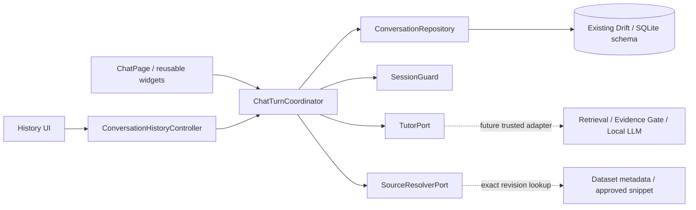

# B-08: Chat / Tutor integration boundary

Implemented independently in `shehab5552/siraj-codex`, starting at
`651af0d62d05761c80d9a8cbc9d1f51b836929eb`. This is Flutter integration infrastructure,
not evidence of a functioning local AI runtime or Android G2/G3.

## Direction and ownership

Widgets render state and relay actions. They do not execute SQL, call a model,
decide source validity, or activate resources. `SirajApp` / `AppBootstrap` and
`AuthenticatedChatRoute` supply the ports. A route owns and disposes one
coordinator; its builder does not recreate it on rebuild.

The existing draft and repository are extended, rather than replaced. There is
no second database, schema migration, new package, DownloadService dependency,
or resource-state mutation. The four `UserRepository` update annotations notify
Drift watchers after existing session/account SQL operations; they do not change
password derivation or production authentication policy.

## Contract and trust boundary

- `TutorStatus`: `answer`, `refusal`, `error`. Partial evidence is an ANSWER with
  `TutorReason.partialEvidence`, never a fourth status.
- `TutorRequest`: request / user / account epoch / conversation identity,
  question, conversation context, captured dataset revision, cancellation token.
  The raw session nonce is not sent to the AI port.
- `TutorReply`: the matching identity envelope, result and an approved source
  allowlist supplied by the trusted retrieval/evidence adapter.
- `SourceReference`: exactly persisted `pack_id`, `chunk_id`,
  `dataset_revision`. No invented page or implicit current-revision fallback.
- `checkedFor` rejects mismatched identity or revision, missing answer text or
  evidence, unsupported/duplicate source IDs, and invalid status/error/reason
  combinations. REFUSAL and ERROR cannot carry source references.
- This is structural and identity validation. It does not prove semantic
  grounding, scientific accuracy, Recall@5, or quality of a real model's output.

`TutorAvailability.ready(revision)` is a port capability snapshot. It is not
`ResourceStatus.READY`, `ACTIVE`, or production `RAG_READY`. The real adapter
must acquire a pinned handle for that exact revision and retain it until work
finishes; it must return a typed failure if unavailable. Merely setting a ready
flag must never substitute for artifact/runtime validation.

Default production composition uses `UnavailableTutorPort` and
`UnavailableSourceResolver`. There is no fallback educational answer, cloud
generation, simulated evidence or production fake. Test fakes live under
`test/support/` only.

## Persistence and turn lifecycle

1. Reject blank input; opening a new draft does not insert a row.
2. Commit the first USER, new conversation, and (when necessary) oldest-chat
   eviction in one existing SQLite transaction. Follow-up USER is also committed
   before invoking Tutor.
3. Check account ownership, epoch, active nonce hash and request cancellation
   inside the write transaction, including its final cancellation fence.
4. Reload the committed transcript. Invoke Tutor only after successful USER
   persistence, with that conversation's context. History is linguistic context,
   not authorization for new retrieval evidence.
5. Validate the returned envelope and source references, recheck session, then
   save a supported answer or standard refusal. Runtime/contract errors remain
   transient errors; they never become fabricated ASSISTANT messages.
6. The assistant transaction also checks that its exact USER remains the latest
   USER. A different screen's later question invalidates an older pending reply.

Stable USER IDs survive retries. Assistant identity is derived from its USER ID
(`:assistant` suffix). A retry uses a new request ID but reuses the stored USER,
so concurrent/repeated submissions cannot duplicate messages. If a SQLite
commit succeeds but its acknowledgement is lost, retry reloads that exact
assistant ID before doing any more generation.

The approved schema is unchanged: status/reason/error are not new columns.
Partial-answer warning is preserved in the stored text; refusal uses safe,
standard text without sources. On reopening a final unanswered USER, the UI
offers retry without pretending to know whether the prior cause was cancellation,
process loss or a runtime error.

Message reads use SQLite `rowid` insertion order, avoiding turn reordering when
wall-clock timestamps tie or move backward. Conversation ordering/oldest
eviction retain the existing `(created_at, conversation_id)` policy. At most ten
conversations are kept. A typed result from the first-message transaction
reports actual eviction only after COMMIT; an idempotent replay reports no new
eviction. History explains this policy, and a once-only nonblocking notice is
shown after successful eviction. Rollback shows no deletion notice.

## Cancellation and session boundaries

- The active request owns its post-write transcript reads. Lifecycle presentation
  refresh does not supersede those reads or silently abandon saved work.
- Cancellation signals the port and releases the waiting coordinator even if
  generation ignores cancellation. A late reply or late adapter error cannot
  create a new write. Cancel waits for an already-started database write to settle.
- A reply durably committed before cancellation remains a completed reply;
  cancellation is not an undo/delete operation.
- Drift watches the user session and owned conversation. Logout, nonce rotation,
  account deletion or conversation eviction invalidate the coordinator and clear
  transcript, pending retry/result and input text. Expiry remains terminal even
  if it arrives during cancellation settlement.
- Disposal cancels work, unsubscribes and fences UI callbacks. Source panels
  observe the same boundary and suppress late private snippets.

The low-level legacy repository APIs retain optional nonce parameters for old
B-03 callers/tests. All B-08 application reads and writes supply the active
nonce hash. New integrations must follow that guarded application path.

## Source opening

The resolver receives the exact persisted source identity. The coordinator
checks ownership/session before and after async resolution, confirms that the
reference belongs to the current transcript, and accepts only the same reference,
a nonempty snippet, and a positive page number when one is actually supplied.
Missing historical revisions return unavailable; a newer revision is never
substituted. Malformed historical reference JSON keeps the message text but
disables source chips. Source display does not re-index PDF files into RAG.

## Next integration, outside this change

A real adapter can implement these two ports and be injected at composition
without rewriting Chat UI or ConversationRepository. It must independently
provide scope resolution, fresh retrieval for follow-ups, evidence gates,
Local LLM execution, typed native failures, revision pinning and native resource
cleanup. Shared Query Embedding and compatible index/vector configuration are
Dataset resources; LLM remains an independent model; PDF remains independent.

Use an isolated Debug/Test Biology fixture for early B-09 G2/G3. Do not point it
at production active registry state. Model loading/generation, embedding/index
compatibility, RAM, latency, native cancellation and real offline source-backed
answers remain PENDING TEST on Android. PDF, Quiz and all five production packs
are not prerequisites for that early technical slice.

Verification and remaining Auth work are recorded in
[`B-08_INDEPENDENT_CHAT_TUTOR_01_AR.md`](../reports/B-08_INDEPENDENT_CHAT_TUTOR_01_AR.md).
