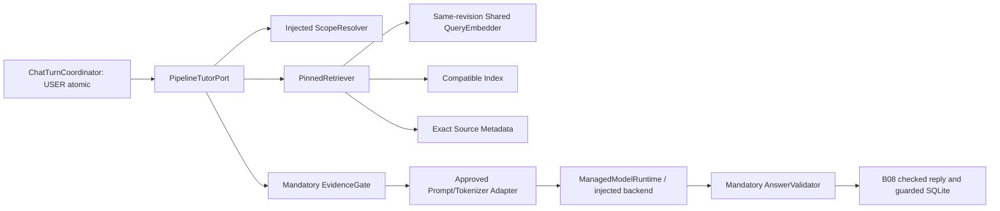

# B-09 / TK-13 — نواة تكامل AI المستقل

23 أكتوبر2026، Asia/Aden. المستودع الوحيد `shehab5552/siraj-codex`.
هذا تقرير تنفيذ برمجي لنواة التكامل، **لا شهادة اكتمال B-09 أو G2/G3**.

## 1. الحالة الفعلية والقاعدة

GitHub: main عند `651af0d62d05761c80d9a8cbc9d1f51b836929eb`؛ PR2 مدمج،
PR1/3/4/5/6 مفتوحة؛ PR4 Draft. لا Merge في هذه المهمة. B04 وتجربة Samsung
مستقلان ولا يوقفان العمل. لم يصل التنفيذ إلى `siraj-p0` أو كمبيوتر المستخدم.

الفرع `codex/b09-ai-integration-core` مبني على
`306b3a69bb855a49b3bf01bbb1b6bd30a1c087f5` من فرع PR4
`codex/b08-independent-chat-tutor`. PR الجديد يستهدف فرع B08، كي تظهر
إضافات B09 فقط. لم تنقل تغييرات PR3 أو PR5/6، ولم تعد كتابة Chat/SQLite.
الرأس النهائي ورابط PR مثبتان في تسليم GitHub؛ هذا التقرير ضمن ذلك الرأس.

المرجعية: المواصفة الرسمية v1.0.1 §§5.3–5.5،6.6–6.8،8.3–8.7،9.4–9.5.1،
وخطة الفريقB المعدلة B09/TK13 وقرار Biology-first. SHA256 للمواصفة
`084d2f3ece9373dacc3795fb35bed99ee36ebbdbb9ba139d5cca9d0daa5727d8`.
لا ينسخ التغيير وثائق التسليم الكاملة إلى المستودع العام.

## 2. الموجود قبل التنفيذ وما أضيف

B08 وفر TutorPort/SourceResolverPort وDTOs وChatTurnCoordinator وHistory
والحفظ والحماية. لم يكن هناك محوّل Tutor حقيقي ينسق المكونات، أو مالك لدورة
حياة محرك AI، أو Retrieval مرتبط بتطابق إعدادات Embedding/Index وقت الطلب.
لا Runtime أو Model أو Shared Embedding أو Biology Index معتمد متاح في
هذه الشريحة؛ أسماء GGUF وQuantization/Tokenizer/Index backend لا تُخترع.

أضيفت مكونات فعلية قابلة لتوصيل التنفيذ المعتمد لاحقًا:

| الملف | التنفيذ |
|---|---|
| `lib/integrations/ai/runtime_contract.dart` | ModelConfig/Capabilities/GenerationRequest، أخطاء Runtime typed، ModelBackend/ModelRuntime، مقاييس اختيارية دون اختلاق RAM أو first-token |
| `managed_model_runtime.dart` | فحص Hash/حجم/GGUF عبر فاحصي B07 القائمين، Load/Generate/Cancel/Unload، lane واحدة، مهلة من configuration المستدعي، تعافٍ صريح |
| `rag_runtime_contract.dart` | Binding كامل لـRevision/Model/Artifact/Tokenizer/Pooling/Normalization/Dimension، Index/Pack DTOs، DatasetProvider/RevisionPinnedHandle، QueryEmbedder/Index ports |
| `pinned_retriever.dart` | فحص التوافق، embedding جديد للسؤال، فحص المتجه والنتائج والمراجع، حل Metadata بالمراجعة نفسها، تمرير score الفعلية إلى EvidenceGate |
| `tutor_pipeline_contract.dart` | Scope/Evidence/Prompt/Output-validation ports مطلوبة؛ لا سياسة علمية افتراضية متساهلة |
| `pipeline_tutor_port.dart` | محوّل ملموس للمنفذين الموجودين TutorPort وSourceResolverPort، منع التداخل، إلغاء/مهلة، مصادر تاريخية دقيقة، إغلاق ينتظر الموارد |

أضيفت أربعة ملفات اختبارات وستجد fixtures الاصطناعية تحت `test/support/`
فقط؛ وثيقة المعمارية وخطة التنفيذ وJSON الأدلة وهذا التقرير. لا حزم جديدة.

## 3. مسار السؤال والحدود

لكل Follow-up Retrieval جديد. History سياق لغوي فقط، وليست Chunks علمية.
المقاطع المقبولة وحدها تصل إلى Prompt، وSourceRefs من Retrieval/Evidence
قبل التوليد، ولا تؤخذ من نص LLM. REFUSAL بلا مصادر عند نقص الدليل أو
الغموض؛ Runtime/OOM أخطاء تشغيلية. Partial المستقلة تتطلب تحديد مطالب
مدعومة وغير مدعومة؛ لا يسمح Validator بتحويلها إلى Full دون تصريح.

أي اختلاف Model/Artifact Revision/مسار/Tokenizer/Pooling/Normalization/
Dimension/Index Type أو Version يمنع البحث. المتجهات والـscores غير المحدودة
والمصادر المكررة/خارج النطاق أو المراجعة وMetadata المفقودة تُرفض. نموذج
Embedding يملكه Handle المراجعة، وليس مسارًا عالميًا يستبدل أثناء الطلب.

Product declaration تعيد استخدام RagCandidateContract للخمس؛ Fixture واحدة
مسموحة Debug فقط. هذه فحوص بنية وتوافق DTOs وليست Validators ملفات Dataset
أو تصريح نشر/READY. Provider المستقبلي مسؤول عن Hashes/Schema وملكية Directory
غير قابلة للتعديل والمكتبات الحقيقية. ModelRuntime يعيد استخدام فحص B07
قبل backend.load؛ تعرف GGUF وحده لا يثبت Tensor validity أو Native Load.

المحرك واجهة تنفيذ محلي ولا يستدعي HTTP، وRetriever لا يستدعي ModelRuntime.
لا فرض لـNative MethodChannel/FFI ABI قبل تثبيت Runtime build المرخص/المراجع
ودعمه على ABI الجهاز. Native bindings غير منفذة هنا، لا binding وهمية.
Streaming غير مفعل؛ الإجابة الكاملة هي المسار إلى أن ينجح TC20 الفعلي.

## 4. الإلغاء والذاكرة والتعافي

الطلب المنطقي يستطيع الانتهاء بالإلغاء/المهلة قبل استجابة Native. تبقى lane
مشغولة حتى تنتهي العملية الأصلية ودالة native cancel؛ لا Generate/Unload
متزامن يمس ذاكرة مستخدمة. إذا لم يتعاون backend، تبقى الموارد محجوزة والخدمة
غير جاهزة؛ لا timeout يحرر الذاكرة قسرًا. بعد drainage: Unload ثم Load صريحان.

Tutor يحتفظ بـRevisionPinnedHandle حتى انتهاء كل العمل، ولو رجع إلغاء سريع
إلى UI. طلب Dataset جديد يُرفض أثناء وجود القديم. إغلاقه يشمل أيضًا قراءات
المصادر التاريخية منذ اكتساب Handle وحتى إغلاقه؛ لا عرض مقتطف قديم بعد close.
تبديل active revision لا يبدل مراجعة طلب بدأ بالفعل، ولا يعوّض مصدرًا تاريخيًا
بمراجعة جديدة. لا Dataset activation أو cleanup أو Active Pointer في هذه PR.

مقاييس runtime الحالية آخر أزمنة ناجحة على مستوى العملية؛ Load يشمل التحقق
والتحميل، ولا يدعي زمن Native خالصًا. RAM/first-token يظلان null لأنهما لم
يقاسا فعليًا. لا Profile لإدارة ذاكرة نموذج كبير على Android هنا.

## 5. الاختبارات والأخطاء المصححة

خط الأساس الفعلي197/0/0 على Commit B08. بعد التنفيذ والتصحيحات:

| الأمر/النطاق | النتيجة | الزمن |
|---|---|---|
| `flutter pub get --enforce-lockfile` | exit0؛ Lockfile دون تغيير |0.634s|
| `flutter analyze --no-pub` | exit0؛ No issues found |1.519s|
| `flutter test --no-pub --machine` | **261ناجح/0فشل/0تخطٍّ** |19.880s|
| ملفات B09 الأربعة | **64/0/0**، ضمن261 |4.379s|

بدأ الكامل23 أكتوبر22:32:21 بتوقيت عدن. توزيع الجديد: Runtime12، Retrieval26،
Pipeline21، SQLite5. الأوامر والتوقيت UTC وبصمات السجلات وبصمات الكود في
[JSON الأدلة](../qa/B09_CLOUD_VERIFICATION_2026-10-23.json).

تشمل الاختبارات USER قبل النموذج، Follow-up في المحادثة نفسها، Cancel/
Logout/Delete أثناء التوليد، وعدم كتابة مساعد وهمي أو متأخر، ومراجعات
المصادر القديمة. SQLite native فعلية؛ لا Fake Repository. AI backends/
vectors/text وقرارات Evidence/Scope/Prompt في الاختبارات doubles صريحة،
ولا تثبت جودة Retrieval علمية أو تشغيل Local LLM.

شاهد التنفيذ اختبارات RED ثم GREEN للمكونات. كُشف سباق تبديل ModelConfig
أثناء إعداد Prompt، وأضيفت حراسة واختبار يمنعان توليدًا بنموذج مختلف.
المراجعة المستقلة للمواصفة والمعمارية وجدت:

1. انتظار backend.cancel غير المتعاون قد يحبس النتيجة المنطقية رغم انتهاء
   التوليد؛ أُعيد إنتاجه، وأصلح الفصل بين نتيجة Cancel وdrainage.
2. close كان ينتظر أسئلة Tutor دون source reads؛ أُعيد إنتاجه، وأصبح ينتظر
   اكتساب Handle وقراءته وإغلاقه. لا Critical findings أو Minor مؤجلة.

بعد الإصلاح نجح فحص Regression الكامل أعلاه؛ المراجعان لم يدعيا تشغيل
Android أو موارد AI. لا إعادة مراجعة مختلقة بعد إصلاح المؤلف؛ الاختبارات
والفحص الكامل يثبتان التصحيح المختبر. انقطع المراجع الثاني مؤقتًا بسبب
حد استخدام ثم استكمل التقرير النهائي على snapshot المراجعة المثبتة.

خطأ تجهيز الاختبار: timeout80ms شملت Hash I/O لملف fixture وأصبحت متقلبة
عند تشغيل متوازٍ؛ وُسع زمن اختبار watchdog إلى2s، دون تغيير أي production
policy. أصلحت أيضًا أخطاء أسماء API/inference في helpers وتحذيرات التنسيق
قبل آخر Analyze. لم تسكت Assertions أو تتجاهل فشلًا في النتيجة النهائية.

## 6. الشبكة وAndroid

أول baseline تعثر قبل الاختبارات أثناء تنزيل SQLite native عبر
`https://github.com/simolus3/sqlite3.dart/releases/download/sqlite3-3.5.2/libsqlite3.x64.linux.so`.
Hostname `github.com`، DNS lookup فشل داخل Dart native hook قبل HTTP؛
**لا HTTP status متاحة**. استخدمت نسخة cloud cache بعد مطابقة Hash الحزمة
`b17729184e5a2818055ecbddd5ed6642521bfe6e56aafa472330e483c0e2e0d2`.
لا package override أو تعديل TLS؛ إعادة baseline نجحت197/0/0.
Pub get وGitHub API/Fetch عملا؛ نجاحهما لا ينفي خطأ native hook المحدد.

لا Android/native AI/LLM/Embedding/Index حقيقية شُغلت في B09 هذه. نتائج
Emulator الخاصة بـB04 لا تُنقل إليها. لم تعَد محاولة تنزيل SDK المحجوب
سابقًا لمجرد إضافة Dart ports؛ لا Native runtime build معتمد لبنائه هنا.
لا نجاح G2/G3 أو قبول Samsung أو فتح Auth/G4/RAG_READY من اختبارات Linux.

## 7. ما يبقى والمهمة التالية

| الاعتماد | المدخل المحدد المطلوب / القبول |
|---|---|
| ModelRuntime فعلي | Runtime build/revision/ترخيص/ABI معتمدة؛ Model مستقل بهوية/hash/config/context/profile، Native Load/Generate/Cancel/Unload على Android |
| Query Embedding/Index | artifact hash/revision، Tokenizer/Pooling/Normalization/Dimension وفهرس ومطابقة source mapping؛ Expected Vector وسماحية مراجَعة، لا رقم مخترع |
| Biology fixture | مقاطع ومراجع درس مراجَعة مع Manifest/Checksums/Index متوافق؛ لا إعادة Extraction لما ثبت وجوده تاريخيًا، ولا اختلاق بيانات غير مسلمة |
| سياسات A/C | Scope/Evidence/Prompt/Question type behavior والتحقق المتاح وتقييم علمي مستقل؛ لا score threshold افتراضية لادعاء النجاح |
| G2 ثم G3 | تشغيل offline حقيقي على Android، RAM/cold-warm/cancel، ثم سؤال أحياء ومصدر وحفظ/reopen؛ ليست Fakes أو مجرد APK |
| B04+B08 | تسوية تعارضات repositories/controller في مهمة دمج منفصلة مفوضة؛ لا تغييرات Auth أو الإنتاج هنا |

**أقرب مهمة مستقلة تالية B11/TK10:** عقود وواجهة Quiz والجلسة المؤقتة
والتصحيح المحافظ بالأنواع الأربعة؛ لا توليد حقيقي أو Bank-only بديل عند
غياب النموذج. فرع/PR منفصل من B08 لأن هذه الواجهة لا تحتاج B09 غير المدمجة.
B10 يحتاج Catalog/Reader وتكامل B07، وB12 له آلية تفعيل مستقلة؛ لا يسبق
PDF/Quiz/الخمس أول Biology G2/G3 عند توفر الموارد. استمرار هذه المهام لا
يرفع جاهزية المنتج ولا يخفف البوابات. القرار المعماري هنا: نبني الحدود
المعتمدة ونؤجل اختيار runtime ABI/موارد غير معتمدة؛ قد تتطلب adapters
تكييفًا عند تثبيت A/C، دون إعادة كتابة Chat أو ConversationRepository.
