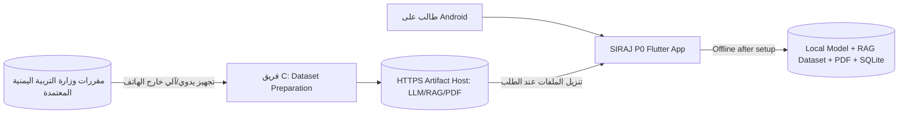
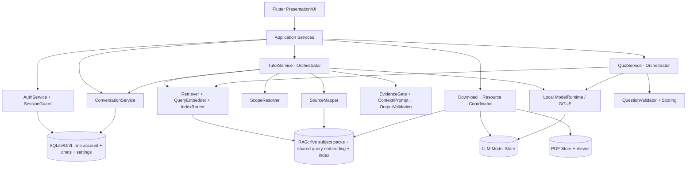
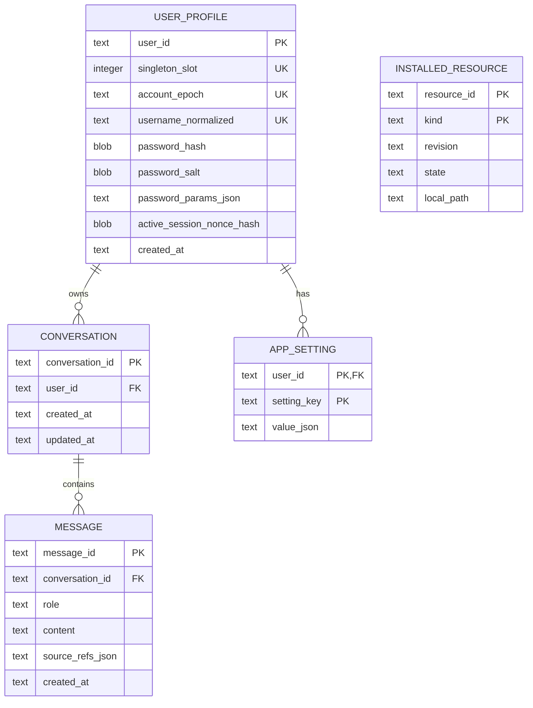
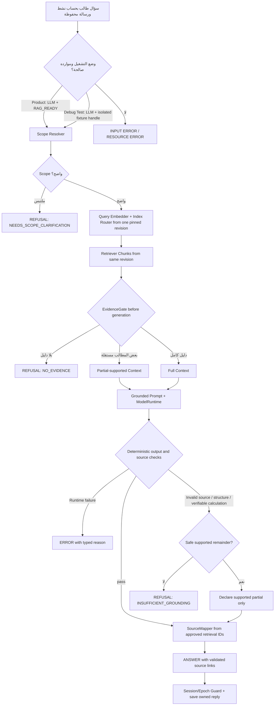
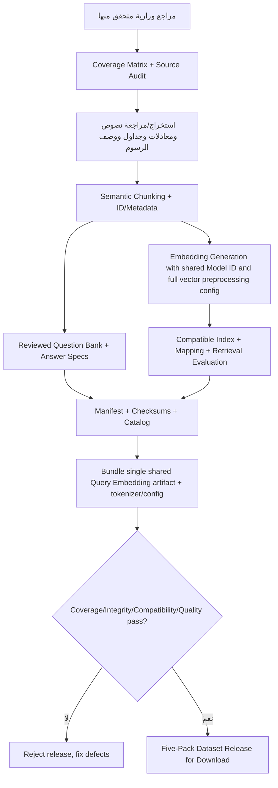
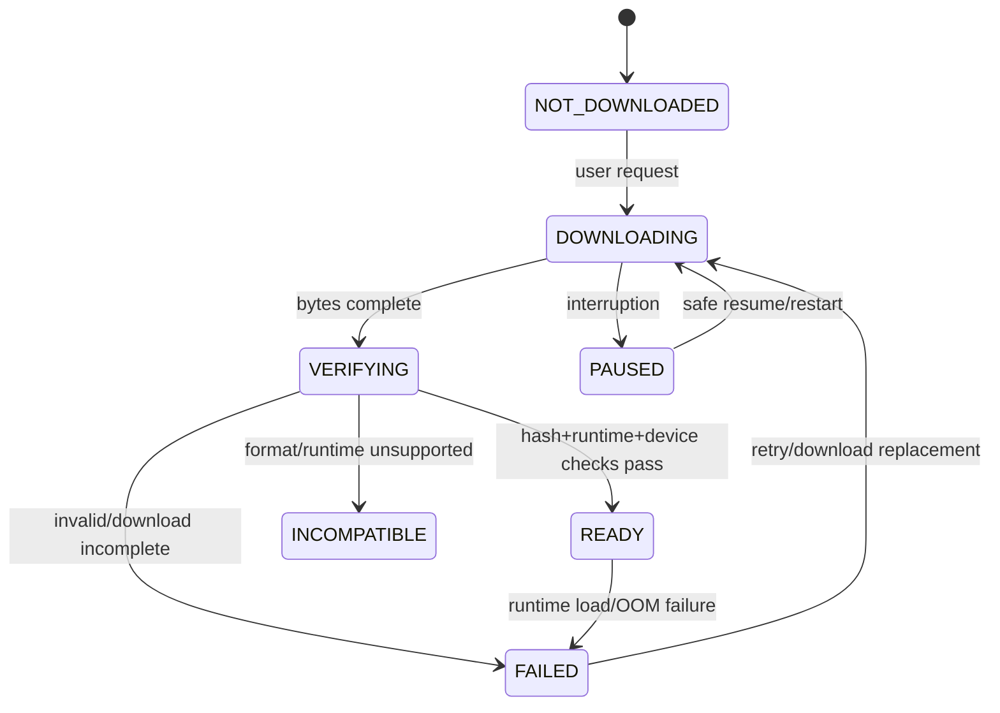
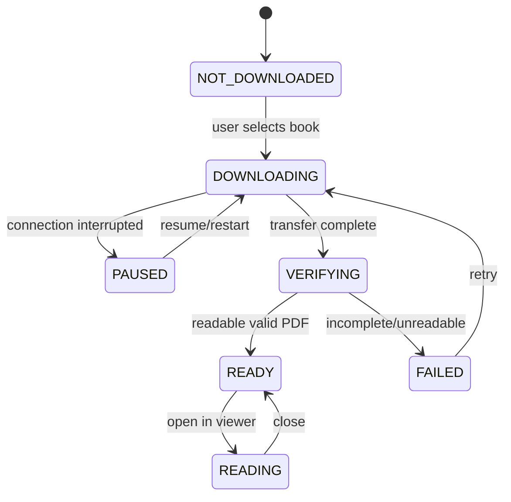
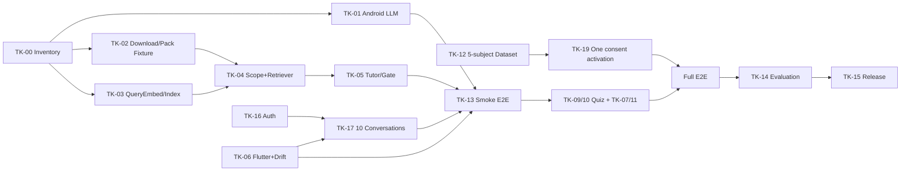

# SIRAJ P0 — Final Master Requirements, Architecture & Detailed Implementation Plan

**معرف الوثيقة:** `SIRAJ-P0-MASTER`  
**الإصدار الوثائقي:** `1.0.1 — Corrected Baseline (20 October 2026)`  
**الحالة:** `READY FOR TEAM BASELINE REVIEW`؛ القرارات الصريحة لصاحب المشروع **APPROVED**، وقرارات التصميم الهندسية الواردة أدناه **DERIVED DESIGN DECISION**؛ التنفيذ والاختبارات `NOT VERIFIED`. لا يدل لفظ Final في العنوان على تحقق التطبيق أو اعتماد نتائج التخرج.  
**النطاق:** P0 فقط؛ تطبيق Android يعمل محليًا بعد تجهيز الموارد؛ مناهج الصف الثالث الثانوي اليمني في الأحياء والكيمياء والفيزياء والرياضيات والإنجليزية، لجميع الدروس المعتمدة رسميًا.  
**المالكون:** A = Team Lead/AI Integration؛ B = Flutter/Mobile/SQLite؛ C = Dataset/Retrieval/Evaluation.  
**تاريخ تثبيت قرارات صاحب المشروع المستخدمة:** 20 أكتوبر 2026؛ مع حفظ سجل تعديل v1.0.0 وبيان ما ينتظر إثباتًا عمليًا.

> **قاعدة القراءة:** `APPROVED` قرار مالك مشروع أو نطاق صريح؛ `DERIVED` اختيار هندسي مُحدد هنا لضبط التنفيذ، قابل لمراجعة الفريق دون اعتباره موافقة سابقة من المالك؛ `CONDITIONAL` مشروط بالدليل؛ `PENDING TEST` تجربة لازمة؛ `PENDING REFERENCE` مرجع وزاري يجب إثباته؛ `UNKNOWN IMPLEMENTATION` لم يُفحص المستودع؛ `DEFERRED TO P1` غير موجود في بوابات قبول P0. جميع نتائج الاختبارات `PLANNED / NOT YET EXECUTED` حتى توثيق أدلتها.

## فهرس الوثيقة

- 1. Document Governance & Baseline
- 2. Product Scope & System Requirements
- 3. Complete User Experience & Screen Specification
- 4. End-to-End User Journeys
- 5. Final System Architecture
- 6. Contracts, Interfaces & Data Flow
- 7. Database & Local Storage Design
- 8. AI / RAG Internal Workflow
- 9. RAG Dataset Engineering Specification
- 10. Resource Lifecycle & Offline Behavior
- 11. Security, Privacy & Data Isolation
- 12. Quiz Functional Specification
- 13. Error Handling & Edge-Case Matrix
- 14. Non-Functional Requirements — Measurement & Acceptance
- 15. Full Implementation Plan
- 16. Timeline, Dependencies & Integration Gates
- 17. Testing Strategy & Acceptance Matrix
- 18. Risk Register & Mitigations
- 19. Final Deliverables & Release Checklist
- 20. Requirements Traceability & Completeness Audit

**الملاحق:** Appendix A — Test Fixtures؛ Appendix B — Change Log & Pending Evidence؛ Appendix C — v1.0.1 Decision and Consistency Audit.

---

## 1. Document Governance & Baseline

### 1.1 مصادر المواصفة وأسبقية التعارض

1. القرارات الصريحة الأحدث لصاحب المشروع في سلسلة محادثات SIRAJ، بما فيها الطلب النهائي المؤرخ 19 أكتوبر 2026؛ المرجع الأعلى.
2. القرارات السابقة المقبولة وغير الملغاة: ثلاث حالات TutorResult، Evidence Gate، Quiz الإلزامي المُولَّد بواسطة LLM مع Few-shot، المحافظة في التصحيح، الحسابات المحلية، حد المحادثات، الفصل بين الموارد.
3. `SIRAJ_P0_Core_Execution_Plan_v1.0.4_CANDIDATE.md` و`SIRAJ_P0_Architecture_Document_v1.0.4_CANDIDATE.md`.
4. `SIRAJ_Master_Execution_Plan_v1.0.4_CANDIDATE.md`، لا سيما §40، و`SIRAJ_Architecture_Document_v1.0.4_CANDIDATE.md`، لا سيما §18 وAppendix A؛ و`SIRAJ_Architecture_Executive_Summary_v1.0.4_CANDIDATE.md`.
5. قرارات التصميم `DD-01..DD-18` بعد تجميدها ضمن مراجعة v1.0.1، مع بقاء اختيار Runtime وقياسات الجودة `PENDING TEST`.

**قاعدة التعارض:** يحل القرار الأعلى أحدثًا محل النص القديم؛ لا يُنقل السلوك القديم إلى عقد أو اختبار. تعارض المراجع الوزارية أو الأرقام المقاسة لا يُعالج بالتخمين؛ يُرفع إلى بوابة تحقق واضحة. لا يُستعمل الويب هنا مصدرًا لمعلومات المشروع أو المناهج.

### 1.2 نطاق الوظائف الحالي

- Android/Flutter، Offline بعد تحميل وتجهيز الموارد؛ تشغيل LLM محلي عبر `ModelRuntime`؛ RAG محلي بـQuery Embedding وRetriever وEvidence Gate.
- **ثلاثة موارد منفصلة وظيفيًا وتخزينيًا:** `LLM Model`، و`RAG Dataset` (يمكن تقسيمها تقنيًا إلى 5 Packs لكنها تُجهز بموافقة واحدة)، و`PDF Books` (كتب قابلة للتنزيل الفردي والقراءة دون إنترنت، لا تُفهرس ولا تغذي RAG).
- **حساب محلي واحد فقط لكل تثبيت:** إنشاء/دخول/خروج، جلسة مستمرة محفوظة آمنًا؛ حذف الحساب الحالي من الإعدادات بعد تحذير وتأكيد فقط، بلا كلمة مرور إضافية؛ لا تبديل حسابات أو استعادة كلمة مرور.
- حتى **10 محادثات محفوظة للحساب المحلي الوحيد**؛ فتح «محادثة جديدة» ينشئ Draft مؤقتًا فقط؛ عند **حفظ أول رسالة صالحة** تُنشأ المحادثة وتحذف الأقدم إن لزم، مع أول رسالة في معاملة ذرية واحدة.
- سؤال مباشر دون قوائم إلزامية لاختيار مادة أو درس؛ Scope من السؤال ثم Dataset؛ Clarification عند الالتباس؛ Grounded/Partial Answer/Refusal/Error؛ المصادر من Dataset فقط.
- الشرح وحل المسائل بخطوات وقوانين ووحدات مناسبة؛ لغة الإجابة: الطلب الصريح > لغة السؤال الواضحة > العربية للسؤال المختلط غير المحسوم؛ دعم Retrieval عبر اللغات.
- Quiz بأربعة أنواع، يولد LLM المحلي أسئلته الجديدة عبر **Few-shot Prompting** من مقاطع Dataset وأمثلة بنك مراجَع؛ فحص إلزامي قبل العرض، تصحيح محافظ وFeedback مؤقتان، **لا بنك فقط عند غياب النموذج ولا حفظ دائم للنتائج**.
- Streaming **CONDITIONAL**؛ Fallback إلى الإجابة الكاملة. جودة وصحة البيانات والأمن والاستقرار والتقييم العلمي بوابات إلزامية.

**مؤجل ولا يُنفذ داخل P0:** `Quiz Persistence/Quiz History/Advanced Progress`، `Advanced Stable IDs`، `Advanced Corrupt Archive Handling`، Cloud Sync/Backend Auth، نموذج سحابي، OCR على الهاتف، فهرسة PDF التي ينزلها الطالب، إدارة نسخ تاريخية متعددة من الكتب، خدمات إضافية خارج النطاق. يبقى الحد الأدنى من المعرفات وسلامة التنزيل والتوافق إلزاميًا.

### 1.3 حالة المستودع والقرارات والتغييرات

- `TK-00` يلزم تحديد Git revision، التطبيقات/المكتبات/الأصول الموجودة، وحالة كل Requirement/Task: `IMPLEMENTED_VERIFIED`, `IMPLEMENTED_UNVERIFIED`, `PARTIAL`, `NOT_IMPLEMENTED` أو `UNKNOWN`. **لا تعيد إنشاء مشروع قائم دون جرد.**
- لا يصبح التعديل على هذه الوثيقة نافذًا إلا بمدخل Change Log: `change_id`, `reason`, `owner_decision_or_DD`, `affected_FR/NFR/UC/contract/TK/TC`, `author`, `reviewer`, `revision_date`، مع مراجعة صاحب القرار إذا غيّر سلوك منتج معتمدًا.
- سياسة الاختبارات: `PLANNED`, `BLOCKED`, `PASS`, `FAIL`, `CANNOT_JUDGE`. `PASS` يتطلب `commit`, `device`, `resource revisions`, `input`, `expected`, `actual`, `logs`, `reviewer`؛ التقييم النهائي له Holdout منفصل.
- استراتيجية المراجع الأكاديمية: اسم المصدر، رقم القسم من المستند الأصلي، ربط المعرفات في §20. لا تُقدم أمثلة JSON القديمة بأبعاد `null` أو أسماء نماذج Placeholder كحزم حقيقية.

### 1.4 قاموس مصغر

| مصطلح | المقصود في P0 |
|---|---|
| `Pack` | جزء تقني من RAG Dataset، وليس كتاب PDF للقراءة |
| `ACTIVE` | مجموعة RAG منشورة عبر مؤشر إصدار واحد؛ `RAG_READY` يتطلب الخمس وEmbedding المشترك؛ Fixture الاختبار لا يعادل ذلك |
| `Content Metadata` | وصف Chunk وموقعه المنهجي ومرجعه المراجع |
| `SourceReference` | معرف محدد لدليل الإجابة؛ لا يكتبه LLM |
| `Dataset revision` | هوية تقنية لنسخة ملفات RAG، وليست طبعة كتاب متعددة |
| `Scope` | مجال البحث المستخلص من السؤال أو طلب Quiz |
| `Grounding` | صحة ارتباط ادعاءات الجواب بالأدلة المسترجعة |
| `Atomic Transaction` | قاعدة بيانات تُثبت كل تعديلات العملية أو لا تثبت شيئًا |
| `Atomic Activation` | لا تظهر موارد ناقصة بوصفها جاهزة |
| `UNDETERMINED` | تعذر حكم صواب/خطأ موثوق، فلا يحسب خطأ |
| `OOM` | نفاد الذاكرة المتاحة لتشغيل النموذج/الموارد |
| `DRIFT Migration` | ترحيل مُراقَب لمخطط SQLite مع حفظ البيانات |

### 1.5 سجل القرارات الهندسية DD-01..DD-18 — التجميد التنفيذي v1.0.1

**قاعدة الحالة:** `APPROVED` يعني أن السلوك تقرر صراحة في نطاق P0 أو جُمّد هندسيًا وفق طلب التحديث؛ `CONDITIONAL / PENDING TEST` يخص صلاحية طريقة تنفيذ لا يمكن إثباتها دون تشغيل. ليس أي بند `PASS` لبرنامج منفذ. تفاصيل التبعيات والاختبارات في §§6–17 و20.

| ID | القرار التنفيذي النهائي والسلوك الملزم | الحالة | التبعية/الموضع/الاختبار |
|---|---|---|---|
| DD-01 | فصل المسارات وملفات وحالات `LLM` و`RAG Dataset` و`PDF`؛ Shared App Resources لا تختلط ببيانات الحساب | APPROVED | §5/7/10؛ TC-26/27 |
| DD-02 | تنزيل Dataset بموافقة واحدة لخمس مواد ونموذج Query Embedding مشترك؛ `RAG_READY` للإصدار المنشور الكامل فقط؛ `INTEGRATION_FIXTURE_MODE` بيئة اختبار معزولة لا تغير جاهزية المنتج | APPROVED؛ Runtime PENDING TEST | §6/9/10/16؛ TC-12/13/26/32 |
| DD-03 | حالات عرض موحدة مع Validators متخصصة بحسب PDF/LLM/RAG؛ لا `READY` وهمية | APPROVED | §6/10؛ TC-12/26/27 |
| DD-04 | صف `UserProfile` واحد كحد أقصى لكل تثبيت بقيد DB؛ `user_id` مستقل عن اسم المستخدم؛ لا Switch Account | APPROVED | §6/7/11؛ TC-24/29 |
| DD-05 | `PBKDF2-HMAC-SHA256` وSalt مستقل عشوائي وConstant-time verify؛ معاملات العمل تُضبط بعد مراجعة واختبار Android | APPROVED؛ KDF parameters PENDING TEST | §6/11؛ TC-21/24 |
| DD-06 | Persistent Login عبر سجل جلسة مشفر ومربوط بـAndroid Keystore و`user_id`/`account_epoch` وبحالة إبطالها في SQLite؛ Logout يبطل الجلسة؛ Restart يتحقق من الحساب ولا يستعمل كلمة المرور | APPROVED | §6/7/11؛ TC-24/29/30 |
| DD-07 | حذف **الحساب الحالي وهو مفتوح فقط** من Settings: التحذير النصي المعتمد، إلغاء أو تأكيد؛ لا مطالبة كلمة مرور أخرى ولا Reset عبر Username؛ إلغاء الطلبات وحذف البيانات الخاصة فقط، مع بقاء الموارد | APPROVED | §3/6/7/11؛ TC-29/30 |
| DD-08 | معاملة SQLite واحدة: إدراج Conversation + أول USER Message صالحة + حذف الأقدم عند العدد 10؛ ترتيب `created_at, conversation_id` | APPROVED | §6/7؛ TC-25 |
| DD-09 | New Chat = Draft في الذاكرة، لا سجل محفوظ ولا حذف قديم قبل نجاح **أول إرسال صالح**؛ منع تكرار الضغط/الكتابة | APPROVED | §3/6/7؛ TC-25/30 |
| DD-10 | `SourceReference={pack_id,chunk_id,dataset_revision}`، مصدره approved Retrieval IDs فقط؛ mismatch ⇒ `SOURCE_UNAVAILABLE` | APPROVED | §6/8/9؛ TC-07 |
| DD-11 | `Metadata-first + Limited Retrieval Fallback` مرشح مقارنة أمام Direct Compatible-Index Search، والتوضيح عند الالتباس | CONDITIONAL / PENDING TEST | §8/14؛ TC-01/03/20 |
| DD-12 | QuizSession مؤقتة؛ **LLM Few-shot Grounded Generation إلزامي لكل Quiz**؛ Reviewed Bank أمثلة/ Rubrics وليس Bank-only fallback | APPROVED؛ الجودة PENDING TEST | §6/9/12؛ TC-09/10/31 |
| DD-13 | PDF تنزيل `.part` ثم تحقق وصلاحية قراءة ثم نقل آمن؛ مستقل تمامًا عن جاهزية AI | APPROVED | §6/10؛ TC-27 |
| DD-14 | كل مرشح Dataset يحوي خمس Packs وملفات Shared Embedder ضمن **Revision Directory غير قابل للتعديل**؛ بعد فحصه يُرقّى كوحدة ويُحوّل مؤشر Active في SQLite ذريًا؛ تنزيل/فشل Candidate لا يمس المجموعة القديمة | APPROVED؛ المحرك PENDING TEST | §6/7/9/10؛ TC-12/13/26/32 |
| DD-15 | تحديد Quiz Scope من الطلب ثم اختيار أمثلة Few-shot، توليد LLM، Validator متعدد الطبقات، حد محاولات مضبوط ثم تعذر معلن؛ لا أسئلة Bank-only | APPROVED؛ الجودة PENDING TEST | §6/12؛ TC-09/11/31 |
| DD-16 | معايير الجودة والأداء غير المقاسة تعتمد قبل Final Holdout؛ الحقائق الحتمية (الحساب الواحد، حد 10، تغطية المنهج، سلامة المراجع والموارد) ثابتة الآن | APPROVED؛ القياسات PENDING TEST | §14/17؛ TC-20/23 |
| DD-17 | ملفات LLM وRAG وPDF مشتركة على مستوى التثبيت وتبقى بعد حذف الحساب؛ رسائل وإعدادات الحساب تُمحى ولا تنتقل للحساب الجديد | APPROVED | §7/10/11؛ TC-27/29/30 |
| DD-18 | Typed Errors وNo False Success: لا إظهار حفظ أو حذف أو Source أو Resource Ready قبل نجاح التحقق؛ طلب قديم لا يكتب بعد حذف الحساب | APPROVED | §6/11/13؛ TC-18/28/30 |

**قيد تجريبي ملزم:** `INTEGRATION_FIXTURE_MODE` خاص بالاختبارات/Debug وليس حالة Resource Status متاحة للطالب؛ لا يجعل `RAG_READY=true` ولا يحقق G4/G7/G8. 

**تعهد هندسي:** تصميم Auth/DB وUI أعلاه محسوم في هذه المواصفة؛ صلاحية Android LLM/Embedding وScope/Accuracy/Latency/Streaming لا تزال `PENDING TEST` ولا تعتمد بالتسمية وحدها.

## 2. Product Scope & System Requirements

### 2.1 تعريف القيمة، المسؤوليات، وبدائل الفشل

**المستخدم الأساسي:** طالب على Android. التطبيق لا يستعين بسيرفر لإنتاج الإجابة أو حفظ حسابه؛ الشبكة مطلوبة عند جلب ملفات PDF وLLM وDataset، لا عند قراءة PDF منزّل أو RAG/Quiz بعد التجهيز. لا يفترض نجاح تنزيل أو تشغيل مورد قبل إثباته. مسؤول الموافقة على المراجع الرسمية والتغطية: صاحب المشروع/المشرف بعد تحضير C لقائمة مراجع قابلة للفحص. يتم دعم العربية والإنجليزية وRTL في UI.

### 2.2 Requirements Register — المتطلبات الوظيفية

**حقول سجل كل صف:** ID؛ السلوك الإلزامي والمدخل/المخرج؛ الاعتماديات والاستثناء؛ مالك التنفيذ؛ معيار القبول ومعرف الاختبار؛ المرجع. يشير `TC` إلى بروتوكول مفصل في §17. أرقام FR-01..FR-18 محفوظة للتتبع؛ تصحيح FR-15 يعني **استبدال مضمونها السابق** لا إسقاط التخزين كله. `FR-19..FR-22` معرّفات جديدة داخل هذه المواصفة.

| ID | الاسم والمدخل → المخرج، السلوك الملزم | التبعيات وحالات الفشل | المالك | القبول / الاختبار | الأساس |
|---|---|---|---|---|---|
| FR-01 | سؤال نصي مباشر → Scope مستخلص أو Clarification؛ **لا قائمة اختيار مادة/درس في Chat** | Dataset ACTIVE؛ ملتبس⇒`NEEDS_SCOPE_CLARIFICATION`، سؤال فارغ⇒Input error | A+C | لا تخصيص مادة خاطئ بثقة؛ TC-01 | Master §40؛ قرار صاحب المشروع الأخير |
| FR-02 | Catalog PDF → مواد/كتب قابلة للتصفح والتنزيل والفتح Offline؛ **لا فهرسة PDF في RAG** | ملف غائب⇒Download، غير صالح⇒غير جاهز؛ عرض البيانات المصدرية منفصل عن Chat | B | قائمة ديناميكية وOpen valid PDF؛ TC-02/27 | فصل الموارد المعتمد؛ يصحح Master §40 |
| FR-03 | Query + Scope + Options → Ranked Chunks من Index متوافق | Embedding missing/mismatch ⇒Typed ERROR؛ No hits⇒`[]` | C | Recall@5 وNo-cross-pack؛ TC-03 | Master §40/Architecture §8 |
| FR-04 | سؤال + Chunks → Evidence Gate قبل التوليد؛ تحقق بعد التوليد من البنية/معرفات المصادر والحسابات القابلة للتحقق حتميًا؛ دعم كل جملة دلاليًا **ليس مضمونًا آليًا** | لا دليل⇒REFUSAL؛ فشل قابل للكشف⇒تعديل آمن/جزئي/رفض؛ Runtime failure⇒ERROR؛ دعم دلالي غير محسوم⇒تقييم مرجعي لا PASS آلي | A | رفض المصدر المختلق والأخطاء الحتمية + تقييم Claims على Gold Set؛ TC-04/23/31 | Architecture §18.2؛ حدود التحقق الفعلي |
| FR-05 | مطالب مستقلة مدعومة جزئيًا → ANSWER بجزء صحيح وتصريح بالنقص | مترابطة لا تفصل⇒REFUSAL | A | Partial correctness & omitted claims؛ TC-05 | Architecture §18.2 |
| FR-06 | مفهوم/مسألة → شرح/قانون/خطوات/وحدات مُراجَعة | بيانات/قانون ناقص⇒توضيح أو عدم الجزم؛ لا Algebra عام | A+C | Reference accuracy؛ TC-06 | Master §10/Architecture §18.4 |
| FR-07 | أدلة مقبولة → SourceReference من Metadata، وفتحها مع مراجعة Dataset revision | Revision غائبة⇒`SOURCE_UNAVAILABLE` بلا ربط خاطئ | A+B+C | Source IDs supported & not invented؛ TC-07 | Architecture Appendix A/قرار تبسيط المصادر |
| FR-08 | Follow-up ضمن Conversation محفوظة → استجابة تستخدم سياقًا لغويًا وتعيد Retrieval | Switching conversation/user⇒clear scope/context؛ history ≠ evidence | A+B | No context/pack leakage؛ TC-08 | Master §40.3 |
| FR-09 | طلب Quiz بنطاق درس/وحدة → **توليد أسئلة جديدة بواسطة Local LLM** باستخدام Chunks وأمثلة Few-shot مراجَعة ثم Validator قبل العرض | **LLM وRAG_READY إلزاميان**؛ فشل النموذج لا يُستبدل بـBank-only Quiz؛ retry محدود أو QUIZ_NOT_AVAILABLE | A+C | أسئلة مولّدة موثقة فقط؛ TC-09/31 | قرار Quiz الأخير؛ DD-12/15 |
| FR-10 | LLM يولد MCQ/TF/Numeric/ShortAnswer وفق `QuizItem/AnswerSpec` وأمثلة مراجَعة، ويُقبل فقط بعد تحقق بنيوي وعلمي/مرجعي | غياب مثال مناسب أو مفتاح مثبت⇒Reject؛ خطأ صيغة⇒لا عرض | C+A | الأنواع الأربعة مولّدة وصالحة؛ TC-10/31 | قرار Few-shot؛ DD-12/15 |
| FR-11 | QuizAnswer + validated AnswerSpec → `CORRECT/INCORRECT/UNDETERMINED` وFeedback وعدّاد جلسة في RAM | غموض/مفتاح غير مثبت⇒UNDETERMINED؛ لا نتيجة دائمة | A+B | لا درجة مضللة؛ TC-11/31 | Architecture §18.3؛ DD-12 |
| FR-12 | Dataset release (خمس Packs + Shared Embedder) → Staging/Verify/Atomic Publish عبر مؤشر `active_dataset_revision`؛ اختبار Fixture منفصل | Candidate ناقص/غير متوافق⇒لا Publish؛ Pending/failed update لا يُعدل Active ولا ملفات Embedder السابقة | B+C | مجموعة واحدة متسقة بعد commit وفشل/انقطاع لا يمس السابقة؛ TC-12/26/32 | Architecture §7؛ DD-14 |
| FR-13 | LLM محلي مستقل + **نموذج Query Embedding مشترك داخل Dataset** + Indexes → readiness وتوافق أثناء التشغيل | Model/Embed runtime/dimension/config mismatch⇒typed ERROR؛ OOM⇒not ready | A+C | Android vector test مع model/pack config؛ TC-13/20/26 | DD-02/14؛ decision final |
| FR-14 | UI/question/request language → AR/EN output according precedence; cross-language retrieval | mixed without explicit preference⇒Arabic | A+B+C | AR↔EN/mixed cases؛ TC-14 | Architecture §18.5 |
| **FR-15** | حفظ الحساب الوحيد والجلسة المستمرة والمحادثات والرسائل والإعدادات وحالة الموارد في SQLite/Drift؛ أول رسالة مع Conversation ذريًا؛ **لا QuizAttempt دائم ولا Draft محفوظة** | DB/Migration/Session failure⇒typed error وrollback؛ الجلسة الملغاة لا تعود؛ لا حذف للمحادثة القديمة عند فشل أول إرسال | B | استعادة البيانات والجلسة الصحيحة بعد restart، عدد المحادثات ≤10، ولا QuizAttempt/Draft دائم؛ TC-15/25/30 | قرار التخزين المحلي وDD-06/08/09؛ FR-15 المصحح |
| FR-16 | Download requests → progress/retry/resume/restart and validated file, per resource type | network/full disk/hash fail⇒not ready؛ PDF/LLM/RAG separate | B | Interrupted/resume tests؛ TC-16/26/27 | Master §24؛ new resource split |
| FR-17 | Official 5-subject curriculum → all required units/lessons in verified Dataset/Coverage Matrix | missing official source⇒PENDING REFERENCE, no final release | C | 100% mapping **of verified required list**, no missing lesson؛ TC-17/22 | Owner full-coverage policy |
| FR-18 | Tutor flow → `ANSWER/REFUSAL/ERROR` + typed reason; scope clarification as REFUSAL reason | Runtime failure not counted as knowledge refusal | A+B | Contract states & UI mapping؛ TC-18 | Architecture Appendix A.11/§18 |
| FR-19 | **حساب واحد فقط للتثبيت**: إنشاء وLogin/Logout وPersistent Login ثم حذف الحساب الحالي من Settings دون إعادة إدخال كلمة المرور؛ لا Reset من Login | Second create⇒`ACCOUNT_ALREADY_EXISTS`؛ invalid stored session⇒login؛ forgotten after logout⇒no recovery path | B | Singleton/session/deletion tests؛ TC-24/29/30 | Owner account freeze؛ DD-04..07 |
| FR-20 | `New Chat` يفتح Draft غير محفوظ؛ أول رسالة صالحة تُنشئ Conversation+Message مع حذف الأقدم عند العدد 10 داخل Transaction واحدة | empty/invalid⇒no write؛ DB fail⇒rollback؛ duplicate submit⇒no duplicate؛ stale request⇒ignore | B | count≤10; draft no effect; first message atomic؛ TC-25/30 | Owner chat freeze؛ DD-08/09 |
| FR-21 | PDF catalog → independently downloaded valid files + in-app offline reader | LLM/RAG missing must not block PDF; invalid PDF not opened | B | Per-book offline open; segregation؛ TC-27 | Owner PDF library decision |
| **FR-22** | موافقة واحدة بعد Login → تجهيز RAG Dataset مستقلة تشمل خمس Subject Packs ونموذج Query Embedding مشترك واحد → `RAG_READY` للإصدار المكتمل المتوافق فقط | تنزيل غير مكتمل/فشل فحص أو Revision⇒يبقى Candidate معزولًا؛ لا يؤثر على مجموعة Active سابقة؛ الاختبار الجزئي يستخدم `INTEGRATION_FIXTURE_MODE` فقط | B+C | موافقة واحدة، فحص كل الحزم والـEmbedder، نشر ذري لمجموعة كاملة دون خلط مراجعات؛ `TC-12/13/26` | قرار تنزيل Dataset وDD-02/14؛ FR-22 المصحح |

**قاعدة عدم التكرار:** FR-02 = التصفح؛ FR-21 = تنزيل/قراءة PDF. FR-12 = صلاحية وتفعيل Packs؛ FR-22 = موافقة وتنسيق عملية تجهيز Dataset الواحدة. FR-15 = حفظ محلي (غير Quiz)؛ FR-20 = قيد عدد المحادثات. لا ينشأ QuizRepository دائم في P0.

### 2.3 Non-Functional Requirements Register

| ID | السلوك غير الوظيفي | اختبار/دليل، ومالك | الوضع |
|---|---|---|---|
| NFR-01 | **Offline-first:** تسجيل دخول محلي وقراءة PDF المحفوظ وChat/RAG/Quiz/Sources/Conversations بعد تنزيل الموارد | TC-19/24/27؛ B+A | APPROVED |
| NFR-02 | Android device actual **6GB RAM**، عدم OOM/Crash حرج، قياس Load/Latency/Peak RAM/Repeated Requests | TC-20؛ A+B؛ عتبات قياس PENDING | APPROVED requirement; PENDING TEST |
| NFR-03 | خصوصية محلية؛ حساب واحد، حماية Password وKeystore-backed Session، حذف الحساب الحالي فقط، منع الكتابة المتأخرة بعد الحذف، تنزيل ملفات آمن | TC-21/24/29/30؛ B | APPROVED |
| NFR-04 | **حد أدنى فقط:** معرفات حساب/محادثة/رسالة فريدة؛ pack+chunk+revision قابلة للتحقق؛ Metadata-driven دون Hardcoding؛ بدون نظام Stable IDs متقدم | TC-22/25؛ B+C | REDUCED; advanced DEFERRED |
| NFR-05 | قياسات قابلة للتكرار مع فصل Development وFinal Holdout وحفظ Git/Device/Resource Rev/Raw Data/Denominators | TC-23؛ C | APPROVED |
| NFR-06 | **DERIVED:** ذرية أول رسالة/إنشاء محادثة/حذف الأقدم؛ ذرية حذف الحساب في SQLite؛ session invalidation وRAG activation fail-closed | TC-15/16/25/26/29/30؛ B | APPROVED INVARIANT |
| NFR-07 | **DERIVED:** قابلية اختبار Boundary Contracts وعزل UI عن Runtime/SQLite/Index | TC-22/28؛ A+B+C | Architectural baseline |

### 2.4 قواعد قبول عامة وحدود صريحة

- `FR-17` شرط **تغطية كل الدروس** وفق قائمة الكتب الرسمية بعد التحقق. اختبار درس واحد يستخدم `INTEGRATION_FIXTURE_MODE` المنفصل في Test/Debug Build فقط؛ لا يجعل `RAG_READY=true` دون مجموعة إنتاج مكتملة، ولا يغيّر حالة مجموعة إنتاجية صالحة إن كانت موجودة؛ لا يثبت Coverage أو Gate G4.
- ترتيب فحوص الجودة: صحة مصدر الوزارة → Chunks/Metadata → Embedding/Index → Retriever → Answer Grounding → Quiz. أي مصدر مرجعي غير مثبت يمنع Release لذلك المحتوى.
- `FR-11` لا يطلب حفظ نتيجة Quiz؛ ويعتمد `FR-09/10` على LLM المحلي للتوليد Few-shot في **كل** اختبار (لا Bank-only fallback)، وتزول النتيجة عند إنهاء الجلسة أو إغلاق التطبيق.
- ملفات PDF وEmbedding المشترك وDataset وLLM على مستوى التثبيت وليست قاعدة RAG للكتب، ولا يمنع غياب LLM أو Dataset فتح كتاب محفوظ سابقًا.
- `FR-01` يمنع اختيار المادة يدويًا **في المحادثة**؛ اختبارات الدروس يمكنها استنباط Scope من نص طلب الاختبار أو طلب توضيح عند الالتباس.

---

## 3. Complete User Experience & Screen Specification

**وضع المواصفات:** سلوك واجهة قابل للتنفيذ `DERIVED UI CONTRACT`، لا Mockup ولا أسماء أزرار تسويقية ملزمة. تنطبق قواعد لغة الواجهة وRTL وإظهار عدم جاهزية الموارد، مع الحماية من فتح بيانات قبل تسجيل الدخول. لكل شاشة: هدف/عناصر/إجراءات/الحالات/انتقالات/قبول.

| شاشة `UI` | الهدف والعناصر/البيانات | إجراء المستخدم → الخدمة → المخرج/الانتقال | حالات منع/فراغ/فشل | القبول |
|---|---|---|---|---|
| UI-01 إنشاء حساب | حقول username/password/confirm، **لا يظهر الإنشاء إن كان حساب محفوظ موجودًا** | Submit→AuthService.create→SQLite singleton userId→login→UI-04/06 | `ACCOUNT_ALREADY_EXISTS` أو invalid input/DB error⇒no half account | TC-24/30 |
| UI-02 تسجيل الدخول | اسم مستخدم وكلمة مرور **بعد Logout أو غياب Session صالحة**؛ **لا رابط إعادة تهيئة/نسيت كلمة المرور** | SignIn→AuthService.login→persistent session→UI-04/06 | invalid login⇒generic failure؛ Restart بجلسة صالحة يتجاوز الشاشة | TC-24/29/30 |
| UI-03 حذف الحساب الحالي — Settings action | يُفتح من UI-14 **لحساب مُصادق فقط**؛ النص حرفيًا «سيتم حذف هذا الحساب ومحادثاته نهائيًا، ولا يمكن استعادة بياناته». زران إلغاء/تأكيد الحذف | Cancel⇒no-op؛ Confirm⇒cancel active Tutor/Quiz→DeleteOwnedSqliteTransaction→clear persistent session→UI-01 | لا إعادة مطالبة بكلمة المرور؛ لا حذف من Login/username؛ لا حذف LLM/RAG/PDF؛ فشل DB⇒لا ادعاء حذف | TC-29/30 |
| UI-04 تجهيز الموارد | حالات LLM وDataset مجمعة وPDF مستقلة؛ مجموع حجم إن توفر؛ موافقة Dataset | Consent→DatasetPreparationCoordinator.start→progress/status؛ model separately downloaded | Offline⇒طلب اتصال؛ لا جعل RAG READY عند نقص resource؛ Cancel⇒incomplete staged | TC-26 |
| UI-05 تنزيل/حالة النموذج | model artifact/status/progress/compatibility | Download→ModelArtifactManager→Verify→ModelRuntime readiness | Missing/invalid/unsupported⇒not ready، retry؛ OOM⇒error | TC-13/16/20 |
| UI-06 Home/Navigation | المدخل إلى Chat/PDF/Quiz/Resources/Settings؛ account current فقط | valid persistent session→Home؛ signed-out→UI-02؛ no account→UI-01 | no model/dataset⇒disable Tutor/Quiz مع شرح؛ PDF يعمل منفصلًا | TC-19/24/26/30 |
| UI-07 مكتبة PDF | Catalog للكتب الخمسة وتفرعات الكتب الفعلية، download/read status | select book→download individual / open saved valid PDF→UI-08 | missing file/offline⇒cannot download؛ invalid⇒not open؛ LLM unavailable لا يؤثر | TC-02/27 |
| UI-08 قارئ PDF | عرض صفحات الملف المحفوظ داخل التطبيق مع حالة تحميل وError | Open saved file→viewer→read/close→UI-07 | PDF malformed/missing⇒show error، لا قراءة RAG أو Index | TC-27 |
| UI-09 قائمة المحادثات | حتى 10 محادثات محفوظة، لحساب التثبيت الوحيد؛ إشعار سياسة الحذف | New→UI-10 **Draft بلا SQLite**؛ Switch→قراءة owned Conversation/Messages | لا حذف عند New؛ فشل أول رسالة⇒Draft باقٍ؛ no account⇒لا عرض | TC-25/30 |
| UI-10 المحادثة | Draft مؤقت أو Conversation محفوظة؛ Messages، إرسال وسياق | First valid Send→`ConversationRepository.createWithFirstMessageAtomic` ثم TutorService؛ Existing Chat→append USER قبل التوليد؛ عرض UI-11 | invalid/blank⇒no new row؛ duplicate tap guard؛ deleted account/epoch stale⇒cancel/ignore | TC-01/08/25/30 |
| UI-11 الإجابة والمصادر | answer_text، source_refs قابلة للفتح، Partial/Refusal/Error states | Source click→SourceMapper.resolve→Dataset Metadata snippet; follow-up→UI-10 | unavailable revision⇒SOURCE_UNAVAILABLE؛ no fabricated page | TC-04/05/07/18 |
| UI-12 إنشاء Quiz | نص طلب/نطاق اختبار و4 أنواع؛ لا Quiz دون Model+RAG_READY | Request→Scope→Few-shot Examples/Chunks→Local LLM→QuestionValidator→UI-13 **بعد قبول الأسئلة** | غياب LLM⇒typed Resource Error، **ليس بنكًا جاهزًا**؛ failed validation⇒retry bounded/unavailable | TC-09/10/31 |
| UI-13 اختبار/Feedback | السؤال والخيار/المدخل، التصحيح وFeedback، correct/incorrect/undetermined counts | SubmitAnswer→QuizService.grade؛ Finish→summary ثم discard memory session | invalid key⇒UNDETERMINED؛ no persistence؛ close process⇒session lost | TC-11/15 |
| UI-14 الإعدادات والحالة | Locale، current user، resource status، Logout، **حذف الحساب الحالي** | Delete→UI-03؛ Logout→revoke DB session nonce/clear secure marker+RAM→UI-02؛ Locale→SettingsRepository | no password re-check on delete؛ DB failures reported؛ no switch user | TC-14/15/24/29/30 |

### 3.1 قواعد واجهة عامة

1. لا تُعرض حقول Username/Password في Logs؛ لا تستمر شاشة محادثة بعد حذف الحساب أو تسجيل الخروج؛ تمنع Actions التعليمية التي تحتاج موردًا مفقودًا فقط.
2. تمييز **`NOT_DOWNLOADED`, `DOWNLOADING`, `VERIFYING`, `READY`, `ERROR`, `INCOMPATIBLE`** حسب المورد؛ بيانات PDF يمكن قراءتها مع فشل LLM/Dataset. `ERROR` التقنية لا تُعرض وكأنها رفض منهجي.
3. زر «محادثة جديدة» يفتح Draft فارغة **دون إدراج SQLite**؛ عند أول إرسال صالح فقط تُنشأ محادثة ويُحذف الأقدم إن كان العدد 10، مع إشعار غير معيق بعد نجاح الحفظ. الإغلاق قبل الإرسال لا يغيّر العدد.
4. لا يجري Quiz كتابة SQLite؛ يبقى ملخص الجلسة ظاهرًا ما دامت واجهتها حية فقط، ويزول عند إغلاق/إنهاء الجلسة.
5. عرض Sources من Metadata؛ إذا كانت خانة `page` فارغة فلا تختلق رقم صفحة. إذا كانت Dataset revision لا تطابق المرجع السابق، اعرض حالة تعذر المصدر.
6. بدء واجهة تجهيز الموارد بعد تسجيل الدخول **عند الحاجة**؛ إذا كانت جاهزة يُتاح Home، ولا تُفرض إعادة تنزيل بعد حذف الحساب وإنشاء حساب جديد في التثبيت نفسه إذا ظلت الموارد الصالحة محفوظة.
7. Offline يوقف فقط تنزيل الملفات غير الموجودة؛ يسمح بالدخول/قراءة الكتب المخزنة؛ Chat/Quiz يسمح بهما عندما تكون كل الموارد اللازمة READY.

---

## 4. End-to-End User Journeys

صيغة ثابتة لكل رحلة: `Precondition → Action → UI → Calls → Read/Write → Result → Failure/Recovery → TC`. لا تعد `Calls` واجهات API سحابية؛ هي عقود محلية.

| UC/Flow | الشروط والإجراء | التفاعل الداخلي والبيانات | النتيجة والفشل/التعافي | الاختبار |
|---|---|---|---|---|
| UJ-01 First Launch | فتح التطبيق؛ وجود UserProfile واحد أو عدمه | Flutter يتحقق من persistent session cryptographic marker + user row/account_epoch | no account⇒UI-01، session valid⇒UI-04/06، account exists+invalid session⇒UI-02؛ failure⇒no data exposure | TC-24/30 |
| UJ-02 Sign-up/Login | حساب غير موجود/موجود وجلسة غير صالحة | AuthService+SQLite singleton + password verifier→Keystore-protected session marker | إنشاء واحد فقط، login Offline؛ duplicate create rejected؛ Logout⇒requires credentials | TC-24/30 |
| UJ-03 Existing Resources | مستخدم يدخل وجهاز مجهز | inspect LLM/Dataset statuses globally | Home/Chat متاحان؛ PDF متاح دائمًا إذا حفظ | TC-19/26 |
| UJ-04 Missing Resources | مستخدم يدخل وجهاز غير مجهز | Resource Status→UI-04؛ Dataset consent وLLM download منفصلان | تجهيز واحد لـ5 مواد، Local Tutor بعد النجاح؛ نقص شبكة⇒resume later | TC-26 |
| UJ-05 Model Download | طلب تنزيل النموذج | DownloadService temporary→Hash→ModelRuntime capabilities | READY إذا صالح؛ invalid/unsupported⇒Error، retry/replace safe | TC-13/16/20 |
| UJ-06 Dataset Download | موافقة الطالب على Dataset | Coordinator→catalog 5 packs→staging→verify→activate→RAG_READY | تقدّم واحد؛ أي Pack ناقصة⇒not globally ready، resumable؛ preserves previous ready | TC-12/16/26 |
| UJ-07 PDF Download/Open | اختيار كتاب | PDFRepository→download `.part`→validate→final path→PDF Viewer | قراءة Offline بعد النجاح؛ PDF ناقص⇒إعادة محاولة؛ لا حاجة LLM/RAG | TC-27 |
| UJ-08 Direct Question | Chat وسؤال مباشر | TutorService→Scope→Retriever→Gate→ModelRuntime→SourceMapper→SQLite | ANSWER أو جزئي أو Refusal؛ errors typed، لا اختلاق | TC-01/03/04/05/18 |
| UJ-09 Ambiguity | سؤال يحتمل أكثر من مادة | Scope Resolver يعيد `NEEDS_SCOPE_CLARIFICATION` | توضيح ثم طلب جديد؛ لا Generate على Scope مخمَّن | TC-01/18 |
| UJ-10 Math/Science | مسألة حسابية | Retrieval formula→compute/units verification→supported explanation | steps/units valid؛ mismatch/unsupported⇒لا جواب نهائي متيقن | TC-06 |
| UJ-11 Follow-up | «لماذا؟/اشرح أكثر» | ConversationRepository read scoped context؛ Retrieval جديد للأدلة | يحافظ على المعنى لا على Evidence القديمة؛ switch clears context | TC-08 |
| UJ-12 Source Open | فتح مصدر إجابة | SourceMapper uses saved pack/chunk/revision→Dataset Metadata | snippet/lesson/page إن توفر؛ changed/missing⇒unavailable warning | TC-07 |
| UJ-13 Quiz Session | Quiz request؛ LLM وRAG_READY وscope واضح | QuizService→retrieved chunks+reviewed few-shot examples→LLM generates→validators→RAM scoring | quiz مولّد موثوق أو typed unavailable؛ failure لا Bank-only fallback؛ لا persistence | TC-09/10/11/31 |
| UJ-14 11th Conversation | 10 محفوظة؛ user presses New Chat then enters first valid message | New⇒Draft only؛ First Send⇒transaction delete oldest + insert conversation and USER message | 10 بعد نجاح أول رسالة؛ rollback شامل عند الفشل؛ blank/exit⇒لا تغيير | TC-25/30 |
| UJ-15 Logout and restart | حساب واحد، session valid أو user chooses logout | Logout⇒invalidate session and cancel pending work؛ Startup validates Keystore marker & current user/nonce_hash | valid session resumes without password؛ logout requires password؛ no switching account | TC-24/30 |
| UJ-16 Delete current account | logged-in only, Settings action, exact warning | cancel active requests → confirmed DELETE current user/owned data transaction → persistent session remove | Cancel no-op؛ confirmed clears DB only; shared files remain؛ signed-out forgotten password⇒no recovery | TC-29/30 |
| UJ-17 Low Storage/OOM | تنزيل أو توليد بذاكرة/مساحة ناقصة | Download/ModelRuntime typed failure، staging unreleased | الخطأ ظاهر، لا READY كاذبة؛ Android process kill قد يتطلب restart | TC-16/20/28 |
| UJ-18 Corrupt/Incompatible | حزمة/نموذج غير صالح | checksum/manifest/index mismatch before activation | reject and preserve old good; retry from source | TC-12/13/21/28 |
| UJ-19 Full Offline | account/persistent session + installed model and 5-pack RAG with shared Embed | Airplane Mode: auto-session restoration, PDFs, Chat and LLM-based generated Quiz, sources | no network dependency after setup; downloadable missing files unavailable | TC-19/24/26/31 |

### 4.1 قواعد الالتزام بالسياق والتزامن

- يوجد `request_id` و`conversation_id` و`user_id` في سياق الطلب (لا يلزم إرسال user_id إلى ModelRuntime). إن غيّر الطالب محادثته أو حذف الحساب أو سجل الخروج أثناء التوليد، يُلغى الطلب إن أمكن؛ وإلا تُهمل نتيجته ولا تُحفظ. `account_epoch` و`request_id` يمنعان callback قديمًا من الوصول لحساب محلي جديد.
- جميع نتائج RAG ترجع إلى Source Metadata فقط. استمرار المحادثة يساعد في إزالة الإبهام، لكنه لا يضيف دليلًا لمحتوى المناهج.
- تنزيل الكتب/النموذج/Dataset لا يحتاج إلى اتصال خادم حسابات؛ الشبكة فقط للملفات. حالات نقص الدليل العلمي منفصلة عن حالة نقص المورد.
- عند إغلاق التطبيق أثناء Quiz تُفقد جلسة الاختبار الحالية **قصديًا**، لا تستعاد من SQLite. تستعاد المحادثات والرسائل المحفوظة بعد **التحقق من Persistent Session** أو الدخول اليدوي بعد Logout.

---
## 5. Final System Architecture

### 5.1 C4 — Level 1: System Context



**System Boundary:** الطالب هو مستخدم الوظائف التعليمية. `Artifact Host` يوزع ملفات فقط ولا يستقبل أسئلة الطالب أو كلمات مروره. تجهيز المحتوى الرسمي يتم خارج الهاتف، ولا يعني أن النظام يقرأ PDF المنزّل لتحويله إلى Dataset. التحقق من المرجع الوزاري `PENDING REFERENCE` حتى يثبت C المصدر والطبعة والمسار ويعتمدها المشرف.

### 5.2 C4 — Level 2: Containers/Stores (حدود منطقية، لا خدمات سيرفر)



**اتجاه الاستدعاء الحاكم:** `Retriever` لا يستدعي `ModelRuntime` مطلقًا؛ `TutorService` يستدعي كلًّا منهما بالتسلسل. `QuizService` يستخدم Retriever للحصول على الأمثلة ثم ModelRuntime لتوليد أسئلة جديدة. `APP` منسق عمليات داخل التطبيق الواحد وليس خادمًا. شريط المصدر الخاص بـDataset لا يرسل السؤال إلى PDF Viewer. مصدر الكتب PDF مستقل عن RAG.

### 5.3 C4 — Level 3: Components ومسؤولياتها

| الطبقة / المكون | المسؤولية الوحيدة وحدوده | يستدعيه / التابع له | قابلية الاختبار |
|---|---|---|---|
| `Presentation` | UI/RTL/Navigation/Validation أولي، يعرض DTOs | Student→Application | Widget/State Tests |
| `AuthService` | حساب واحد وإنشاء/دخول/خروج/Persistent Session وحذف الحساب الحالي | UI→UserRepository | Auth Contract Tests |
| `UserRepository` | singleton UserProfile/password verifier والحذف الخاص بالحساب الحالي | AuthService→Drift | SQLite Isolated Tests |
| `ConversationService` | Draft غير محفوظ ثم First-message Atomic Commit، والتنقل بين المحادثات | UI→ConversationRepository | transaction/switch tests |
| `ConversationRepository` | CRUD مقيد بحساب التثبيت الحالي وAtomic First-message+Oldest 10-limit | Service→Drift | FK/transaction tests |
| `TutorService` | تنسيق Query/Scope/Retrieval/Gate/Generate/Mapping/Save | UI→Domain | stub-based flow tests |
| `RetrievalScope Resolver` | اختيار نطاق من نص السؤال ودليل Metadata | TutorService→Metadata/Index | Scope labelled set |
| `QueryEmbedder` | نموذج Embedding **مشترك** منزّل مع Dataset، ينشئ متجه السؤال بنفس Config الفهرسة | Retriever→local embedding runtime | vector dimension/ID tests |
| `IndexRouter` | اختيار فهارس مجموعة Active الكاملة فقط في Product Mode، أو Fixture محددة في `INTEGRATION_FIXTURE_MODE` الاختباري دون تغيير Active Pointer | Retriever→Manifest/Registry | mismatch/mode isolation tests؛ TC-32 |
| `Retriever` | Top-K Chunks حقيقية، لا يولد نصًا ولا مصادر | TutorService→Dataset | Recall@5 tests |
| `EvidenceGate` | Judge evidence: full/partial/insufficient/ambiguous | TutorService | deterministic/reference sets |
| `ContextBuilder` | المقاطع المقبولة ضمن Context Budget | TutorService→Retrieved Chunks | source-grounding checks |
| `PromptBuilder` | PromptProfile + language + allowed use case | TutorService | prompt snapshot tests |
| `ModelRuntime` | load/generate/cancel/unload/metrics؛ لا يعرف المناهج | TutorService→Native | Android/device tests |
| `AnswerFormatter` | صياغة مخرجات مفهومة دون اختلاق Evidence | TutorService | formatting tests |
| `SourceMapper` | SourceRefs من Retrieval IDs وMetadata فقط | TutorService/UI→Dataset | anti-hallucination tests |
| `QuizService` | Few-shot generation **إلزامي عبر LLM** بأمثلة بنك مراجَع ثم Validation/Scoring in memory | UI→Pack/LLM if needed | answer-spec tests |
| `ContentRepository` | RAG data tree/chunks/source metadata، **ليس PDF Viewer** | Tutor/RAG/Quiz→Dataset | coverage/schema tests |
| `PdfLibraryRepository` | Catalog books, local file locator, available/readable state | Library UI→PDF Store | download/open tests |
| `DownloadService` | نقل HTTP(S) إلى staging ثم resume/retry/finalize؛ لا يقرر جودة Evidence | Resource Coordinator | simulated disconnect tests |
| `ResourceValidator/Activator` | يتحقق من مرشح RAG المتكامل وShared Embedder ثم يرقّي ملفات Revision كاملة ويبدّل Active Pointer ذريًا؛ لا تحديث in-place؛ PDF/LLM Validators منفصلة | Resource Workflow→Stores | integrity/atomicity/crash tests؛ TC-12/32 |
| `ResourceStatusRepository` | حالة الموارد العامة على الجهاز وإصدارها | Resource UI→Drift/files | no false READY |
| `SettingsService` | Locale وإعدادات الحساب الوحيد؛ Logout/Delete Account من واجهة Settings | UI→SettingsRepo | settings isolation |

**مسؤولية Scope:** `Scope Resolver` يرشح نطاقًا؛ `EvidenceGate` يقرر السماح بإجابة؛ `SourceMapper` وحده يحدد المراجع؛ `ModelRuntime` يولد نصًا فقط. **مسؤولية النجاح:** `ResourceValidator` يقرر صلاحية الملفات، و`Resource Coordinator` يعرض حالة التجهيز الجامعة، فلا توجد جهتان مختلفتان تسمحان بتنشيط Dataset.

### 5.4 اتجاه الاعتماد المسموح

`Presentation → Application Services → Domain Interfaces ← Infrastructure Implementations`. يمنع UI→native llama/SQLite/index مباشرة؛ يمنع RAG→UI؛ يمنع ModelRuntime→SQLite/Pack metadata؛ يتم عبر Injected Ports قابلة للمحاكاة.

### 5.5 تقنيات وحدود الاعتماد

- `Flutter/Dart`، `SQLite/Drift`، `llama.cpp`/`GGUF` هي Architecture Baseline من الوثائق. اسم GGUF النهائي/Quantization/Embedding library/Index backend غير مثبت: `PENDING TEST TK-01/03`.
- ملفات Dataset وPDF والنموذج في مسارات محلية منفصلة داخل مساحة التطبيق؛ أسماء الدلائل الدقيقة لا تُفترض من مستودع لم يُراجع. **DD-01**: اصطلاح منطقي `app_data/models/`, `app_data/rag/releases/<revision>/`, `app_data/rag/staging/<candidate_id>/`, `app_data/books/`, `app_data/tmp/`، يطابق عبر PathResolver الخاص بالمنصة بعد TK-00.
- `HTTPS Catalog` يحمل بيانات موقع الملف وحجمه إن توفر وتجزئته؛ احتفاظ الكود بمعرف المورد وليس URL متغير في الرسالة أو SourceReference.
- أي نص `ContentPack` في الوثائق السابقة يصبح **جزءًا من RAG Dataset** لا وصفًا لكتاب PDF؛ الاستثناء فقط إذا ذكرنا صراحة `BookCatalog/PDF`.

---

## 6. Contracts, Interfaces & Data Flow

### 6.1 القواعد العامة لكل العقود

كل عملية تعيد `Result<T, DomainError>` مع Error Code ثابت، فلا تعتمد UI على نص الاستثناء. المدخلات تتحقق قبل أي side effect؛ المخرجات لا تظهر Success قبل إكمال التزام البيانات. `created_at` UTC و`id` string unique. قيد الحساب الوحيد في SQLite، و`user_id/account_epoch` يؤخذان من SessionGuard لا من UI؛ `request_id` و`draft_id` يمنعان تكرار/تأخر العمليات. لا يعتمد Auth على username كهوية FK.

**قائمة Error Codes الحاكمة:**

| مجال | أكواد أساسية | التعافي |
|---|---|---|
| Auth | `INVALID_INPUT`, `USERNAME_TAKEN`, `INVALID_CREDENTIALS`, `NOT_AUTHENTICATED`, `ACCOUNT_NOT_FOUND`, `ACCOUNT_DELETE_CANCELLED`, `ACCOUNT_ALREADY_EXISTS`, `SESSION_INVALID`, `SECURE_SESSION_UNAVAILABLE` | تصحيح/دخول/تراجع دون كشف بيانات |
| DB | `DB_READ_FAILED`, `DB_WRITE_FAILED`, `DB_MIGRATION_FAILED`, `OWNERSHIP_DENIED`, `CONVERSATION_NOT_FOUND`, `CONVERSATION_LIMIT_TX_FAILED`, `FIRST_MESSAGE_INVALID`, `DUPLICATE_SUBMISSION`, `ACCOUNT_EPOCH_EXPIRED` | Rollback/Retry؛ لا تسريب |
| Download | `OFFLINE`, `DOWNLOAD_INTERRUPTED`, `INSUFFICIENT_STORAGE`, `HASH_MISMATCH`, `FILE_INCOMPLETE`, `INVALID_FILE` | استئناف/إعادة تنزيل آمن |
| Resources | `RESOURCE_MISSING`, `RESOURCE_NOT_READY`, `SCHEMA_UNSUPPORTED`, `EMBEDDING_MISMATCH`, `INDEX_INCOMPATIBLE`, `MODEL_UNSUPPORTED`, `SOURCE_UNAVAILABLE` | إصلاح مورد/إعادة المحاولة |
| AI | `QUERY_EMPTY`, `SCOPE_AMBIGUOUS`, `NO_EVIDENCE`, `MODEL_LOAD_FAILED`, `GENERATION_FAILED`, `REQUEST_CANCELLED`, `OUT_OF_MEMORY` | وضوح النطاق/Refusal/Typed Error |
| Quiz | `QUIZ_SCOPE_AMBIGUOUS`, `QUESTION_INVALID`, `KEY_UNVERIFIED`, `QUIZ_NOT_AVAILABLE`, `GRADE_UNDETERMINED`, `SESSION_EXPIRED`, `QUIZ_MODEL_REQUIRED`, `QUIZ_GENERATION_REJECTED` | إعادة توليد LLM بصورة محدودة أو تعذر؛ ممنوع fallback إلى بنك فقط |

### 6.2 Authentication وUserRepository (حساب واحد وجلسة مستمرة)

```text
UserProfile {
  user_id: UUID-string, singleton_slot: integer = 1 (UNIQUE + CHECK),
  account_epoch: random UUID-string, username_normalized, username_display,
  password_kdf: "PBKDF2-HMAC-SHA256", password_salt: bytes,
  password_params_json, password_hash: bytes, active_session_nonce_hash?: bytes,
  locale, created_at, updated_at
}
PersistedSessionMarker { user_id, account_epoch, session_nonce, issued_at }
  // encrypted at rest using Android Keystore-backed secure storage, not a password
AuthSession { user_id, account_epoch, session_nonce, authenticated: true }
AuthService.create(username,password,confirm) -> Result<UserId,AuthError>
AuthService.login(username,password) -> Result<AuthSession,AuthError>
AuthService.restoreSession() -> Result<AuthSession,SESSION_INVALID|DB_READ_FAILED>
AuthService.logout() -> Result<void,AuthError>
AuthService.deleteCurrentAccount(confirmed:boolean) -> Result<void,AuthError>
UserRepository.insertSingleton(profile) -> Result<UserId,ACCOUNT_ALREADY_EXISTS|DbError>
UserRepository.findSingleton() -> UserProfile?
UserRepository.deleteOwnedAccountAtomic(user_id, account_epoch) -> Result<void,DbError>
SessionGuard.validateCurrent(user_id,account_epoch,session_nonce?) -> Result<void,AuthError>
  // match hash(session_nonce) with DB.active_session_nonce_hash for active auth
```

**إنشاء:** لا يُعرض UI-01 إلا عندما لا يوجد `UserProfile`. تنفذ `INSERT singleton_slot=1` مع `UNIQUE`/`CHECK` في DB لمنع السباق؛ إدخال ثانٍ يرجع `ACCOUNT_ALREADY_EXISTS` حتى لو تجاوز Widget. `user_id` و`account_epoch` جديدان عند كل إنشاء. الاسم يعالج بقاعدة Normalization موحدة؛ Password غير فارغة ومطابقة للتأكيد، لا plaintext في DB أو Logs.

**Password verification (DD-05):** `PBKDF2-HMAC-SHA256` مع Salt مستقل من مولد آمن وKDF Parameters مخزنة، مقارنة Constant-time باستخدام تنفيذ موثوق؛ عدد Iterations يختاره B بناءً على مراجعة أمنية وBenchmark الجهاز 6GB (`PENDING TEST`)، ثم يُثبّت في Config ويختبر TC-24. لا يدّعي المستند قيمة لم تُختبر.

**Persistent Login (DD-06):** بعد Login ناجح يُنشئ AuthService `session_nonce` عشوائيًا؛ يحفظ **Hash لهذا الرمز** في `UserProfile.active_session_nonce_hash` عبر SQLite ويحفظ الرمز الأصلي مع `user_id/account_epoch` **مشفرًا** في Android Keystore-backed secure storage (لا Password/Hash لكلمة المرور في السجل). عند Startup يفك السجل، ويتحقق من وجود الحساب الوحيد، ومطابقة `user_id/account_epoch` وHash الرمز مع DB؛ أي فشل/غياب/تعذر Keystore⇒ UI-02 دون كشف بيانات الحساب.

**Logout الذري منطقيًا عبر مخزنين:** يُبطل `active_session_nonce_hash` في SQLite **أولًا** ثم يمحو Marker المشفر والـRAM؛ الفشل في محو Marker بعد إبطال DB لا يعيد صلاحيتها، ويُعاد تنظيفه عند Startup. إذا فشل إبطال DB لا يعرض Logout ناجحًا، ويحجب العمليات الحساسة إلى حين Retry أو العودة لجلسة مصادق عليها. إنشاء جلسة جديدة يلغي القديمة بتغيير Nonce Hash. لا تمس العملية LLM/RAG/PDF. **TC-24/30**.

**حذف الحساب (DD-07):** لا تقبل العملية إلا `AuthSession` نشطة في UI-14→UI-03. يعرض النص الحرفي **«سيتم حذف هذا الحساب ومحادثاته نهائيًا، ولا يمكن استعادة بياناته».** `Cancel` ⇒ no-op. `Confirm` ⇒ تعطيل الإرسال/إلغاء Tutor وQuiz وإبطال `account_epoch` للعمليات الجارية، ثم Transaction حذف `UserProfile` الحالي وما له من `Conversation/Message/AppSetting` عبر FK؛ بعد Commit تمحى Session RAM والنسخة المشفرة. إذا وقع Crash بين Commit ومسح السجل، تفشل `restoreSession()` حتمًا لأن صف الحساب أو Nonce Hash لم يعودا موجودين؛ لا يمكن اختطاف حساب جديد. إذا فشل حذف DB، تبقى صفوفه سليمة ولا يُعلن نجاح الحذف؛ يمكن طلب Login من جديد إذا أُبطلت الجلسة احترازًا. إذا فشل تنظيف Keystore بعد Commit، يبقى Auth مغلقًا ويُعاد Cleanup في Startup دون إحياء الحساب.

**حد نسيان كلمة المرور:** بعد Logout مع فقدها لا يوجد Reset أو حذف عبر Username ولا استرداد للبيانات من شاشة الدخول؛ لا يُستحدث طريق تجاوز. إنشاء حساب جديد ممنوع ما دام القديم موجودًا. **TC:** TC-24/29/30/21.

### 6.3 ConversationRepository — First-message Atomic Commit

```text
Conversation { conversation_id, user_id, created_at, updated_at, active_scope_json? }
Message { message_id, conversation_id, role: USER|ASSISTANT,
          content, source_refs_json, created_at }
DraftConversation { draft_id, transient_messages:[], sending:boolean } // RAM only
ConversationRepository.listForCurrent(session) -> List<Conversation>
ConversationRepository.getOwned(session,conversation_id) -> Conversation | error
ConversationRepository.listMessagesOwned(session,conversation_id) -> List<Message>
ConversationRepository.createWithFirstMessageAtomic(session,draft_id,
      message_id,valid_question) -> Result<{conversation_id,message_id},DbError>
ConversationRepository.appendMessageOwned(session,conversation_id,message) -> Result
ConversationRepository.deleteOwned(session,conversation_id) -> Result
```

**New Chat:** UI تُنشئ `DraftConversation` في RAM فقط؛ لا استعلام INSERT ولا حد العشر ولا حذف عند فتح واجهة فارغة أو الخروج. `valid_question` = محتوى غير فارغ بعد trim ويجتاز InputValidator؛ لا يترتب Side Effect على مدخل غير صالح.

**First Send transaction:** 1) تحقق SessionGuard و`account_epoch` و`draft_id` و`message_id`، 2) قفل كتابة SQLite، 3) إن وجد Message بهذا `message_id` لنفس الحساب أعد نتيجة العملية السابقة بلا إنشاء جديد (idempotent)، 4) احسب محادثات الحساب؛ إذا كانت 10 احذف الأقل بـ`ORDER BY created_at ASC,conversation_id ASC` مع CASCADE؛ 5) أدرج Conversation جديدة وأول USER Message داخل **نفس المعاملة**؛ 6) Commit ثم ابدأ TutorService. أي فشل⇒Rollback كامل، وبقاء الـDraft والأقدم بلا حذف؛ لا ترد نجاحًا وهميًا.

**التزامن:** قفل إرسال مؤقت في UI والـService يمنع الضغط المتكرر أثناء العملية؛ UUID فريد لـ`message_id` يجعل Retry بعد استجابة غير مؤكدة لا يكرر الإنشاء. إذا وقع Crash قبل Commit فلا محادثة ولا حذف؛ إذا وقع بعد Commit وقبل توليد LLM تبقى رسالة الطالب ويمكن رؤية المحادثة عند إعادة الفتح. إذا فشل LLM بعد Commit تبقى رسالة الطالب مع Typed Runtime Error دون حفظ إجابة مزيفة.

**الملكية والحذف:** كل قراءة وكتابة تتحقق من `session.user_id/account_epoch` والحساب القائم؛ FK `ON DELETE CASCADE` يحذف الرسائل ومراجعها المضمنة فقط. عند حذف الحساب أو حذف المحادثة الجارية، تُلغى طلبات التوليد أو تُهمل الـcallbacks القديمة. العدد النهائي دائمًا ≤10، ولا تتأثر ملفات PDF/LLM/RAG. **TC:** TC-08/15/25/29/30.

### 6.4 ContentRepository / PdfLibraryRepository (فصل صارم)

```text
ContentRepository.listActiveRagPacks() -> List<RagPackInfo>
ContentRepository.listSubjects() -> List<SubjectMetadata>
ContentRepository.getUnits(pack_id) -> List<Unit>
ContentRepository.getLessons(pack_id, unit_id) -> List<Lesson>
ContentRepository.getChunk(pack_id, chunk_id, dataset_revision?) -> Chunk | SOURCE_UNAVAILABLE
ContentRepository.getSourceMetadata(pack_id, chunk_id, dataset_revision?) -> Metadata | SOURCE_UNAVAILABLE
PdfLibraryRepository.listBooks() -> List<BookCatalogItem>
PdfLibraryRepository.getLocalBook(book_id) -> PdfFileLocator | RESOURCE_MISSING
PdfLibraryRepository.markDownloaded(book_id, local_path, checksum?, size?) -> Result
```

**RAG Pre:** ACTIVE validated revision؛ `getChunk` لا يرجع chunk من إصدار مختلف إذا طلبت Revision معينة. **PDF Pre:** BookCatalog item محدد، الملف المحلي موجود وصالح؛ Viewer يقرأ PDF فقط، لا ينتج RetrievalResult. **Post:** مصدر RAG يأتي من `getSourceMetadata`؛ ملف PDF يُفتح في viewer دون LLM/Dataset dependency. **حالات الفشل:** Unknown ID⇒Not found؛ missing revision⇒SOURCE_UNAVAILABLE؛ missing PDF⇒DOWNLOAD_NEEDED. **TC:** TC-02/07/22/27.

### 6.5 DownloadService وResource Manager

```text
ResourceKind = LLM | RAG_PACK | RAG_EMBEDDING | PDF
// RAG_EMBEDDING is an internal artifact of one Dataset consent, not a user-facing independent download
DownloadSpec { resource_id, kind, https_url, expected_sha256?, expected_size?, destination_key }
DownloadState = NOT_DOWNLOADED | DOWNLOADING | PAUSED | VERIFYING |
                READY | INCOMPATIBLE | FAILED
DownloadService.start(spec) -> DownloadHandle
DownloadService.pause(handle) -> Result
DownloadService.resumeOrRestart(handle) -> Result
DownloadService.cancel(handle) -> Result
DownloadService.progress(handle) -> {downloaded_bytes, total_bytes?, state}
ResourceManager.verifyAndActivate(resource_id, kind) -> Result<ActiveResource, ResourceError>
ResourceManager.getStatus(resource_id) -> ResourceStatus
DatasetPreparationCoordinator.prepareAllFive(consent, catalog) -> Progress/Result
DatasetReleaseManager.prepareCandidate(release_id, five_packs, shared_embedder) -> StagedCandidate
DatasetReleaseManager.verifyCandidate(candidate) -> VerifiedCandidate | ResourceError
DatasetReleaseManager.commitActiveRevision(verified_candidate) -> ActiveRevision | ResourceError
DatasetReleaseManager.openHandle(mode: PRODUCTION|INTEGRATION_FIXTURE, fixture_id?) -> RevisionPinnedHandle | ResourceError
```

**Pre:** HTTPS source/consent when Dataset; enough disk or explicit `INSUFFICIENT_STORAGE`. **Post:** partial writes only to temp/staging؛ `READY` implies resource-specific validator passed and atomic finalization. **Dataset Release Contract:** مجموعة مرشح `candidate_release_id` تحوي خمس Packs وShared Embedder داخل Directory مستقلة غير قابلة للبحث؛ يفحص Manager سلامتها وتطابق Revision/Vector Config ويختبر Embedded Query قبل نشرها. بعد ترقية Directory المكتملة في نفس FileSystem، يبدّل `active_dataset_revision` في SQLite **ضمن Transaction واحدة**، دون تعديل/استبدال ملفات Active السابقة. فشل فحص أو نقل أو Transaction يترك المؤشر القديم صالحًا؛ Promotion بلا Commit يُستعاد كملف يتيم غير نشط عند startup. أي طلب بدأ قبل التبديل يستعمل `RevisionPinnedHandle` للمجموعة القديمة حتى نهايته؛ لا يختلط Embedder جديد مع Index قديم. تنظيف المراجعات السابقة لا يتم أثناء وجود قارئ أو مرجع قائم؛ عدم توفر Revision لرسالة قديمة ينتج `SOURCE_UNAVAILABLE` وفق FR-07. **اختبار Fixture:** `openHandle(INTEGRATION_FIXTURE,...)` مسموح في Test/Debug فقط، منع ربطه بمؤشر إنتاج أو ResourceStatus؛ لا يثبت `RAG_READY`. **Pause/resume:** HTTP-range only when supported and partial data can be validated against artifact identity; otherwise restart cleanly؛ لا دمج bytes من إصدارات مختلفة. **Cancel:** removes/keeps partial safely according to resumed download policy but never activates; status visible. **Dataset:** five-pack operation presents one progress flow; `RAG_READY` iff five required Packs **and a single shared Query Embedding model downloaded in this same operation** pass manifest/hash/runtime/vector-config/index checks; never fetch embedding as a separate user download. **Model:** GGUF standalone verified as file, no extract. **PDF:** basic `%PDF-` header and reader open/parse check plus downloaded bytes/expected hash when provided, no embedding/index verification. **TC:** TC-12/13/16/26/27/28.

### 6.6 ModelRuntime / QueryEmbedder / Retriever

```text
ModelConfig { model_id, model_version, artifact_path, runtime_id,
              context_length, prompt_profile_id, generation_defaults }
ModelRuntime.load(ModelConfig) -> Result<ModelCapabilities, RuntimeError>
ModelRuntime.generate(GenerationRequest{request_id,prompt,max_tokens,options})
  -> Result<GenerationStreamOrText,RuntimeError>
ModelRuntime.cancel(request_id) -> Result<void,RuntimeError>
ModelRuntime.unload() -> Result<void,RuntimeError>
ModelRuntime.getCapabilities() -> ModelCapabilities
ModelRuntime.getMetrics() -> {load_ms,first_token_ms?,completion_ms,peak_ram?}
QueryEmbedder.load(SharedEmbeddingConfig{model_id,artifact_revision,artifact_path,tokenizer_config, pooling_config,normalization_config,dimension}) -> Result
QueryEmbedder.embed(text) -> Vector | ResourceError
Retriever.search(query, scope, options{top_k}) -> List<RetrievalResult> | RetrievalError
RetrievalResult { content_locator:{pack_id,local_content_id}, chunk_id,
                  score, text, metadata, dataset_revision }
```

**Pre:** Model verified/loadable؛ `QueryEmbedder` يُحمّل من Shared Embedding الخاص بـ`RevisionPinnedHandle` المحدد، وليس من مسار Shared عالمي قابل للاستبدال؛ يطابق ID/revision/tokenization/pooling/normalization/dimension لكل Pack وIndex Type/Version. لا `RAG_READY` قبل اختبار Query Vector حقيقي محليًا على Android؛ اختيار المحرك `PENDING TEST`. `QueryEmbedder` لا يُسمح له بإرسال نص السؤال للخارج. **Post:** RetrievalResult IDs موجودة في Dataset Revision التي يشير إليها `RevisionPinnedHandle` (Production Active أو Test Fixture بحسب وضع Build)، وخالية من مصادر PDF Viewer؛ ModelRuntime يعيد نصًا/Stream دون مراجع. **Lifecycle:** `NOT_LOADED→LOADING→READY→GENERATING→READY` أو `ERROR`؛ `cancel` إن دعمه Runtime يُوقف العمل، وألا تُحفظ نتيجة late callback. **OOM:** typed Error عند إمكان التقاطه؛ Android kill قد يتطلب restart. **Streaming:** يحوَّل إلى non-streaming عند عدم نجاح تجربة TC-20. **TC:** TC-03/13/14/20.

### 6.7 EvidenceGate / TutorService / TutorResult

```text
EvidenceDecision = FULL | PARTIAL_INDEPENDENT | INSUFFICIENT | AMBIGUOUS
EvidenceGate.evaluate(question, retrieved_chunks) -> EvidenceDecision + supported_subparts
TutorResult { status: ANSWER|REFUSAL|ERROR, answer_text?: string,
              source_refs: List<SourceReference>, reason?: string }
TutorService.ask({auth_session,conversation_id,question,request_id}) -> TutorResult
```

**Rules:** `ANSWER` نص غير فارغ ومصادر من المقاطع التي ساندت فعليًا الادعاءات؛ `PARTIAL_INDEPENDENT` نتيجة ANSWER مع التصريح بالمطالب غير المدعومة؛ `INSUFFICIENT`⇒REFUSAL بلا مصدر؛ `AMBIGUOUS`⇒REFUSAL `reason=NEEDS_SCOPE_CLARIFICATION`؛ missing/failed resources⇒ERROR، وليس Refusal معرفي. `source_refs=[]` في REFUSAL/ERROR. **Pre:** رسالة صالحة، جلسة حساب التثبيت الحالي، `account_epoch` مطابق؛ **في Product Mode** LLM READY و`RAG_READY=true` من Active Revision كاملة؛ **في Test/Debug Slice فقط** LLM محلي و`RevisionPinnedHandle` لFixture درس واحد متحقق، دون تغيير Product Readiness. **First send:** يحفظ `Conversation+USER Message` ذريًا بواسطة ConversationService **قبل Generation**؛ في محادثة قائمة تُحفظ USER Message أولًا. **Post:** بعد التحقق من Grounding ومن تطابق Request/Session/Conversation، تُحفظ Assistant Message فقط؛ فشل LLM يبقي سؤال الطالب المحفوظ ولا يحفظ جوابًا مختلقًا. **Cancellation:** Guard بالـ`request_id+account_epoch+conversation_id` قبل أي كتابة متأخرة؛ حذف الحساب يوقف/يهمل الاستجابة. **TC:** TC-01/04/05/08/18/25/28/30.

### 6.8 SourceMapper / SourceReference

```text
SourceReference {
  pack_id: string, chunk_id: string, dataset_revision: string
}
SourceMapper.mapApprovedRetrieval(approved_chunk_ids, active_dataset_revision)
  -> List<SourceReference>
SourceMapper.resolve(reference) -> {
  subject_id, unit_id?, lesson_id?, document_ref?, page?, snippet
} | SOURCE_UNAVAILABLE
```

**Pre:** IDs جاءت من `Retriever` وEvidenceGate قبل Generation؛ لا تؤخذ من tokens تولدها LLM. **Post:** IDs موجودة ضمن Manifest/Metadata ذات المراجعة المسجلة؛ UI تعرض حقولًا متحققة فقط (لا ترسم صفحة غير موجودة). **Revision policy:** تخزين معرف Dataset التقني مع Message source_refs؛ لا إدارة طبعات كتب متعددة؛ إذا لم تعد revision متاحة لا fallback صامت. **ملاحظات النزاهة:** SourceRef صحيح يثبت وجود مقطع مسترجع معتمد **لا** استلزام كل جملة له. فحوص ما بعد التوليد الحتمية تشمل وجود IDs وRevision في المقبول فقط وصحة البنية والحسابات/الوحدات القابلة للفحص؛ المقارنة الدلالية العامة لكل Claim غير مثبتة كقدرة آلية. لا تُقبل مصدرية اسم ملف PDF منفصل لمجرد التطابق في اسم المادة؛ تقاس صحة الإسناد الدلالي بعينة Gold مستقلة `PENDING TEST`. **TC:** TC-07/04.

### 6.9 QuizService — Mandatory Few-shot LLM Generation, RAM Session

```text
QuizScope { subject_id?, unit_id?, lesson_id?, derived_from_request }
FewShotExample { reviewed_bank_id, type, stem, reviewed_answer_spec,
                 source_refs, difficulty_label? }
QuizGenerationRequest { scope, desired_type?, desired_count?,
                        approved_chunks, reviewed_examples, prompt_profile_id }
QuizItem { quiz_item_id, type: MCQ|TRUE_FALSE|NUMERIC|SHORT_ANSWER,
           stem, options?, validated_answer_spec, source_refs, origin: LLM_GENERATED }
QuizSession { session_id, validated_items, answers_in_memory, per_item_outcome }
QuizService.create(request_text, desired_type?, desired_count?) -> Result<QuizSession,QuizError>
QuestionValidator.validate(candidate,scope,approved_chunks,reference_rubrics)
   -> Result<ValidatedQuizItem,QUESTION_INVALID|KEY_UNVERIFIED>
QuizService.answer(session_id,item_id,student_answer)
   -> CORRECT|INCORRECT|UNDETERMINED + feedback
QuizService.finish(session_id) -> {correct,incorrect,undetermined,judgeable_count}
QuizService.discard(session_id) -> void
```

**Pre:** AuthSession active، **LLM READY** و`RAG_READY` بما فيه Embedding المشترك، Scope محدد أو طلب توضيح، Chunks وFew-shot Examples مراجَعة من بنك Dataset. البنك **مرجع أمثلة لا مصدر أسئلة تعرض وحدها**. `QuizService` يستدعي Retriever للأدلة وReviewed Examples، ثم `PromptBuilder` يبني Few-shot Prompt، ثم **ModelRuntime يولّد أسئلة جديدة**. يطبّق QuestionValidator فحص الأنواع/options/format/source/scope والمفاتيح والوحدات والسماحيات وعدم تعدد الصحيح وعدم الغموض. مصادر كل سؤال من IDs المقبولة، لا من نص LLM.

**Retry bounded:** حد تنفيذي `MAX_GENERATION_ATTEMPTS=2` لكل طلب اختبار (المحاولة الأولى وإعادة واحدة) في إعدادات QuizService، قابل للاختبار؛ لا تعني قيمته معيار جودة النموذج. إذا لم تتوفر العناصر الصالحة المطلوبة، فشل Typed `QUIZ_GENERATION_REJECTED` أو `QUIZ_NOT_AVAILABLE`؛ **يمنع Bank-only Fallback حتى لو كان البنك سليمًا**. عند فقد ModelRuntime قبل/أثناء التوليد، يعود `QUIZ_MODEL_REQUIRED`/Runtime ERROR ولا تعرض أسئلة بنك بدلًا منه.

**Scoring:** كما في §12، `UNDETERMINED` خارج الصحيح والخاطئ ولا تنشأ SQLite `QuizAttempt` إطلاقًا؛ عند إغلاق Quiz/التطبيق تُفقد الجلسة. **TC:** TC-09/10/11/15/31.

### 6.10 ResourceStatus / Settings contract

```text
ResourceStatus { id,kind,state,downloaded_bytes,total_bytes?,reason_code?,
                 local_ready:boolean,revision?,last_checked_at? }
SettingsRepository.get(locale,user_id?) -> LocalSetting
SettingsRepository.set(locale,value,user_id?) -> Result
```

Status واجهة الطالب تستمد من Validators/Registry؛ لا توجد حالة `ACTIVE` لكتاب PDF تتطلب Index، ولا حالة `RAG_READY` دون Query Embedding usable. حسابات المستخدمين لا تُعد موارد تحميل مشتركة. **TC:** TC-14/15/26/27.

### 6.11 اختبار العقد المستقل لكل Port

- Mock `ModelRuntime` يعيد ANSWER/LOAD_ERROR/CANCEL؛ الاختبار يتحقق أن TutorService لا يستدعي Generation بعد Refusal/Clarification.
- Fake `Retriever` يعيد Chunks مع IDs/Revision ثابتة؛ SourceMapper يرفض IDs غير معلومة، ويحجب `SOURCE_UNAVAILABLE` بدقة. اختبر Fixture Mode بمعزل عن Product Mode، وأن Handle يثبت Dataset Revision مع Embedding/Index أثناء تبديل Active.
- In-memory Drift DB يختبر Ownership/10-limit/rollback؛ لا يُكفي اختبار Widget وحده لإثبات FK أو transaction.
- Fake DownloadSource يحاكي restart/range/invalid hash/disk full؛ ResourceManager لا يعلن READY إلا بعد verifier المناسب.
- Quiz fixtures تتضمن أمثلة Few-shot صحيحة/خاطئة علميًا، `LLM_GENERATED` items وInvalid key وغياب LLM؛ التحقق يرفض Bank-only Fallback، ويعزل Scoring الصحيح/الخاطئ/UNDETERMINED.

---

## 7. Database & Local Storage Design

### 7.1 ERD P0 — حساب وحيد وResource Registry مشترك



**قيود:** Session Marker لا تمنح دخولًا إن لم يطابق Nonce Hash داخل UserProfile؛ `USER_PROFILE.singleton_slot` لا يقبل إلا `1`، ويُفرض فريدًا في DB ليمنع **حسابين حتى مع سباق الطلبات**. `account_epoch` يتغير عند إنشاء حساب جديد. Registry مشترك داخل التثبيت وخارج FK الحساب؛ الملفات تبقى بعد حذفه. `PersistedSessionMarker` في Android Keystore-backed secure storage **لا في SQLite ولا في RAM وحدهما**. `DraftConversation` و`QuizSession` في الذاكرة فقط، ولا جدول `QuizAttempt/ProgressRecord` ضمن قبول P0.

### 7.2 Logical SQL Specification (DDL موجه لـDrift، لا ادعاء أنه الكود الحالي)

```sql
CREATE TABLE user_profile (
 user_id TEXT PRIMARY KEY NOT NULL,
 singleton_slot INTEGER NOT NULL DEFAULT 1 UNIQUE CHECK(singleton_slot=1),
 account_epoch TEXT NOT NULL UNIQUE,
 username_normalized TEXT NOT NULL UNIQUE,
 username_display TEXT NOT NULL,
 password_kdf TEXT NOT NULL CHECK(password_kdf='PBKDF2-HMAC-SHA256'),
 password_salt BLOB NOT NULL,
 password_hash BLOB NOT NULL,
 password_params_json TEXT NOT NULL,
 active_session_nonce_hash BLOB,
 locale TEXT NOT NULL DEFAULT 'ar',
 created_at TEXT NOT NULL,
 updated_at TEXT NOT NULL
);
CREATE TABLE conversation (
 conversation_id TEXT PRIMARY KEY NOT NULL,
 user_id TEXT NOT NULL REFERENCES user_profile(user_id) ON DELETE CASCADE,
 active_scope_json TEXT,
 created_at TEXT NOT NULL,
 updated_at TEXT NOT NULL
);
CREATE INDEX ix_conversation_owner_created
 ON conversation(user_id,created_at,conversation_id);
CREATE TABLE message (
 message_id TEXT PRIMARY KEY NOT NULL,
 conversation_id TEXT NOT NULL REFERENCES conversation(conversation_id) ON DELETE CASCADE,
 role TEXT NOT NULL CHECK(role IN ('USER','ASSISTANT')),
 content TEXT NOT NULL,
 source_refs_json TEXT NOT NULL DEFAULT '[]',
 created_at TEXT NOT NULL
);
CREATE INDEX ix_message_conversation_created
 ON message(conversation_id,created_at,message_id);
CREATE TABLE app_setting (
 user_id TEXT NOT NULL REFERENCES user_profile(user_id) ON DELETE CASCADE,
 setting_key TEXT NOT NULL,
 value_json TEXT NOT NULL,
 updated_at TEXT NOT NULL,
 PRIMARY KEY(user_id,setting_key)
);
CREATE TABLE installed_resource (
 resource_id TEXT NOT NULL,
 kind TEXT NOT NULL CHECK(kind IN ('LLM','RAG_PACK','RAG_EMBEDDING','PDF')),
 revision TEXT,
 state TEXT NOT NULL,
 local_path TEXT,
 manifest_json TEXT,
 updated_at TEXT NOT NULL,
 PRIMARY KEY(kind,resource_id)
);
```

**ضبط البيانات:** `PRAGMA foreign_keys=ON` لكل Connection؛ User/Conversation/Message IDs فريدة؛ `created_at` UTC ISO-8601 بترتيب ثابت و`conversation_id` يفصل التعادل؛ JSON SourceRefs يتحقق منه قبل الكتابة؛ Query الرسائل تتم عبر JOIN إلى Conversation مع Owner + SessionGuard. `RAG_EMBEDDING` هو **Artifact داخلي ضمن الموافقة الواحدة لـDataset** وليس زر تنزيل رابعًا. لا تُكرر بيانات حساب أو موارد مشتركة بعد إنشاء حساب جديد.

### 7.3 Transactions وOwnership

**A. New Chat يفتح Draft (RAM فقط):** لا إدراج Conversation؛ لا حذف؛ عند مغادرة الشاشة يُلغى Draft. لا يُستدعى TutorService قبل نجاح حفظ أول USER Message.

**B. أول إرسال صالح (Drift Transaction واحدة):**

```text
validate active_session(user_id, account_epoch) and nonblank question
prepare stable draft_id and message_id; disable duplicate sends
BEGIN TRANSACTION (serialized write)
  RECHECK account row and account_epoch (account not deleted)
  IF message_id already committed for this account: return its conversation_id
  SELECT count(*) FROM conversation WHERE user_id=:owner
  IF count >= 10:
      DELETE oldest owned conversation
        ORDER BY created_at ASC,conversation_id ASC
      -- cascading DELETE messages/source_refs of that oldest
  INSERT conversation(new_conversation_id, owner, created_at,...)
  INSERT first USER message(message_id,new_conversation_id,validated_question,...)
COMMIT, else ROLLBACK ALL
AFTER COMMIT: start Tutor request with owner+epoch+conversation+request_id
```

**Invariant:** `0≤saved_conversations≤10`; لا تغيير في العدد عند فتح Draft أو رسالة فارغة؛ فشل أي INSERT/DELETE يترك المحادثات القديمة سليمة؛ إعادة محاولة تحمل `message_id` نفسه؛ repeated tap لا ينتج صفين. إذا فشل ModelRuntime لاحقًا لا تمحى أول رسالة المحفوظة. `created_at` لا يتغير بتحديث المحادثة أو آخر استخدام.

**C. حساب واحد وحذفه:** حذف `user_profile` المحدد فقط ضمن Transaction بعد موافقة UI-03؛ `ON DELETE CASCADE` يمحو Messages/Conversations/Settings. resources registry وملفات Model/RAG/PDF لا تتأثر. لا يمكن إنشاء حساب آخر طالما `singleton_slot=1` مشغول. التحقق من `account_epoch` قبل Callback ثم قبل كتابة SQL يحمي من نتائج حساب محذوف أُنشئ بعده حساب آخر.

**D. Persistent Session:** Marker مشفر خارج DB ويربط `user_id/account_epoch/session_nonce`، وHash nonce مخزن في DB. `restoreSession()` يرفض أي عدم تطابق. Logout يبطل Nonce Hash في DB أولًا ثم يزيل Marker، حتى لا تؤدي أخطاء تخزين آمن إلى عودة جلسة قديمة؛ حذف الحساب يزيل Nonce Hash مع الصف. لا يُدّعى وجود SQLite+Keystore Transaction مشتركة.

### 7.4 التخزين على الملفات

| مسار منطقي (DD-01) | المحتوى | السياسة |
|---|---|---|
| `app_data/models/` | GGUF Model + metadata | مصدر منفصل؛ لا فهرسة PDF |
| `app_data/rag/staging/<candidate_id>/` | مرشح تنزيل Dataset مؤقت، خمس Packs + نموذج Embedding مشترك | معزول عن Active؛ ممنوع البحث فيه أثناء تشغيل المنتج |
| `app_data/rag/releases/<revision>/` | كل إصدار Dataset متكامل غير قابل للتعديل: خمس Packs + Shared Embedder + Manifest/Indexes/Metadata | `active_dataset_revision` يشير إلى مجموعة كاملة واحدة؛ ملفات Active السابقة لا تعدل |
| `app_data/rag/releases/<revision>/shared_embedding/` | نموذج Query Embedding **مشترك واحد داخل كل مجموعة**، بإعداداته وHash؛ ليس نسخة لكل Pack | لا يستبدل in-place؛ حمّله من RevisionPinnedHandle؛ لا تنزيل مستقل |
| `app_data/books/` | PDF كتب مقروءة | Viewer فقط؛ يمكن استخدامها دون LLM |
| `app_data/tmp/` | تنزيلات `.part` واختبارات تنزيل | تنظيف/استئناف ضمن خطة download |
| App private SQLite | Accounts/Chats/Messages/Preferences/ResourceRegistry | لا QuizAttempt؛ لا نص المنهج كله |

المسارات أسماء تعاقدية منطقية وليست مسارات Android مطلقة اخترعناها. يحدد `PathResolver` المسار الفعلي ضمن App Sandbox بعد جرد المستودع. لا نحتاج Storage Permission واسع إن كان الوصول داخل Sandbox كافيًا؛ يجب اختبار سلوك PDF viewer على Android الحقيقي.

### 7.4.1 مؤشر Active Revision وتثبيت القراءات

- `installed_resource` / Resource Registry في SQLite يستخدم **صفًا واحدًا محجوزًا** `kind=RAG_PACK, resource_id=__ACTIVE_DATASET__`؛ الحقل `revision` فيه هو `active_dataset_revision`، و`local_path` يشير إلى `releases/<revision>/`، و`state=READY` بعد التحقق. مفتاح الجدول الحالي المركب يمنع وجود مؤشر إنتاج ثانٍ؛ إن لم توجد مجموعة صالحة لا يكون المؤشر READY. لا حاجة لجدول جديد أو مؤشر مستقل لكل Pack أو Shared Embedder. في معاملة SQLite واحدة يُحدَّث/يُدرج هذا الصف بعد اكتمال Promotion فقط.
- يؤكد `DatasetReleaseManager` وجود Directory كاملة ومدققة قبل كتابة المؤشر؛ تحديث المؤشر ذري في Transaction. عند فشل المعاملة يظل مؤشر/إصدار المجموعة القديمة نافذًا، ويُعامل المرشح غير المنشور كـOrphan غير قابل للاستهلاك.
- `RevisionPinnedHandle` يحتفظ بالمراجعة المتوافقة (Packs/Index/Embedding/Runtime Config) طوال الطلب؛ إذا كان محرك Embedding لا يدعم مثيلين متزامنين، تُسلسَل عملية الاختبار/التبديل ولا يُفرَّغ مثيل Active المستخدم حتى يكتمل قارئه؛ عند فشل Candidate تُعاد موارد Active إلى حالة صالحة. No in-place overwrite / no mixed revisions؛ عند Crash يفحص Startup المؤشر ويعيد التحقق من الملفات المرتبطة دون تحويل مرشح غير مكتمل إلى Active.
- `INTEGRATION_FIXTURE_MODE` لا يكتب `active_dataset_revision` ولا يتطلب إنشاء خمسة Packs تجريبية؛ يُفعّل فقط في اختبارات Debug/Automation ويدخل إلى نفس العقود بHandle اختباري منفصل.

### 7.5 Migration Strategy

1. TK-00 يحدد `schemaVersion` القائم، نسخة اختبار من DB، وDAOs ومفاتيح FK. لا يُسقط كود إنتاجي قائم عشوائيًا.
2. B يضيف `singleton_slot UNIQUE CHECK=1` و`account_epoch` وعقود Conversation First-message+Resources Registry عبر Migration مرقمة؛ يختبر على Snapshot. Persistent Session Marker يُخزن مشفرًا خارج DB باستخدام Android Keystore-backed secure storage، ويُربط بالـepoch وبـ`active_session_nonce_hash` في SQLite لتأمين Logout الفعال.
3. **بيانات قديمة مخالفة لقيد الحساب الواحد أو بلا user_id:** لا تختَر حسابًا عشوائيًا، ولا تمسح أي سجل تلقائيًا. توقف ترحيل البيانات المتعارضة بعد Snapshot واجعل TK-00 يثبت حجمها وملكيتها؛ يقرر صاحب البيانات كيفية تسويتها قبل Migration. لا يسمح الإنتاج بجدول USER_PROFILE يحوي أكثر من صف.
4. إذا كان `QuizAttempt` موجودًا في قاعدة قديمة، لا يُعد حفظه وظيفة P0؛ لا يُفرض إسقاط بيانات حقيقية دون تقرير Migration/حماية، لكن UI لا تنشئ/تستعيد محاولات جديدة.
5. نفّذ schema validation وFK/index validation وrollback/upgrade tests على نسخة DB ثم على تطبيق اختبار؛ فشل Migration يمنع تشغيل CRUD بمخطط غير مطابق ويُظهر DB_MIGRATION_FAILED.

### 7.6 Data Ownership, Privacy, Deletion

- **خاص بالحساب الوحيد:** UserProfile وConversations وMessages وAppSetting؛ كل استعلام يتحقق من SessionGuard/Owner Predicate، ولا ينتقل أي سجل لحساب جديد بعد حذف السابق.
- **مشترك على مستوى التثبيت:** LLM/Dataset **مع Query Embedding الوحيد**/PDF downloaded resources؛ لا تؤدي عملية حذف الحساب إلى حذف هذه الملفات.
- **حذف محادثة:** حذفها وكل الرسائل المرتبطة بها، ولا حذف مرجع Content Chunk من Dataset؛ المرجع داخل الرسالة يُزال مع الرسالة.
- **Quiz session:** بيانات مؤقتة في الذاكرة فقط؛ عند إنهاء الجلسة تُمحى؛ قد يفرغها OS إذا أغلق التطبيق، وهو السلوك المحدد.
- **حماية ملفات DB:** تخزين داخل App Sandbox، تحكم بأذونات النظام، وعدم تسجيل كلمات المرور أو نصوص الرسائل افتراضيًا. Local account ليس تشفيرًا تلقائيًا لكل ملف DB؛ يُسجل هذا الحد الأمني بصراحة.

---

## 8. AI / RAG Internal Workflow

### 8.1 Workflow وقرارات التنفيذ



**حدود المخطط:** `N -- pass` تعني **اجتياز الفحوص الحتمية المحددة فقط**؛ لا تدّعي اعتماد كل جملة دلاليًا آليًا. عند غموض Semantic Support الذي لا يستطيع فاحص مُثبت حسمه، لا نختلق PASS: يستخدم النظام الأدلة المتاحة وسياسة Evidence Gate المتحفظة، وتُقاس جودة Claims علميًا على Gold Set (`PENDING TEST`). `F/J/E/O/X` فروع منتهية. `INTEGRATION_FIXTURE_MODE` لا يُتاح في Release App، ولا يغيّر `RAG_READY` أو شروط G4/G7/G8.

### 8.2 Scope Discovery المرشح للقياس

**Policy:** `Metadata-first + Limited Retrieval Fallback` هو `PENDING TEST`, وليس قرارًا مثبت النجاح. إذا احتوى السؤال على إشارة «الأحياء/الوراثة» تُقرأ كHint داخل النص لا كمادة اختارها UI. Metadata candidate matching ثم Search في المرشح؛ إذا لم يكفِ أو لم يكن المرشح واضحًا، جرب مجموعة محدودة من الفهارس المتوافقة، مع منع مقارنة Scores غير متجانسة مباشرة. إذا لم يمكن الثقة، `NEEDS_SCOPE_CLARIFICATION`؛ لا اختيار قسري.

**التجربة الحاسمة:** C يجهز أسئلة مصنفة: واضحة/ملتبسة/مرادفات/AR→EN وEN→AR/رقمية، ويقارن طريقتي Metadata-first+fallback وdirect compatible-index search على Android 6GB. يسجل Subject Accuracy وWrong-confident Subject وClarification وRecall@5 وLatency وPeak RAM. يعتمد A+C الطريقة التي تحقق عتبات مقبولة مع عدم تخمين؛ إن لم تنجح المرشحة يبقى أسلوب بديل مضبوط أو طلب توضيح.

### 8.3 Retrieval وEvidence Decision Rules

| الشرط | قرار النظام | حالة TutorResult |
|---|---|---|
| سؤال فارغ | لا توليد؛ تحقق إدخال | UI Input Error |
| مادة ملتبسة بلا دليل حاسم | اطلب تحديد المقصود في النص | REFUSAL + NEEDS_SCOPE_CLARIFICATION |
| Pack/Embed/Index مفقود أو غير متوافق | لا استرجاع/توليد | ERROR + typed resource reason |
| صفر أدلة أو أدلة غير ذات صلة | لا اختلاق | REFUSAL + NO_EVIDENCE |
| بعض مطالب السؤال مستقلة ولها دليل | أجب المدعوم وصرّح بغير المدعوم | ANSWER + partial explanation |
| مطالب مترابطة لا يمكن فصلها ودليل جزئي | امتنع عن جواب مضلل | REFUSAL |
| دليل كاف وصحيح | ابنِ Context، ولّد مع مراجعة المصدر | ANSWER + SourceRefs |
| ادعاء غير مسنود **اكتُشف بفحص متاح** أو بمراجعة مرجعية | لا تُسند إليه مصدرًا مصطنعًا؛ أزل جزءًا مستقلًا حين يكون ذلك قابلًا للتحقق أو امتنع؛ **لا ضمان اكتشاف كل الادعاءات دلاليًا آليًا** | ANSWER مدعوم للمتاح أو REFUSAL؛ الجودة الدلالية PENDING TEST |
| OOM/Cancel/Crash/DB save failure | سجل فشلًا تشغيليًا؛ لا تحوله إلى رفض معرفي | ERROR/Operation Error |

### 8.4 Context, Prompt, Languages, Follow-up

- `ContextBuilder` يأخذ أفضل Chunks مقبولة ويحتفظ بـIDs/Revision ويحدد Budget وفق `ModelConfig.context_length`. لا يضيف محتوى من PDF Viewer أو شرح سابق للطالب كدليل علمي.
- `PromptBuilder` يأخذ `prompt_profile_id`, use case, language policy، ويميز المسائل عن الشرح وعن Quiz. تنفذ المخرجات وفق `ANSWER/REFUSAL/ERROR`; LLM لا ينشئ Sources.
- **Language precedence:** لغة طلب صريح؛ وإلا لغة السؤال الواضحة؛ وإلا العربية للسؤال المختلط غير المحسوم؛ احتفاظ مصطلحات الإنجليزية المصدرية عند اللزوم؛ تقيَّم Cross-language Retrieval قبل جودة الصياغة.
- `Conversation Context`: آخر الرسائل الملائمة فقط لفهم «لماذا؟» ثم Retrieval أدلة جديدة عند الحاجة. تبديل المحادثة أو تسجيل الخروج أو حذف الحساب يزيل Cached Context وPending Request، وتبديل المادة يزيل Chunks السابقة. لا يحفظ Tutor ردًا دون إعادة فحص `account_epoch`.
- `Streaming`: استخدمه فقط إذا `getCapabilities().streaming` ونجح TC-20 لثبات الرد والإلغاء والذاكرة؛ وإلا GenerationResult كامل. في الحالتين لا تُعتمد الإجابة إلا بعد post-generation checks من §8.7؛ إذا أظهرت Streaming نصًا مؤقتًا، يُوسم «جارٍ التوليد» ولا يُعد نهائيًا قبل اجتياز الفحص.

### 8.5 Problem Solving في P0

`Question → Identify known values → Retriever finds reviewed law/example → substitution/arithmetic where deterministic available → unit and tolerance check → Supported steps → answer`. لا وعد بحل جميع المسائل الرمزية المفتوحة. خطأ في وحدات أو قانون يمنع عرض الحل بوصفه يقينيًا؛ افتقار المحتوى لدليل يؤدي Refusal/Partial/Clarification حسب استقلال المطالب. C يوفر Gold Solutions، وA يختبر صحة القانون/النتيجة/الخطوات/الوحدات مستقلًا؛ لا يكفي أن تبدو الخطوات مقنعة.

### 8.6 Resource Memory Lifecycle

قبل Model Freeze يُجري A+B قياسين بإصدارات ثابتة: Model loaded across requests مقابل load/unload مرحلي؛ يقاس Peak RAM وCold/Warm Load وLatency وOOM وإلغاء الطلب وتكراره. اختيار نمط الذاكرة `PENDING TEST`؛ لا يعتمد نموذج بديل أو Quantization دون معيار قياس حقيقي. Android 6GB هو الجهاز المرجعي للخطة؛ ليس إثبات نجاح.

### 8.7 Grounding Verification — حدود الفحص القابلة للإثبات

1. **قبل التوليد:** يحدد Scope ثم Retriever المقاطع من نفس RevisionPinnedHandle، وEvidenceGate مقدار دعم كل مطلب مستقل. دليل ناقص أو ملتبس⇒Clarification/Partial/Refusal **قبل** LLM حسب §8.3.
2. **أثناء التوليد:** Grounded Prompt من Chunks المقبولة فقط وتعليمات عدم إضافة معلومات خارج Context؛ LLM ينتج النص ولا ينشئ SourceReference. هذه قيود تخفف الأخطاء **ولا تبرهن صدق النص تلقائيًا**.
3. **فحوص ما بعد التوليد الحتمية المتاحة الآن:** صحة شكل النتيجة ونوعها، `request_id`/epoch، SourceReference ضمن `(pack_id,chunk_id,dataset_revision)` الموافق للمقاطع المقبولة، وجود الحقول المرجعية وعدم اختلاق الصفحات، اتساق Source Revision، وفحص العمليات الحسابية/الوحدات فقط حين تتوفر قاعدة حساب حتمية معتمدة. فشل شرط قابل للتحقق⇒رفض النتيجة/إزالة جزء مستقل بشكل آمن أو REFUSAL؛ فشل Runtime⇒ERROR.
4. **حد الدعم الدلالي:** لا توجد آلية P0 مثبتة تفحص الاستلزام الدلالي **لكل جملة** وتقرر بثقة إن كانت مستندة إلى Chunk. اجتياز فحص ID والحساب لا يساوي إثبات Grounding لكل Claim. لذلك **لا يوجد Semantic PASS آلي شامل** ولا تُزعم قدرة اكتشاف جميع الادعاءات غير المسندة. إذا كانت جزئية غير مدعومة *واضحة وقابلة للفصل بقاعدة متحققة* تُستبعد مع تصريح، وإلا تستخدم سياسة Evidence Gate المتحفظة؛ عند عجز الآلية عن الحسم لا تعلن تصحيحًا معرفيًا تلقائيًا.
5. **التحقق العلمي الحقيقي:** C+A يبنيان Gold Set يحكم فيه مراجعون على Claims ومصادرها؛ يسجلون `SUPPORTED/UNSUPPORTED/CANNOT_JUDGE` بالمقامات وFalse Refusals، ويربطون النتائج بإصدارات Prompt/LLM/Dataset. نجاح الجودة `PENDING TEST` وThresholds تعتمد قبل Holdout؛ لا يضاف LLM ثانٍ ولا يُحول تحكيم البشر إلى خدمة وقت تشغيل.
6. **Streaming:** النص المتدفق مسودة مؤقتة حتى نجاح فحوص البنية/المراجع والحسابات القابلة للتحقق؛ واجهة المنتج لا تعرض «تم التحقق دلاليًا من كل جملة». أحداث QA `INVALID_SOURCE_REF`, `CHECKABLE_CALCULATION_FAILED`, `GROUNDING_REVIEW_REQUIRED` لا تحفظ رسائل الطلبة في Production Logs. **TC-04/05/06/07/18/23/31**.

---

## 9. RAG Dataset Engineering Specification

### 9.1 مدخلات C ومخطط اكتمال المنهج

1. احصل على ملفات الكتب الوزارية الرسمية للصف الثالث الثانوي **للمواد الخمس**؛ تحقق من الوزارة/المسار/سنة أو طبعة كل مرجع ونسخة النص قبل استخدامه. تفاصيل المسار والطبعة الحالية `PENDING REFERENCE`؛ لا تختلقها.
2. أنشئ `SourceRegister`: `source_id`, `subject_id`, `grade_id`, `track_id`, `official_title_verified`, `edition_or_release_verified`, `file_hash`, `authority_evidence`, `reviewer`, `status`.
3. أنشئ `CoverageMatrix`: صف لكل `subject_id + unit_id + lesson_id` مطلوب رسميًا، يحوي `source_id`, `source_pages`, `extracted?`, `reviewed?`, `chunk_ids`, `indexed?`, `question_bank_reviewed?`, `evaluation_sampled?`, `defect_status`.
4. أبلغ عن `required_lessons`, `covered_lessons`, `missing_lessons` لكل مادة؛ لا يُقبل إصدار نهائي مع أي درس وزاري مطلوب غير مغطى أو بلا أدلة مراجعة. **عدد الدروس لا يُخمن قبل فحص المرجع.**
5. أسماء النصوص/العناوين والوحدات تُستخرج وتُراجع مع المصدر الرسمي؛ لا تُقدَّم عناوين تجريبية بوصفها مقررًا وزاريًا نهائيًا.

### 9.2 Authoritative Release → Runtime Dataset



**قاعدة:** Extraction/Chunking/OCR/Index build على جهاز التجهيز خارج Android Runtime، لا على هاتف الطالب. Dataset لا تُولد من ملفات PDF التي ينزلها المستخدم؛ ربما يجري تجهيز المصدر الوزاري من ملفات مرجعية خارج التطبيق، لكن بيانات Runtime المستهلكة مستقلة تمامًا عن كتب Library.

### 9.3 قواعد Chunking وMetadata

- `Semantic Chunk`: وحدة دلالية لا تقطع معادلة في منتصفها ولا تفصل جدولًا عن مفاتيحه أو نص سؤال عن إجابة مرجعية؛ تحافظ على الأرقام والوحدات والرموز.
- **قاعدة الترقيم:** `pack_id` يحدد المادة/الحزمة؛ `chunk_id` فريد داخل Pack؛ إعادة بناء Dataset تخرج revision تقنيًا إذا غيرت Mapping. لا نظام Global Stable IDs/نسخ كتب تاريخية.
- **Source metadata الدنيا:** `pack_id`, `chunk_id`, `dataset_revision`, `subject_id`, `unit_id`, `lesson_id`, `source_id`, `page?`, `text_or_fragment_location?`, `text`. `track_id/grade_id` في Manifest؛ مفاتيح الصفحة Optional ويمنع إظهارها عند غيابها.
- **Data validation:** رفض Duplicate IDs وOrphan mappings وEmpty Text وIndex rows غير المقابلة لـChunks، ومصادر غير مراجعَة عندما تكون الإحالة مطلوبة.
- **المعادلات والجداول:** Preserve formula variables, symbols, units, tables ordering; C يثبت Audit log لعينة كل درس وأي خطأ جوهري قبل الإصدار.
- **الأوصاف العلمية للرسوم:** تعتمدها مراجعة محتوى مستقلة، ولا يخترع Runtime وصفًا رسميًا.

### 9.4 Manifest/Index Compatibility Contract — single Shared Embedder

Dataset Release Root Manifest (القيم التالية **حقول رمزية لا أسماء نماذج مثبتة**):

```yaml
dataset_revision: <shared-dataset-revision>
subject_pack_ids: [<five-verified-pack-ids>]
shared_query_embedding:
  embedding_model_id: <actual-model-id>
  artifact_revision: <actual-revision>
  artifact_path: shared_embedding/<actual-filename>  # relative to immutable releases/<dataset_revision>/
  artifact_sha256: <actual-hash>
  embedding_dimension: <actual-positive-integer>
  tokenizer_config_id_or_hash: <exact-preprocessing-config>
  pooling_config_id_or_hash: <exact-pooling-config>
  normalization_config_id_or_hash: <exact-normalization-config>
  android_runtime_compatibility: <measured-supported-config>
pack_format_version: <supported-version>
minimum_app_version: <supported-version>
checksums: <checksums-file-path>
```

كل Subject Pack يحتوي `pack_id`, `dataset_revision`, `subject_id`, Verified Source Registry Reference، `schema_version`, Index Type/Version، Index Mapping/Checksum، `embedding_model_id`, `embedding_dimension`، وإشارة ثابتة إلى Shared Query Embedding Config (لا يكرر ملفات النموذج داخل كل Pack). `pack_id/chunk_id` فريدان في النطاق المحدد. `RAG_READY` = تفعيل المجموعة كاملة **بعد** تطابق ID/Artifact Revision/Dimensions/Tokenizer/Pooling/Normalization/Index Format، وسلامة Hashes، ونجاح Query Embedding/Index على Android.

**ممنوع:** Download منفصل لEmbedding، دمجه داخل GGUF الرئيسي، الإعلان عن جاهزية Dataset مع خمس Packs فقط بدون Embedder، قبول Config تختلف عن مرحلة إنشاء Embeddings. Runtime/Model Choice يظل `PENDING TEST TK-03`، ومعيار الاختبار متجه معروف يقارن بـExpected Vector ذي سماحية قياس معتمدة (لا رقم مختلق). Package Schema النهائي يُثبت في Contract قبل بناء إصدار Dataset؛ لا تستعمل قيم placeholder في إصدار فعلي.

### 9.5 Packaging وIntegrity وDataset revision

- **One logical preparation:** Artifact Catalog يعلن خمس Subject Packs **وعنصر Shared Query Embedding واحد** بمساره وHash ومعلومات vector preprocessing؛ UI تبدأ موافقة واحدة وتنزيلًا مترابطًا. لا يظهر زر تنزيل Embedder مستقل.
- **External SHA-256:** إذا الحزمة أرشيف، Catalog خارجي يحفظ Hash النهائي؛ داخلها Checksums للملفات بما في ذلك Manifest (باستثناء ملف Checksums ذاته). تُرفض Path Traversal والملفات غير المكتملة/غير المتوافقة، قبل أي Activation.
- **Candidate→Release→Active:** تنزل خمس Packs وShared Embedder ضمن `staging/<candidate_id>/`؛ تحسب Hashes وتراجع Manifest ومطابقة جميع الفهارس ونموذج Query Embedding وتجربة متجه على Android **قبل** أي نشر. بعد نجاح المجموعة كاملة فقط تُرقّى Directory غير قابلة للتعديل إلى `releases/<revision>/`، ثم تُثبت إشارة `active_dataset_revision` في SQLite ذريًا؛ لا تفعيل Pack أو Embedding على حدة ولا استبدال ملفات المجموعة السابقة in-place. فشل Hash/Runtime أو النقل أو Commit يبقي مؤشر Active القديم وملفاته كما هي؛ مرشح تام بلا مؤشر بعد Crash يبقى غير نشط ويُنظف بأمان. Handles المفتوحة مثبتة للـRevision حتى اكتمال الطلب.
- **Dataset revision:** identifier تقني ثابت للمجموعة النشطة (أو pack-level revision ضمن SourceRef)، يربط المصدر بالبايتات/المحتوى الذي تم البحث فيه؛ لا يعني وجود طبعتين دراسيتين معروضتين للطالب. SourceRef للمحادثة القديمة قد يصبح `SOURCE_UNAVAILABLE` بعد replacement؛ لا تعرض Chunk جديدًا بدل القديم.
- **نشر المصادر:** `SourceMapper` يحصل IDs من approved RetrievalResult فقط؛ يتم اختبار نسبة صحتها في TC-07، ولا تُنشئ PDF URLs من الملفات المنزّلة من الطالب.

### 9.5.1 Integration Fixture Dataset (اختبار داخلي فقط)

- تُبنى Fixture درس واحد بمقاطع ومراجع مراجَعة وIndex/Shared Embedding **متوافقين معًا**؛ تستخدم نفس Validators وRetriever وEvidenceGate وModelRuntime ولكن عبر `RevisionPinnedHandle(mode=INTEGRATION_FIXTURE)` في Test/Debug Build فقط.
- حالتها `FIXTURE_VALIDATED` للاختبار وليست `RAG_READY`، ولا تدخل إلى Catalog إنتاجي أو `active_dataset_revision` أو واجهة تنزيل الطالب. يظل متطلب الخمس كاملًا في Product Mode، ولا تجوز شهادة G4/Release من Fixture.

### 9.6 Reviewed Quiz Bank — Few-shot Examples (not Bank-only Quiz)

`quiz_example_id`, `scope`, `type`, `stem`, `reviewed_answer_spec`, `source_refs`, `difficulty_label?`, `reviewer`, `reviewed=true`, `dataset_revision`. يحتوي البنك أمثلة مراجَعة لأنماط MCQ وTrue/False وNumeric وShortAnswer، وصياغات ومستويات تشبه أسئلة المقرر الوزاري **فقط بعد التحقق من مصدرها**. Rubrics/Allowed Variants وSourceRefs تُستخدم لبناء Prompt وفحص المخرجات لا لعرض الأسئلة المخزنة كاختبار أساسي.

**السلوك الإلزامي:** `Reviewed Examples Selection → Few-shot Prompt → LLM generates NEW items → Structural/Scope/Science/AnswerSpec/Source Validation → QuizSession`. لا Fine-tuning ولا تعديل أوزان النموذج. لا تتوفر وظيفة Quiz إذا غاب LLM حتى لو كان بنك الأمثلة متاحًا، ولا fallback إلى بنكه وحده. تُسجل كل محاولة توليد/رفض بصورة قابلة للتقييم دون كشف بيانات الطالب. `Final Holdout` منفصل عن بنك الأمثلة المستخدم في Prompt.

### 9.7 اختبارات القبول قبل Dataset Release

| Check | المخرج المطلوب | المالك/الدليل |
|---|---|---|
| Official Source Validation | قائمة الكتب الخمسة ومسار/طبعة مرجعيان موثقان | C→صاحب المشروع/المشرف؛ SourceRegister |
| Coverage Audit | جميع الدروس المطلوبة موجودة ومراجَعة، صفر Missing Required Lessons | C؛ CoverageMatrix signed |
| Content QA | النص والمعادلات والجداول والأرقام والوحدات والرسوم الموصوفة صالحة | C؛ Source-page Review Log |
| Chunk/Source Mapping | 100% IDs فريدة، لا Orphans، لا مصادر مختلقة | C؛ validation report |
| Index/Embedding Compatibility | النموذج المشترك الواحد قابل للتشغيل محليًا، وID/Artifact Revision/Dimension/Tokenizer/Pooling/Normalization تطابق جميع الفهارس | A+C؛ TC-13/26 + device trace |
| Retrieval Quality | Recall@5/Scope/Language وفق عتبات معتمدة قبل Final Holdout | C؛ TC-03/14/23 |
| Pack Integrity | Hashes + Manifest + Safe paths، فشل الملفات الفاسدة/الناقصة | B+C؛ TC-12/26 |
| Quiz Few-shot Validity | الأمثلة والمفاتيح مراجَعة، والمخرجات **مولدة جديدة بواسطة LLM** وتجتاز QuestionValidator | C+A؛ TC-09/10/31 |
| RAG Offline | لا حاجة للشبكة بعد التجهيز | A+B؛ TC-19 |

**الحالة الآن:** `PENDING REFERENCE` للمرجع الرسمي؛ `PENDING TEST` للـEmbedding/Index/Android؛ `UNKNOWN IMPLEMENTATION` للمستودع. لا نسب نجاح مزعومة.

---
## 10. Resource Lifecycle & Offline Behavior

### 10.1 ثلاث موارد، ثلاثة Life Cycles، حالة تعليمية جامعة

| الخاصية | LLM Model | RAG Dataset | PDF Books |
|---|---|---|---|
| Download trigger | الطالب ينزل النموذج بشكل مستقل | **بعد Login وموافقة واحدة** يبدأ تجهيز الخمس + **نموذج Query Embedding مشترك واحد** | الطالب يختار كتابًا وينزله وحده |
| مصدر الملف | رابط Artifact في Resource Catalog عبر HTTPS | روابط Dataset Packs المستقلة في Catalog/Manifest عبر HTTPS | **نفس موقع تنزيل النموذج**، وروابط Catalog للكتب |
| مساحة التخزين | `models/` | `rag/staging/<candidate_id>/`, `rag/releases/<revision>/` + Active Pointer | `books/` |
| فحوص إلزامية | file complete/hash، format/runtime/device compatible، Model Load proof | archive+internal integrity، Pack Schema، **Shared Embedder model/hash/Revision/Tokenizer/Pooling/Normalization/Dimension** وIndex Type/Version، خمسة Packs | download complete وملف PDF قابل للقراءة، hash إن توفر |
| Activation | Ready فقط بعد التحقق وقابلية الاستدعاء | Active only after all five plus one shared Query Embedding artifact passes Android compatibility/verification | final readable file؛ لا Embedding/Index/Pack activation |
| Offline | Generate إذا LLM READY وبقية AI ready | Retriever works with active indexes | Viewer مستقل حتى عند غياب LLM/Dataset |
| فشل | Error + Retry/replacement؛ لا توليد | Reject/retain last valid; no partial search | لا فتح الملف المعطوب؛ خيار إعادة تنزيل |
| بيانات SQLite | Resource registry (metadata/path/status) | Resource registry/active revision | Catalog IDs and downloaded-file state |

**Network separation:** DownloadService وحده يستخدم HTTP(S)؛ نموذج Embedding يُنزَّل ضمن Dataset، لا من عملية مستخدم منفصلة. Chat/Quiz/SourceMapper/Auth/SQLite لا يُجري Requests إلى Artifact Host. اختبرها في Airplane Mode، مع إيقاف الشبكة قبل السؤال دون استخدام بيانات Cached عبر شبكة.

### 10.2 State Machine: LLM



ModelManager يحفظ GGUF كملف منفرد عند تنزيله بهذه الصيغة؛ لا يفرض unarchive. بعد `READY` قد يصبح Runtime `LOADING/GENERATING`؛ حالة Load Failure تمثل `ERROR` ويجب إيقاف استخدام AI حتى معالجة الخلل. **الحجم الفعلي وQuantization والحدود المقبولة تعتمد على TK-01/03**.

### 10.3 State Machine: Dataset + Shared Query Embedding

```mermaid
stateDiagram-v2
  [*] --> AWAITING_CONSENT
  AWAITING_CONSENT --> DOWNLOADING: one consent after login
  DOWNLOADING --> PAUSED: interruption/cancel
  PAUSED --> DOWNLOADING: verified resume/retry
  DOWNLOADING --> STAGING_VERIFY: five packs + one shared embedding in candidate directory
  STAGING_VERIFY --> VERIFIED_CANDIDATE: integrity + full config match + Android sample query
  STAGING_VERIFY --> FAILED: incomplete/hash/schema error
  STAGING_VERIFY --> INCOMPATIBLE: embedding/index/runtime mismatch
  VERIFIED_CANDIDATE --> RELEASE_PROMOTED: immutable directory promotion on same filesystem
  RELEASE_PROMOTED --> ACTIVE: atomic SQLite active_dataset_revision switch
  RELEASE_PROMOTED --> ORPHAN: transaction fails/crash before pointer commit
  FAILED --> DOWNLOADING: safe retry
  INCOMPATIBLE --> DOWNLOADING: compatible artifact retry
  ORPHAN --> DOWNLOADING: old active remains / cleanup candidate
  ACTIVE --> ACTIVE: candidate downloads/verifies/fails independently; old release remains live
```



**الذرية الحاكمة:** الترقية لا تعدّل ملفات `releases/<old_revision>/` أو Embedder القديم؛ مؤشر SQLite يتحول مرة واحدة إلى Revision تجمع **الخمس ونموذج Embedding**. الملفات المرقّاة دون Commit تظل غير مفعلة (Orphan)؛ فشل مرشح جديد لا يسقط `RAG_READY` إذا بقيت مجموعة قديمة صالحة. لا تنظف مجموعة قديمة أثناء طلب يقرأها. Startup يراجع Active Pointer ووجود ملفات مجموعته قبل عرض READY، ولا يستنتج الجاهزية من `staging/` أو اكتمال نقل bytes.

**Readiness:** `RAG_READY` = (Active Revision واحدة كاملة تحوي 5 subject packs) AND (Shared Query Embedder موحد صالح ومطابق لكل Index) AND (اختبار التوافق على Android اجتاز عند الاعتماد). إذا لم توجد مجموعة Active صالحة، تبقى الحالة غير جاهزة حتى اكتمال التنزيل والتحقق. موافقة Dataset الواحدة وسلوك Resume/Retry لا يتغيران.

**التجربة المبكرة:** `INTEGRATION_FIXTURE_MODE` حالة تشغيل داخل Build اختبار منفصل، تفتح Fixture لدرس واحد بهوية `fixture_id` عبر Handle لا يلمس SQLite Active Pointer. نتيجتها `FIXTURE_VALIDATED` أو `FIXTURE_FAILED` ضمن سجل الاختبارات فقط؛ **لا تنتج `RAG_READY` ولا تُعرض كجاهزية للطالب**. Gate G2/G3 تختبران هذه الآلية؛ G4/G7/G8 تتطلب Product Mode الحقيقي وخمس مواد.

**Runtime decision:** اسم محرك Query Embedding/Artifact النهائي `PENDING TEST`: A+C يقيسان Vector Correctness وIndex Consistency وPeak RAM على Android 6GB قبل G2؛ لا يتجاوز اختبارًا فاشلًا أو يعلن نتيجة وهمية.

### 10.4 State Machine: PDF Book



**فصل PDF:** لا تستهلك موافقة Dataset، ولا تتطلب LLM، ولا Chunking/Embedding/Index. تقرأ من LocalFileLocator فقط، ولا تستبدل مصادر RAG بمعرف PDF منزّل. إذا كان PDF موجودًا وصالحًا ثم فشل Resource Manager للنموذج، يبقى Reader يعمل.

### 10.5 سياسة تنزيل آمن دنيا مشتركة

- **HTTPS**، File staging غير قابل للاستخدام، والتحقق من الحجم إذا أعلنه المصدر، والتجزئة `SHA-256` عند توفيرها (إلزامية وفق عقد توزيع Model/Dataset/Catalog المحدد)، ورفض غياب مرجع hash الإلزامي لحزم Dataset.
- **Resume** مع فحص ETag/Last-Modified أو معرّف Artifact إذا توفر، وعدم الجمع بين Partial File وArtifact مختلف؛ إذا لم يدعم المصدر Range يبدأ Restart نظيفًا.
- **ZIP Pack** يستخرج إلى Staging مع منع Absolute paths و`../` وإلغاء تفعيل أي مستخرج ناقص، ويُراجع Manifest/Hash قبل READY. ذلك فحص سلامة أساسي **وليس** نظام إصلاح الأرشيفات التالفة المؤجل.
- **Resource shared scope:** الموارد المنزّلة متاحة للحساب المحلي الوحيد وتبقى محفوظة عند حذفه؛ لا يحصل حساب جديد على محادثاته أو إعداداته القديمة. نموذج Embedding تابع لتنزيل Dataset ولا ينزّل مستقلًا.
- **Delete/remove:** إن كانت إزالة مورد متاحة عبر إدارة الموارد وفق العقد الأصلي، تُمنع أثناء عملية قراءة/توليد نشطة أو تُؤجل حتى توقف المستهلك، ويُعرض أثر الحذف على توفر الوظائف؛ حذف PDF لا يحذف رسائل، حذف Dataset يجعل RAG not ready ولا يجعل PDF غير قابل للقراءة.

### 10.6 Offline Capability Matrix

| العملية دون شبكة | الحساب محلي | LLM جاهز | Dataset جاهزة | PDF جاهز | المتوقع |
|---|---|---|---|---|---|
| إنشاء/دخول/استعادة جلسة حساب وحيد | نعم | لا يشترط | لا يشترط | لا يشترط | متاح |
| عرض/حفظ/التنقل بين المحادثات | نعم | لا يشترط | لا يشترط | لا يشترط | متاح |
| تنزيل ملف غير موجود | نعم | — | — | — | غير متاح حتى الاتصال |
| فتح كتاب PDF محمّل | نعم | لا يشترط | لا يشترط | نعم | متاح |
| RAG question + answer | نعم | نعم | نعم + Query Embedder | لا يشترط | متاح |
| Quiz Few-shot Grounded | نعم | **إلزامي وجاهز** | **نعم مع Embedder المشترك** | لا يشترط | LLM يولّد أسئلة جديدة وValidator يقبلها؛ لا بنك فقط |
| فتح مصدر إجابة | نعم | لا يشترط | مصدر الـrevision متاح | لا يشترط | متاح أو SOURCE_UNAVAILABLE |

---

## 11. Security, Privacy & Data Isolation

### 11.1 Trust Boundaries

- **UI input غير موثوق:** Username/password/question/Quiz answers تتحقق Domain Validators منها. لا SQL interpolation أو مسارات ملفات من نص المستخدم.
- **Resource files غير موثوقة:** حتى بعد HTTPS تخضع Hash/Manifest/File Parsing/Compatibility؛ Dataset لا تملك صلاحية تنفيذ كود وتظهر فقط كبيانات للاسترجاع.
- **Model output غير موثوق:** SourceMapper لا يقرأ مصادر مولدة من النص؛ EvidenceGate/grounding controls تستخدم أدلة مراجعة.
- **App sandbox:** ملفات SQLite وRAG وLLM وPDF تخزن في مساحة التطبيق الخاصة قدر الإمكان؛ لا تعطى صلاحيات Storage عامة دون سبب وظيفي مثبت.
- **Account boundary:** `AuthSession.user_id/account_epoch` ويُتحقق من nonce hash في SessionGuard قبل Repository Action؛ لا يقبل User ID من UI للنفاذ. وجود حساب واحد لا يلغي Owner Guard، وبمجرد حذف الحساب تُرفض نتائج الطلبات القديمة.

### 11.2 Authentication requirements — one local account and persistent login

| العملية | سياسة الأمان والسلوك الإلزامي | اختبار |
|---|---|---|
| Create | DB singleton constraint يمنع الحساب الثاني؛ Username normalized وPassword KDF وسجل واحد فقط | TC-24/30 |
| Password Check | PBKDF2-HMAC-SHA256، Salt فريد، Param record وConstant-time comparison؛ iterations test/review before release | TC-21/24 |
| Persistent Login | Android Keystore-backed encrypted marker، تحقق `user_id/account_epoch/session_nonce_hash` عند كل Startup؛ لا إعادة طلب Password لكل فتح | TC-24/30 |
| Logout | إبطال DB.active_session_nonce_hash ثم مسح marker والجلسة والـin-memory context، إلغاء requests؛ يحتاج Password للدخول التالي | TC-24/30 |
| Delete Account | داخل الجلسة الحالية Settings→تحذير حرفي→إلغاء أو تأكيد؛ لا كلمة مرور ثانية؛ CASCADE owned SQLite فقط | TC-29/30 |
| Session After Delete | Marker قديم لا يعمل لأن User row/epoch زالا؛ الطلبات المتأخرة fail-closed | TC-28/30 |
| Forgotten Password after Logout | لا Password Reset/Username-only Reinit؛ لا يظهر زر يسمح بتجاوز التحقق | TC-29 |
| Resource Persistence | LLM/RAG+Embedding/PDF تبقى بعد حذف الحساب ولا تنتقل معها بيانات المحادثة | TC-27/29/30 |
| Offline | Login/Restore/Delete دون اتصال؛ لا Backend/Auth Network | TC-19/24 |

**Session security:** يربط `SessionGuard` الطلب الجاري بـ`user_id + account_epoch + request_id`. يلزم التأكد من الـepoch عند الدخول وبعد إلغاء الطلب وقبل كل DB commit، وألا يُعاد فتح واجهة بيانات خاصة من Cache بعد Logout/Delete. إن تعذر قراءة Keystore فعندئذ Login يدوي، لا السماح التلقائي. Secret/Marker لا يُدرج في Logs أو SQLite.

### 11.3 حدود نسيان كلمة المرور وحذف الحساب

- **عند فقد كلمة المرور مع بقاء Persistent Session صالحة:** يمكن للطالب الوصول إلى Settings وحذف الحساب الحالي بالطريقة المعتمدة، دون إعادة مطالبة بكلمة المرور. هذه عملية تدميرية صريحة وليست Recovery.
- **عند Logout ونسيان كلمة المرور:** لا توجد آلية استعادة أو إعادة تهيئة باسم المستخدم من شاشة الدخول؛ لا يجوز ادعاء استعادة الحساب أو تجاوز كلمة المرور. لا يمكن إنشاء حساب ثانٍ في قاعدة البيانات نفسها قبل حذف الحالي عبر المسار المصرح.
- **عند تأكيد الحذف:** يُعرض حرفيًا «سيتم حذف هذا الحساب ومحادثاته نهائيًا، ولا يمكن استعادة بياناته»؛ Cancel no-op؛ Confirm يلغي requests، ويحذف بيانات الحساب الحالي فقط داخل SQLite transaction، ويمحو session marker، وينتقل UI-01. لا تحذف ملفات LLM/RAG/Embedding/PDF ولا Settings عامة تخص Registry.
- **مخاطرة متبقية:** من يستخدم جهازًا مفتوحًا بجلسة قائمة يمكنه تأكيد حذف الحساب دون إعادة كلمة مرور؛ هذا **سلوك معتمد**، لذا وضوح التحذير ومنع الضغط العرضي واختبارات عدم الحذف عند الإلغاء إلزامية. لا يُخترع OTP أو تحقق بيومتري إلزامي أو Recovery Method مضاد لهذا القرار.
- **فشل/Crash جزئي:** SQLite Commit يُعامل مصدر حقيقة وجود الحساب؛ Marker بعد حذف DB يُرفض قطعًا عند Startup. عند DB failure لا يُعلن الحذف. سجّل فشل تنظيف Marker وجرّب إزالته بأمان في Startup دون استعادة صلاحية الحساب.

### 11.4 Privacy Logging & Resource Access

- Logs إنتاجية: Event/Code/Duration/Resource IDs/Hashed Artifact ID عند الحاجة، **لا كلمات مرور ولا نص أسئلة أو إجابات شخصية ولا نسخ SQLite كاملة**.
- Evaluation Logs التي تحتاج أسئلة تعليمية تستخدم مجموعات اختبار مرجعية لا محادثات طلاب؛ قبل حفظ بيانات فعلية يلزم فصل بيانات الاختبار عن بيانات المستخدمين.
- Download Host يستقبل طلبات ملفات فقط؛ لا `Authorization` خاص بحسابات الطالب أو محادثات Quiz/Chat.
- لا يشارك UserProfile مع LLM أو Dataset؛ يعمل Retriever على محتوى مشترك، والـConversationService وحده يحدد سياق المستخدم.
- عند إنهاء الحساب، تزال `Conversation/Message/AppSetting` التابعة فقط؛ SourceRefs المحفوظة في Messages تزول، لكن Dataset عامة لا تُحذف.

### 11.5 اختبار سيناريوهات التهديد (حساب وحيد)

1. محاولتا إنشاء حساب متزامنتان ⇒ تنجح واحدة فقط بقيد `singleton_slot=1`. `TC-24/30`.
2. Restart بعد Login ⇒ استعادة AuthSession المشفرة وتطابق `account_epoch`؛ Restart بعد Logout ⇒ Password مطلوبة. `TC-24/30`.
3. جلسة مخزنة تتبع حسابًا حُذف ثم أُنشئ آخر ⇒ INVALID، ولا تُقرأ رسائل السابق ولو احتفظ الجهاز بـMarker تالف. `TC-29/30`.
4. Callback من LLM أو Quiz يصل بعد Confirm Delete ⇒ لا كتابة ولا ظهور جواب أو Feedback في الحساب الجديد. `TC-28/30`.
5. فتح New Chat والخروج قبل أول رسالة ⇒ لا DB rows؛ إرسال Blank/Invalid ⇒ لا حذف؛ أول رسالة صالحة مع 10 ⇒ Oldest deleted and first message inserted atomically. `TC-25/30`.
6. ضغط Send مرتين أو فشل Commit ⇒ رسالة واحدة على الأكثر، ولا تضيع محادثة سابقة دون إنشاء بديل مكتمل. `TC-25/30`.
7. Cancel Account Deletion ⇒ لا تعديل حساب/Session/Resources؛ Confirm⇒ User/Chats/Settings deleted، Resources retained. `TC-29/30`.
8. ZIP traversal أو Hash mismatch أو shared Embedder incompatible ⇒ رفض تفعيل Dataset، وعدم تغيير Active سليمة. `TC-12/13/21/26`.
9. LLM يولد Source/page غير موجودة ⇒ SourceMapper يرفضها؛ لا يثبت صحة كل Claim لمجرد صحة ID. `TC-04/07/31`.
10. Airplane Mode ⇒ Login/Session/PDF/Tutor/LLM-generated Quiz دون طلب شبكة بعد التجهيز. `TC-19/21/31`.

## 12. Quiz Functional Specification

### 12.1 Session Flow — mandatory LLM Few-shot (No Persistence)

`Quiz Request → Scope Discovery → RAG Retrieval → Reviewed Few-shot Examples Selection → Prompt Builder → Local LLM Generates NEW Items → QuestionValidator → In-memory QuizSession → Conservative Scoring → Feedback → Discard`.

**Pre:** جلسة الحساب الوحيد صالحة؛ `LLM READY` **و** `RAG_READY` تشمل Embedder المشترك؛ نطاق درس/وحدة واضح أو Clarification؛ Chunks مرتبطة بنطاق الطلب وأمثلة مراجَعة مناسبة. **Reject:** لا Model/Embedding/Index⇒typed Error ولا Bank-only Quiz. **Post:** يحتفظ QuizService بالمخرجات المقبولة فقط داخل RAM، دون `QuizAttempt` SQLite؛ إنهاء Quiz/إغلاق التطبيق يفقد نتيجته.

**Session gating:** إلغاء/حذف الحساب يبطل `QuizSession` والطلبات الجارية؛ لا يسمح برسم نتيجة متأخرة في حساب جديد. **TC:** TC-09/10/11/15/30/31.

### 12.2 Reviewed Bank → Few-shot Prompt → LLM Generation → Validation

| المرحلة | القاعدة الإلزامية | التصرف عند الفشل |
|---|---|---|
| 1. Scope/Resources | Quiz request يحدد درسًا أو وحدة؛ LLM+Dataset+Embedder+Index READY | طلب توضيح أو typed Error؛ لا اختبار |
| 2. RAG Retrieval | استرجاع Chunks علمية موثوقة داخل النطاق | `QUIZ_NOT_AVAILABLE` عند نقص الدليل |
| 3. Reviewed Examples | اختيار أمثلة مراجَعة مرتبطة بالنوع والمستوى، تشمل AnswerSpec/Rubric ومصادر صحيحة | لا توليد غير مؤسس دون أمثلة ملائمة |
| 4. Few-shot Prompt | شرح المطلوب، وثائق الأدلة وأمثلة بنك السؤال؛ منع نسخ الأسئلة حرفيًا باعتبارها جديدة | Prompt invalid⇒منع Generator |
| 5. **LLM Generation** | ModelRuntime يولد **أسئلة جديدة فعلًا**؛ لا Fine-tuning | Model fail⇒`QUIZ_MODEL_REQUIRED`/Runtime ERROR؛ ممنوع Bank-only fallback |
| 6. Structural Validation | Parse، required fields، النوع، الخيارات، نطاق الدرس، ومنع إعادة عرض مثال بنك بحرفيته أو تكرار نص السؤال داخل الجلسة | Reject candidate |
| 7. Scientific Validation | SourceRefs approved، صحة المفتاح، خيار وحيد صحيح عند MCQ، الوحدات/الدقة والسماحية، عدم الالتباس | Reject candidate; لا تعوّضها بسؤال البنك |
| 8. Retry/Availability | حد `MAX_GENERATION_ATTEMPTS=2` لكل طلب (أول توليد + إعادة واحدة) | بعد فشل العدد/الجودة المطلوبة `QUIZ_GENERATION_REJECTED` أو `QUIZ_NOT_AVAILABLE`؛ لا Quiz جزئي غير معلن |
| 9. Session | عرض العناصر المقبولة فقط، ثم scoring وFeedback in RAM | session canceled/closed⇒discard |

**حد التحقق:** Validator يستطيع إثبات البنية وتطابق IDs وبعض قيم ومفاتيح الأسئلة حتميًا؛ لا يجوز ادعاء أنه يضمن كل صحة علمية دلالية آليًا. يعمل C+A على Gold Sets لمراجعة Validity، لا نموذج ثانٍ يراجع كل سؤال. **TC:** TC-09/10/23/31.

### 12.3 Answer Specifications & Outcomes

| النوع | `answer_spec` | CORRECT | INCORRECT | UNDETERMINED |
|---|---|---|---|---|
| MCQ | `correct_option_id`, set of options | اختيار مطابق لمفتاح مراجَع | اختيار غير مطابق لمفتاح مراجَع | خيارات/مفتاح معيب بعد العرض |
| True/False | `expected_boolean` | القيمة تطابق المرجع | قيمة مضادة لمفتاح صحيح | العبارة أو المرجع غير حاسم |
| Numeric | `reference_value`, `tolerance`, `unit_policy`, `precision` | ضمن السماحية، والوحدة صحيحة | خارج السماحية أو وحدة غير مقبولة وفق rubric صالح | غموض أو تناقض في answer spec/units |
| Short Answer | `reviewed_reference`, `allowed_variants` | إجابة مطابقة أو بديل مراجَع | مخالفة مؤكدة للمعيار المرجعي | صياغة محتملة صحيحة لكن خارج بدائل يمكن إثبات صحتها أو خطئها |

**قيد Short Answer:** لا يستخدم LLM حاكمًا نهائيًا لحالات مفتوحة غير مراجَعة؛ لا اعتبار الإجابة غير المحسومة خاطئة تلقائيًا. يُعرض سبب محايد مختصر عند UNDETERMINED. لا يُعد عدد UNDETERMINED جزءًا من الأخطاء في الناتج.

### 12.4 Session Score Representation

`{total_presented, correct, incorrect, undetermined, judgeable=correct+incorrect}`؛ مثال جلسة 5 أسئلة، 3 CORRECT و1 INCORRECT و1 UNDETERMINED → «3 صحيحة، 1 خاطئة، 1 تعذر الحكم»، ويُحظر عرض 3/5 كدرجة نهائية تحكم بأن الأخيرة خاطئة. يمكن إظهار «من 4 أسئلة محسومة» مع تنبيه إجابة غير محسومة، وليس تسويقها Score نهائيًا شاملًا. الحقول/العرض تبقى فقط أثناء الجلسة.

### 12.5 Failure & Edge Cases

- Invalid question before UI: reject generated candidate ثم Retry LLM وفق المحاولات المحددة؛ **لا Bank-only fallback**؛ do not show. `TC-09`.
- Too few valid items: لا تُقدّم جلسة كاملة بعدد غير مطلوب على أنها اكتملت؛ بعد محاولتين تظهر `QUIZ_NOT_AVAILABLE` مع سبب النقص، ولا تُعرض أسئلة البنك وحدها. `TC-09`.
- Embedding/Model failure during generation: أوقف التوليد وأظهر Typed Resource/Runtime Error؛ **لا تُعرض أسئلة البنك وحدها مهما كان عددها**. `TC-09/18`.
- Numeric answer empty/non-numeric: validate input؛ لا حكم خطأ علمي إلا إذا تعريف السؤال يسمح بذلك. `TC-10/11`.
- Reference key invalid detected after presentation: `UNDETERMINED`، ليس صفرًا. `TC-11`.
- App close or session end: session gone, لا SQLite persisted QuizAttempt. `TC-15`.
- Development/Final Holdout: Bank reviewed data مستقل عن Final Holdout evaluation. `TC-23`.

---

## 13. Error Handling & Edge-Case Matrix

**التصنيف:** UI لا تعلن نجاحًا وهميًا؛ جميع الأخطاء ذات `reason_code`؛ حالات المعرفة تعود `REFUSAL` وعمليات التشغيل تعود `ERROR`. `recovery=retry` فقط إن كانت إعادة المحاولة آمنة بلا تكرار Side Effects.

| ID | المصدر/الكشف | التصرف الآلي | رسالة/حالة الطالب | الممنوع | التعافي/سلامة البيانات/TC |
|---|---|---|---|---|---|
| ER-01 | Network offline أثناء Download | Pause/failed state؛ لا finalize | يحتاج اتصالًا للاستكمال | تشغيل الملف الجزئي | Resume/restart; no data loss; TC-16 |
| ER-02 | Staging file incomplete | Size/hash mismatch | التنزيل لم يكتمل | READY | Retry; old active preserved; TC-12/16 |
| ER-03 | RAG Pack hash mismatch | reject verify/activation | فشل سلامة المورد | استخدام index جديد | retry; no active corruption; TC-12/21 |
| ER-04 | `embedding_model_id/dimension` mismatch | reject search/activation | المورد غير متوافق | إجابة من index غير متوافق | acquire compatible; TC-13 |
| ER-05 | Model runtime unsupported | do not load/activate | النموذج غير قابل للتشغيل | fake ANSWER | compatible artifact; TC-13/20 |
| ER-06 | Low storage | stop staging before finalization | مساحة غير كافية | partial final writes | free space then retry; TC-16 |
| ER-07 | DB read/write failure | transaction rollback; typed DB error | تعذر حفظ/قراءة البيانات | show saved when not saved | retry; no cross-user writes; TC-15/25 |
| ER-08 | Migration failed | preserve old DB/stop incompatible CRUD | تعذر تجهيز قاعدة البيانات | silent reset/delete | recover from tested backup; TC-15 |
| ER-09 | Second create/username validation | reject via `singleton_slot UNIQUE` or input validator | يوجد حساب محلي بالفعل أو بيانات غير صالحة | multiple saved accounts | no partial row; TC-24/30 |
| ER-10 | Invalid Login/invalid persisted session | deny; Keystore marker invalid⇒require password; no username reset | بيانات الدخول غير صحيحة/إعادة تسجيل الدخول | auto-enter without valid epoch | retry credentials; TC-24/30 |
| ER-11 | Stale deleted-account user_id/epoch | SessionGuard rejects all CRUD | انتهت جلسة هذا الحساب | old message accessed or written to new account | create new session only after new account; TC-29/30 |
| ER-12 | First-message atomic transaction failed | Rollback oldest delete + Conversation INSERT + first USER Message INSERT | تعذر حفظ الرسالة؛ لم تتغير المحادثات | old deleted without new/first message | retry same draft/message_id; TC-25/30 |
| ER-13 | Repeated first-send tap / concurrent submit | guard draft in UI/service + idempotent `message_id`, serialize writes | جارٍ إرسال الرسالة أو تم حفظها | two new chats/11+ saved | retry controlled; TC-25/30 |
| ER-14 | Background generation after Logout/Delete/Chat change | cancel or ignore via epoch+request+conversation Guard | لا تعرض إجابة متأخرة | write to deleted or new account | new request only if logged in; TC-28/30 |
| ER-15 | RAG Dataset missing/not ready | stop Tutor/Quiz RAG | يحتاج تجهيز Dataset | treating as no evidence | download/activate; TC-18/26 |
| ER-16 | Shared Query Embedding missing/failure/config mismatch في المجموعة المستخدمة | abort request; candidate fail-closed؛ عند فشل مرشح جديد تبقى R1 Active وRAG_READY إن كانت صالحة | مورد البحث المطلوب غير صالح؛ المورد القديم يظل متاحًا إذا سليم | separate embedding download or fake hits / disabling sound previous release | retry failed candidate; TC-12/13/26/32 |
| ER-17 | No Relevant Evidence | EvidenceGate refusal | لا يوجد دليل كافٍ | unsupported ANSWER | refine question; TC-04 |
| ER-18 | Ambiguous Subject | clarify scope from text | طلب توضيح | guessing subject | new user request; TC-01/18 |
| ER-19 | Partial unrelated claims | answer independent supported parts only | بيان الجزء غير المدعوم | implicit full answer | request more context; TC-05 |
| ER-20 | Model load/generate fail | Runtime typed error | تعذر تشغيل المساعد | classify as Refusal | retry after resource fix; TC-18/20 |
| ER-21 | OOM/process termination | catch if possible; on restart show resource status | تعذر التشغيل/إعادة تشغيل | fake successful completion | choose measured lifecycle; TC-20 |
| ER-22 | Source revision unavailable | no silent fallback | المصدر الأصلي غير متاح | display newer chunk as old | preserve answer text, warn; TC-07 |
| ER-23 | Generated Quiz item invalid/no verified key | exclude candidate, bounded LLM retry, then unavailable | تعذر إعداد اختبار موثوق | bank-only fallback/invalid question | LLM retry only; TC-09/31 |
| ER-24 | Grading ambiguous | UNDETERMINED | تعذر الحكم؛ لا درجة وهمية | mark incorrect | finish session with counts; TC-11 |
| ER-25 | PDF invalid/unreadable | reject finalize/open | تعذر فتح الكتاب | index it or block all Chat | redownload; TC-27 |
| ER-26 | Cancel Dataset candidate during preparation | staged candidate remains uncommitted؛ product RAG_READY reflects last valid Active, if any | لم يكتمل التحديث؛ المجموعة الحالية الصالحة لا تتعطل | partial/mixed-revision retrieval | resume/restart; TC-26/32 |
| ER-27 | Logout + forgotten password | deny UI reset by username; no path to delete from Login | لا توجد آلية استعادة محلية لكلمة المرور | bypass auth/deleting account by name | no in-app recovery; TC-24/29 |
| ER-28 | Untrusted ZIP path | reject unsafe extraction | فشل تجهيز المورد | write outside sandbox | retry safe artifact; TC-12/21 |
| ER-29 | Streaming interrupted | cancel or fallback only if safe and no duplicate answer | إجابة غير مكتملة أو كاملة بعد إعادة المحاولة | show partial as verified final | disable streaming after test failure; TC-20 |
| ER-30 | Account delete DB commit succeeds but secure marker remains | startup compares account_epoch against DB, rejects marker and retries secure cleanup | الحساب محذوف؛ يلزم إنشاء حساب | stale session authenticates new account | fail-closed; TC-29/30 |
| ER-31 | No Model or insufficient reviewed examples for Quiz | stop quiz generation; typed Error/unavailable | لا يمكن إنشاء اختبار موثوق حاليًا | bank-only quiz despite missing LLM | recover resources/examples; TC-09/31 |
| ER-32 | New Chat opened and closed / blank first submit | discard Draft/no transaction | لا محادثة محفوظة جديدة | delete oldest when no first valid message | resend valid; TC-25/30 |

**ضبط الاختبارات:** `ER` IDs ليست Features جديدة؛ كل صف يعود لـTC موجود، مع تحديد كشف/تصرف/ممنوع/تعافٍ. اختبار مرتبط قد يكون Unit أو Device وفق §17.

---

## 14. Non-Functional Requirements — Measurement & Acceptance

| الجودة | التعريف العملي | Metric/Method | Acceptance State & Owner |
|---|---|---|---|
| Offline | لا اتصال لتسجيل الدخول، قراءة PDF المحمل، Chat/Quiz/Sources بعد جاهزية الموارد | Airplane Mode feature pass rate + no runtime network | APPROVED principle; B+A, TC-19 |
| Latency | Cold model load, first token when streaming, end answer, query embedding, retrieval | Android 6GB stopwatch/device instrumentation | **Threshold PENDING**؛ A+B قبل Final Holdout، TC-20 |
| Peak RAM | أعلى RAM أثناء load + embed + retrieval + generation | Android on-device memory logs | no OOM critical، threshold measured/approved، A+B |
| Stability | repeated 10/20 requests, app background/foreground, cancellation, low storage | crash/OOM count and recovery logs | no critical blocker، threshold approved، B+A |
| Retrieval Accuracy | quality of Top-5 relevant chunk retrieval per subject and language | `Recall@5`, Hit@5 + empty-rate | thresholds `PENDING ACCEPTANCE CRITERIA`؛ C |
| Evidence Grounding | supported claims/all judgeable claims | reviewed claim-level labels | threshold pending؛ C+A |
| Refusal | unsupported → REFUSAL، supported not falsely refused؛ error separate | Correct/False Refusal rate + Error count | threshold pending؛ A+C |
| Scope | subject accuracy, ambiguity, wrong-confident | pre-labeled query set; latency/RAM | pending test & threshold؛ C+A |
| Quiz | **LLM-generated Few-shot** question validity, key correctness, grade precision | valid generated/total, scoring confusion matrix, undetermined rate + rejection reasons | no Bank-only fallback, no invalid presented; quality threshold pending؛ C+A |
| Source Traceability | source resolves to approved Chunk and pinned Dataset Revision؛ **ليس إثباتًا لكل Claim** | valid refs / displayed refs؛ separate claim-level adjudication | no invented refs؛ semantic support Pending Gold Test؛ TC-07/04، A+C |
| Content Coverage | كل درس وزاري مطلوب موجود ومراجع | `covered_required_lessons / verified_required_lessons` | **100% completeness** شرط صاحب المشروع، C/supervisor |
| Local Security | singleton account, PBKDF2 salted password, Keystore-persistent login, confirmed deletion only within session | Auth/epoch/repository deletion tests | no second account or stale user access؛ B |
| Integrity | PDF readable, Model valid, Dataset+shared Embedder hashes and vector/index config compatible | corrupted/partial resources fail closed | no invalid resource READY؛ B+C |
| Maintainability | Flutter لا يتضمن Subject-specific logic ولا access مباشرة لـIndex/SQLite | architectural review + new pack smoke | Gates A-G؛ A+B+C |
| Localization | Arabic/English/RTL with specified precedence | UI and Cross-language labelled questions | no rule violation؛ B+A+C |
| Reproducibility | records Git/Model/Pack/Prompt/Device/Data hashes and denominators | TC-23 rerun of metrics | exact provenance؛ C |

**تحديد العتبات:** يكتب C بروتوكول Evaluation ويستخرج عينة المرجع، ويوافق الفريق/المشرف على عتبات الجودة وحجم العينة قبل `Final Holdout`. أي رقم زمن/ذاكرة/دقة تجريبي لا يملأ مسبقًا. هذا **لا يمنع كتابة الخطة** لكنه يمنع إعلان PASS لتقييم لم ينفذ. `NFR-04` في هذا التسليم يشير إلى حد أدنى للمعرفات؛ يتوقف طلب Stable IDs المتقدمة عند P1.

---
## 15. Full Implementation Plan

### 15.1 قاعدة التنفيذ والتسليم

**`TK-00` أولًا.** لا يُعاد تنفيذ المكونات المنجزة المثبتة. يُربط كل Task بـIssue وGit Revision وContracts وTC Evidence. أي ملف كود مذكور باسم Component لا يعني وجود Path فعلي قبل الجرد؛ مسار `/apps/mobile` و`/packages` المقترح في Master §15 بنية مرجعية فقط، ويطبق الفريق على المستودع الموجود.

**المعاني:** Owner مسؤول واحد يوقع على DoD؛ Contributor يزوده بجزء أو Review؛ Dependencies تمنع دمج/قبول النهائي، لا تمنع كتابة Mock/Test Fixtures مبكرًا. `Gate` في §16. **الفشل:** إذا فشل شرط مسبق، تخرج المهمة إلى `BLOCKED` مع Error/Evidence وصاحب حل؛ لا توضع `DONE` كتجاوز.

### 15.2 سجل مهام TK-00..TK-19

| Task | المالك الأساسي / المساهمون | هدف المخرج، والعقود/المكونات | Preconditions / Depends | قبول / Test / Gate |
|---|---|---|---|---|
| **TK-00** | A / B+C | `Repository Inventory`: قائمة ملفات فعلية، Git revision، Build/Resource evidence وحالة جميع Tasks | مستودع فعلي وأذونات قراءة | تقرير verified/partial/not-implemented؛ TC-23؛ Gate-0 |
| **TK-01** | A / B | `LocalModelRuntime` Android 6GB: load/generate/cancel، memory/latency logs | TK-00، GGUF مرشح أو دليل غيابه | `TC-20`; Gate-2 |
| **TK-02** | B / C | Download/Integrity/Staging/Activation مشتركة مع Validators متخصصة (RAG، نموذج، PDF) | TK-00، Catalog + fixture files | TC-12/16/21/26/27؛ Gate-2/3 |
| **TK-03** | A / C | Local QueryEmbedder **single shared in Dataset** + exact vector configuration compatibility on Android; runtime selection pending test | TK-00، Dataset shared embedding fixture+index | TC-13/20/26؛ Gate-2 |
| **TK-04** | C / A | Scope Discovery + Retriever دون UI manual selector؛ Strategy Evaluation | TK-02/03، `INTEGRATION_FIXTURE_MODE` + validated one-lesson Pack | TC-01/03؛ Gate-3 |
| **TK-05** | A / C | EvidenceGate, TutorResult full/partial/refusal/error, post-generation Grounding validation and SourceMapper | TK-03/04 | TC-04/05/07/18/31؛ Gate-3 |
| **TK-06** | B / A | Flutter navigation/locale/settings + Drift DB Resources/Accounts skeleton | TK-00، Contract schema | TC-02/15/22؛ Gate-3 |
| **TK-07** | A / C | Problem Solving + deterministic calculation where feasible | TK-05، reviewed problem corpus | TC-06؛ Tutor Beta |
| **TK-08** | B / A | Conversation context & SourceRefs + `account_epoch` stale-write guard + first USER message before generation | TK-05/06/17 | TC-07/08/25/30؛ Gate-3 |
| **TK-09** | A / C | **LLM Few-shot Quiz generation** من بنك أمثلة مراجَع، Prompt Profile، Validator علمي وبنيوي وRetries محدودة؛ منع Bank-only | TK-01/02/03/04، reviewed chunks/examples | TC-09/10/31؛ Tutor Beta |
| **TK-10** | B / A | In-memory QuizSession + validated generated items and feedback/conservative scoring؛ cancel on account delete; **no QuizAttempt DB** | TK-09/06/16 | TC-11/15/30/31؛ Tutor Beta |
| **TK-11** | A / B+C | Language policy AR/EN/mixed + cross-language Retrieval evaluation | TK-04/05، bilingual cases | TC-14؛ Feature Freeze |
| **TK-12** | C / A+B | Official Coverage/5 Packs + **one shared Embedding artifact/config** + reviewed Few-shot example bank | source register، TK-02/03 contract | TC-13/17/22/26/31؛ Gate-4 |
| **TK-13** | B / A+C | Early Smoke Vertical Slice through `INTEGRATION_FIXTURE_MODE` only (not `RAG_READY`), with **single-account persistent session** + first-message chat, and separate five-pack Product E2E Offline | Smoke: TK-01/02/03/04/05/06/08/16/17؛ Full: TK-12/19 + LLM Few-shot Quiz/Five Packs | **G3** TC-18/20/24/25/30/32؛ **Product Full E2E** TC-19/26/31 بعد G4 |
| **TK-14** | C / A+B | Development/Final Holdout, protocol, metrics, reproducible evaluation | baseline fixtures early؛ full build for final | TC-03..23 as applicable؛ Validation Gate |
| **TK-15** | A / B+C | Feature Freeze/Regression/Build/Release Evidence + Docs | TK-13/14 PASS + criteria/coverage decisions | TC-23 + all mandatory; Release Gate |
| **TK-16** | B / A reviewer | **single local account**+DB singleton constraint; PBKDF2; Keystore Persistent Login; Logout; **delete current account via Settings without password re-entry** | TK-00/06 DB schema | TC-21/24/29/30؛ first journey |
| **TK-17** | B / A reviewer | Draft New Chat in RAM; first message+Conversation+delete oldest Atomic; count ≤10; owner+epoch guard | TK-06/16 | TC-08/15/25/30؛ Smoke Gate |
| **TK-18** | B / C reviewer | PDF Catalog/Download/Local Viewer مستقل عن RAG | TK-00/02 Catalog connectivity | TC-27/19؛ Full E2E |
| **TK-19** | B / C+A | One-consent all-five Dataset + **shared Query Embedding** bundled; immutable candidate verify/promote + atomic Active Pointer activation; preserve pinned prior release | TK-02/03/12 Pack + shared embed manifests | TC-13/26/12/16؛ Full E2E |

**New Task ID provenance:** TK-16..19 مشتقة من قرارات المالك الجديدة، وتحتاج إدراجها رسميًا في Issue Tracker/RTM دون إعادة ترقيم TK-00..15. `TK-02` يبقى Download primitive/validators، و`TK-19` ينفذ تجربة الموافقة الواحدة وتجميع حالات الخمس؛ ليس تكرارًا لنفس العمل.

### 15.3 أوامر العمل التفصيلية (Steps, Handoffs, DoD, Blockers)

**TK-00 — Project Preflight (A؛ B/C مساهمان):**
1. احصر الفروع والـcommit والـbuilds والمجلدات الفعلية؛ اكتب قائمة Code/File Paths الموجودة فقط، وروابط Resource Artifacts وإصداراتها إن توفرت.
2. حدد حالة كل `FR/NFR/TC/TK` بـEvidence وليس الوصف؛ سجل العوائق والأجهزة وأسماء المراجع الرسمية غير المتحققة.
3. انشر `SIRAJ_P0_Preflight_Inventory.md` بقائمة `VERIFIED/PARTIAL/UNKNOWN`؛ B يراجع Flutter/Drift، وC يراجع Packs/Embedding.
**DoD:** قابل لإعادة إنتاج أوامر الجرد مع Git revision؛ **Blocked:** لا Repo⇒اكتب UNKNOWN واطلب access من الفريق فقط؛ **handoff:** قائمة أعمال مفتوحة لكل مالك، دون إعادة بدء من الصفر.

**TK-01 — On-device LLM Spike (A؛ B Android):**
1. حدد Model file actual وQuantization/Runtime/PromptProfile وAndroid ABI من Inventory، ولا تفترض أن baseline التاريخي هو النهائي.
2. أنشئ Device test لـload/generate/cancel/unload و10/20 request repetition وfirst-token/full latency وPeak RAM.
3. قارِن KeepLoaded/Unload إذا كان الجهاز يسمح؛ سجل crashes/OOM ورمز الخطأ وسبب التوقف.
**DoD:** Android 6GB logs/prompt/build/Version؛ **Blocked:** لا نموذج ⇒ اختبر المرشح المتوفر أو سجل طلب artifact؛ **handoff:** A→B واجهة ModelRuntime وملاحظات الذاكرة؛ A→C constraints.

**TK-02 — Downloads & Resource Safety (B؛ C metadata):**
1. افصل `DownloadService` transport عن Validators: Dataset Manifest/Index، Model File/Runtime، PDF Basic Parse.
2. أنشئ temporary staging وHTTPS catalog/hash/resume/restart وقطع شبكة ونقص مساحة، مع عدم تغيير Active عند الفشل.
3. اختبر استعادة تنزيل وحالة incomplete وPack hash mismatch وPDF unreadable وGGUF standalone.
**DoD:** Artifact fixtures good/bad + screen states + rollback trace؛ **Blocked:** catalog غير موجود ⇒ Fixture catalog واضح إلى أن يعتمد Endpoint فعلي؛ **handoff:** B→C Pack field/schema contract؛ B→A resource-ready API.

**TK-03 — Local Embedding/Index Proof (A؛ C):**
1. احصر Query Embedding runtime الفعلي وكيفية تحويل السؤال محليًا على Android.
2. افحص Embedding model ID, dimension, index_type/version, vector mapping/pack IDs على fixture صالح.
3. افحص نموذج Embedding المشترك الواحد ومساره داخل Dataset وملف Tokenizer/Pooling/Normalization وعلاقته بVector Dimension وIndex؛ شغّل Query متجهًا وTop-K على Android. إما نتيجة مطابقة للمرجع أو Typed Error، وليس نتائج وهمية.
4. قارن Runtime المحلي المتاح وخياراته عبر Vector Correctness وRAM وLatency، ولا تعتمد المحرك النهائي قبل الجهاز الحقيقي.
**DoD:** Device trace+Metadata compatibility log؛ **Blocked:** Android unsupported ⇒ سجل القرار التجريبي قبل اعتماد بديل؛ **handoff:** A/C→B compatibility status، C→A RetrivalResults.

**TK-04 — Scope & Retriever (C؛ A):**
1. نفذ مصدر hints من السؤال ثم Metadata-first وLimited Fallback خلف نفس `Retriever`/Scope Port؛ لا Subject Selector في Chat.
2. اختبر الجملة الواضحة والملتبسة والمرادفات واللغتين وحالات no-pack/no-evidence؛ وثق candidate IDs وسبب القرار.
3. قارن البحث المباشر في الفهارس المتوافقة بأسلوب المرشحين مع الزمن والذاكرة والدقة، ثم أوصِ بطريقة واحدة وفق معيار معتمد.
**DoD:** نتائج TC-01/03 + contract trace؛ **Blocked:** لا indexed pack ⇒ لا اعلان Auto-scope success؛ **handoff:** C→A ScopeDecision/Results.

**TK-05 — Tutor, Evidence, Sources (A؛ C):**
1. عين EvidenceGate قبل generation وأخرج حالات Full/Partial/Insufficient/Ambiguous.
2. أنشئ TutorResult بثلاث Statuses فقط وReason typed؛ امنع تسمية Runtime Error Refusal.
3. SourceMapper من approved Retrieved IDs فقط. بعد توليد النص افحص صحة المراجع وبنية TutorResult، والقوانين والحسابات الممكنة حتميًا؛ الادعاءات الجوهرية غير المثبتة لا تعرض بيقين، بل إجابة جزئية أو Refusal. لا Model ثانٍ للتحقق.
**DoD:** Contract Fixtures full/partial/refusal/error مع source provenance؛ **Blocked:** لا Retrieval صحيح⇒Tester عبر fake ثم integration Pending؛ **handoff:** A→B TutorResult schema.

**TK-06 — Flutter & DB Foundation (B):**
1. جرد Drift Schema الحقيقي قبل Migrating، ثم إنشاء user/resource/conversation/messages/settings tables وفق §7.
2. صمّم UI navigation/RTL/locale states and resource readiness؛ Widgets لا تتعامل مع SQL.
3. اختبر Migration وFK/Indexes وoffline settings، مع فشل DB لا يُفهم على أنه حفظ ناجح.
**DoD:** build + migration trace + UI tests؛ **Blocked:** Legacy DB owner migration unresolved ⇒ يعلق طرح migration المدمرة، لا يخمن ownership؛ **handoff:** B→A typed UI/service contracts.

**TK-07 — Problem Solving (A؛ C):**
1. حدّد الصيغ والقوانين والأمثلة المرجعية لكل مادة من C.
2. أنشئ مسار التعويض والحساب وفحص الوحدة/الدقة حيث يمكن حتميًا، مع استخدام model للشرح المدعوم.
3. اختبر gold wrong units/missing data/wrong formula/unsupported symbolic cases.
**DoD:** per-case correctness logs؛ **Blocked:** Reference law unverified ⇒ no confident final answer؛ **handoff:** A→B structured rendering requirements؛ C→A reviewed cases.

**TK-08 — Chat Context & Sources (B؛ A):**
1. ربط UI وحفظ Message تحت `user_id` المصدق ومحادثة صريحة، مع إسقاط callbacks stale.
2. حفظ SourceRefs `{pack_id,chunk_id,dataset_revision}` من Model-independent mapper فقط.
3. اختبر تغيير المحادثة/حذف الحساب/Logout/الموضوع وفتح مصدر قديم مع Dataset Revision غير متاحة؛ الرسالة الأولى تسبق LLM generation.
**DoD:** TC-07/08/25 regression؛ **Blocked:** SourceMapper contract not ready ⇒ mock ID ثم integration؛ **handoff:** B→A context window interface.

**TK-09 — Quiz Generation (C؛ A):**
1. جهّز بنك **أمثلة Few-shot مراجَعة** بأربعة أنواع وAnswerSpec/Rubrics ومصدر ومستوى صعوبة ضمن Dataset.
2. اشترط `LLM_READY + RAG_READY`، واجلب Chunks وأمثلة مراجَعة عبر Retrieval ثم ابنِ Few-shot Prompt.
3. ولّد بواسطة Local LLM أسئلة **جديدة**، ثم ارفض العناصر غير الموثوقة بنيويًا أو علميًا أو حسابيًا، مع محاولتين مضبوطات كحد تنفيذي.
4. إن لم يكفِ الناتج الصالح، أعرض `QUIZ_NOT_AVAILABLE` دون **أي Bank-only fallback**؛ احتفظ بأسباب الرفض وGold Samples للتقييم.
**DoD:** validated fixtures and logs؛ **Blocked:** Missing curriculum reference ⇒ no release of bank؛ **handoff:** C→B typed QuizItem/AnswerSpec.

**TK-10 — Quiz Runtime Scoring (B؛ A):**
1. QuizSession داخل RAM لأسئلة `LLM_GENERATED` المقبولة فقط بالأنواع الأربعة دون QuizAttempt SQLite؛ إلغاء أي call لQuizRepository دائم في P0، وإبطال الجلسة فور حذف الحساب.
2. إنشاء Correct/Incorrect/Undetermined Feedback وفق answer_spec مراجَع.
3. عرض `correct/incorrect/undetermined` وحالات session-end/close، وعدم اعتبار undetermined صفرًا.
**DoD:** TC-11/15 with no persistent DB records؛ **Blocked:** invalid Bank/AnswerSpec ⇒ reject before display؛ **handoff:** B→C per-type aggregate evaluation from fixtures only.

**TK-11 — Localization & Cross-language (A؛ B+C):**
1. Implement output language precedence explicit>clear query>Arabic mixed، مع UI RTL.
2. Validate AR→AR/EN→EN/AR→EN/EN→AR وmixed queries على Dataset.
3. تحقق من مصطلحات English الأصلية وRefusal عند ضعف دليل.
**DoD:** language/recall/grounding traces؛ **Blocked:** Embedding AR/EN unsupported ⇒ experiment/mismatch documented, no invented translation service.

**TK-12 — Official Five-Subject Dataset (C؛ A+B):**
1. تحقق من مسار/طبعة الكتب الوزارية واعتمد SourceRegister مع المشرف؛ أصدِر CoverageMatrix كاملة للمواد الخمس.
2. لكل درس: extraction review→Chunk/IDs/Metadata→question bank→Embedding/Index→quality audit.
3. ثبّت **Embedding Model واحدًا** للمواد الخمس مع ID/Revision/Tokenizer/Pooling/Normalization/Dimension وIndex compatible، وأدرج Artifact/Checksums مرة واحدة في Root Dataset Manifest.
4. أصدِر خمس Packs وShared Embedder بعملية تجهيز واحدة بالتنسيق مع TK-02/19؛ اختبر 100% required lesson mapping، ومطابقة البنوك لاستخدامها كأمثلة Few-shot.
**DoD:** five full official subjects with signed coverage and pack QA؛ **Blocked:** official source uncertain⇒PENDING REFERENCE، لا إعلان complete؛ **handoff:** C→A/B pack manifest,index, gold questions.

**TK-13 — Integration E2E (B؛ A+C):**
1. **Smoke early:** single local account→persistent session→one active lesson Pack+shared Embedder→first-message atomic Chat→Scope→Retriever→Gate→LLM→Source→SQLite→Airplane Mode.
2. اختبر حسابًا واحدًا فقط وRestart/Login/Logout/Delete ثم New Account؛ وNew Chat بلا حفظ حتى أول رسالة، ثم 11th First-message Transaction، وStale Callback بعد الحذف.
3. **Full:** خمسة Packs+shared Embedder جاهزة، PDF/LLM/Dataset منفصلة، Quiz **LLM Few-shot mandatory**، Language/Problem Solving وFailure States.
**DoD:** Separate Smoke/Full logs and acceptance status؛ **Blocked:** missing Android evidence⇒BLOCKED not PASS؛ **handoff:** all defect owners.

**TK-14 — Evaluation (C؛ A+B):**
1. أعد Development Set وFinal Holdout من مصادر مراجَعة؛ ثبت طريقة تحكيم relevance/claim/quiz/math.
2. احصل على Thresholds/Cases approval قبل Final Holdout؛ اعمل iterative improvements فقط على Development.
3. قيّم Recall@5، Grounding، Refusal، Sources، Scope، Quiz، Math، Language، Android، وDataset Coverage بالنسخ المثبتة.
**DoD:** rerunnable raw output/denominators and honest FAIL/CANNOT_JUDGE؛ **Blocked:** absent thresholds ⇒ holdout gate BLOCKED؛ **handoff:** C→A Academic Evidence.

**TK-15 — Release & Documentation (A؛ B+C):**
1. حدّث Diagram/Contract/RTM/Task Evidence؛ أعِد Full Regression بكل TC ملزم.
2. ثبّت Build/Model/Dataset/PDF Catalog/DB Migration versions وChecksums، وأنتج APK/AAB وDemo/backup وGuide.
3. قرار GO فقط عند approved coverage/thresholds, no critical bugs and evidence; otherwise NO-GO with blockers.
**DoD:** ReleaseManifest + signed checklist + academic docs؛ **Blocked:** أي mandatory gate FAIL/UNKNOWN.

**TK-16 — Local Accounts (B؛ A reviewer):**
1. Implement `AuthService`/`UserRepository`/singleton UserProfile + `account_epoch`، Create/Login/Logout/**Delete current account from Settings**.
2. `PBKDF2-HMAC-SHA256` salted verifier + secure Android Keystore-backed Persistent Session marker؛ Validate at startup، Logout clears.
3. Confirm Delete with exact warning, no password re-entry; SQLite transaction deletes account/Chats/Settings, keeps shared resources, clears marker. Do not implement username reset or switch account.
**DoD:** TC-21/24/29/30 passes for one-account constraint, persistent session, exact deletion; **Blocked:** unaudited KDF/Keystore integration⇒G3/G7 blocked؛ **handoff:** B→TK-17 `account_epoch` and SessionGuard contract.

**TK-17 — 10 Chats (B؛ A reviewer):**
1. Implement list/new(Draft RAM only)/switch conversations/restore with `account_epoch` validation.
2. On **first valid send** atomically insert Conversation+first USER Message and delete oldest `(created_at,conversation_id)` only if already 10 saved.
3. Test Blank Draft exits, repeated tap/UUID dedup, 11th first message, DB rollback, LLM failure retaining first user message, account deletion/stale async callbacks.
**DoD:** TC-25/08/15 and 10-max invariant؛ **Blocked:** invalid FK/migration ⇒ fix TK-06؛ **handoff:** B→TK-13 smoke traces.

**TK-18 — PDF Library (B؛ C reviewer):**
1. Implement BookCatalog reading من ملفات metadata/HTTPS with verified ministerial source links as available؛ لا اختلاق أسماء كتب.
2. Add individual download/temp verify/final path/open viewer، no RAG/LLM dependency.
3. Test offline open, unreadable file, missing PDF, model unavailable and resource deletion behavior.
**DoD:** TC-27/19 passes؛ **Blocked:** official book URL unavailable⇒catalog item marked not downloadable, no invented URL.

**TK-19 — One-consent Dataset Prep (B؛ C/A contributors):**
1. Orchestrate five Packs **and one shared Query Embedding artifact** under one consent with aggregate progress؛ C provides model ID, artifact revision, tokenizer/pooling/normalization, dimensions, hash and pack manifests.
2. Validate all five packs **plus shared model vector reproducibility and Android runtime compatibility** before `RAG_READY`؛ stage/restart safely, old active preserved.
3. Test broken one pack, interrupted network, cancel, low storage, offline usage after completion.
**DoD:** TC-26/12/16/19 passes؛ **Blocked:** one Pack missing or incompatible⇒not globally ready؛ **handoff:** B→A ready state and active revision.

### 15.3.1 إضافات قبول المهام المتأثرة بالإصلاحات

- **TK-02 (B/C):** اختبر staging→immutable release promotion→SQLite pointer transaction، تعطل العملية قبل/بعد الترقية، فشل Embedding الجديد، الحفاظ على Active القديمة. DoD مرتبط بـTC-12/26/32 لا مجرد فحص Hash لكل Pack.
- **TK-03 (A/C):** يختبر Embedding/Index للـFixture في Test Build ثم للخمسة في Product Mode؛ النتائج `PENDING TEST` ولا تبدّل حالة Product Readiness.
- **TK-05 (A/C):** يمنع مساواة Source IDs الصحيحة بإثبات دلالي شامل؛ ينفذ الفحوص الحتمية ويسلم Gold Claim Evaluation لبروتوكول TK-14.
- **TK-13 (B/A/C):** Gate G3 يقرأ Fixture معزولة فقط ويثبت مسار Tutor، ثم Full E2E يعيد المسار بمؤشر Active Product حقيقي؛ لا يحمل وضع Fixture في Release.
- **TK-14 (C/A):** يسجل Supported/Unsupported/CannotJudge لادعاءات Gold Set؛ لا يعلن Grounding PASS شاملًا من Regex/ID checker؛ العتبات تبقى قبل Holdout.
- **TK-19 (B/C):** يدير تنزيل الخمس/Embedding والتفعيل كوحدة Revision؛ اختبارات rollback/pinned readers/old active مستقلة عن نجاح Fixture المبكر.

### 15.4 Required Handoff Contracts

| من → إلى | ما يجب تسليمه | يُرفض التكامل إذا |
|---|---|---|
| C→B (TK-12→02/19/18) | official SourceRegister، full CoverageMatrix، Dataset Pack manifests/URLs/Hashes؛ BookCatalog links | أحد الكتب غير موثق أو Pack ناقص أو حقول تجزئة/توافق مفقودة |
| C→A (TK-12/03→04/05/09) | Chunks/Indexes + single Shared Embedder Config + **Few-shot Reviewed Examples** + Relevance Gold | Embedding لا يعمل على Android أو Config mismatches أو بنك ليس أمثلة مراجعَة |
| A→B (TK-05→08/13) | TutorResult schema + typed errors + ScopeDecision + SourceRefs | نقص حالتَي REFUSAL/ERROR أو LLM يصنع المراجع |
| B→A (TK-16/17→Tutor) | Persistent AuthSession/`account_epoch`, Draft-first-message commit, ConversationRepository, request cancellation | إمكانية كتابة رد بعد حذف الحساب أو قبل حفظ السؤال الأول |
| B→C (TK-19→12/14) | Resource states، Dataset revision، Android install logs | تنشيط Staging قبل التحقق أو مخفي مصدر خطأ |
| الجميع→C (TK-14) | Versioned test outputs وDevice/Commit/Artifact Hashes | المقامات أو Runtime Config أو Gold source غير معروف |

---

## 16. Timeline, Dependencies & Integration Gates

### 16.1 مرجع زمني لا ادعاء بتقدم فعلي

الخطة الأصلية **24 أسبوعًا/12 Sprint، كل Sprint أسبوعان** (`Master §19`)، وليس تقويمًا يبدأ تلقائيًا من تاريخ إعداد هذه الوثيقة. يعيد A جدول الأعمال *المتبقية فقط* بعد TK-00 والموعد الحقيقي للتسليم. وجود مهام TK-16..19 الجديدة يستلزم إعادة حساب حمل B وتوزيع أعمال المراجعة، لا اختراع موعد تسليم أو نسبة إنجاز.

| Sprint / Weeks المرجعية | مخرجات P0 بعد آخر القرارات | العمل المتوازي | Integration Gate |
|---|---|---|---|
| **S1 / 1–2** | TK-00، اعتماد العقود والـDB/Profile/Resource split، ADR مراجعة، تجهيز Dataset SourceRegister | A inventory/contracts؛ B single-account Auth+Persistent Session schema design؛ C official source audit | **G1** Architecture/Contracts baseline؛ `UNKNOWN` documented |
| **S2 / 3–4** | Android LLM+QueryEmbedder spikes؛ Pack/download fixture؛ أول محتوى مراجَع | A TK-01/03، B TK-02/06/16 persistent session، C initial TK-12 | **G2** Model+retrieval work on real Android أو documented blocker |
| **S3 / 5–6** | `INTEGRATION_FIXTURE_MODE` لاختبار One-lesson Vertical Slice مع حساب واحد وPersistent Login وأول رسالة محفوظة؛ **لا RAG_READY** | A TK-04/05، B TK-08/13/17، C fixture/evaluation | **G3** Debug/Test slice فقط؛ G4 ما يزال يتطلب خمس مواد |
| **S4 / 7–8** | تنزيل Dataset بعملية واحدة + PDF Library؛ Chemistry/Physics data pipelines | B TK-18/19، C TK-12، A scope evaluation | Resource separation integration |
| **S5 / 9–10** | Mathematics/English retrieval/math/language؛ Full-coverage data progressing | A TK-07/11؛ C English/math QA؛ B viewer/UX | Product Alpha (ليس Full P0) |
| **S6 / 11–12** | Five-Subject Alpha، all dataset packs + shared Embedder, verified Coverage Matrix | C finalize references/packs؛ B installs؛ A answer tests | **G4** five subjects complete with single shared Embedding artifact per official requirements |
| **S7 / 13–14** | Explain/Solve With Me/Summarize ضمن Tutor/LLM Few-shot Quiz Validator/Conservative Scoring | A+C TK-07/09؛ B TK-10 | Tutor+Quiz Beta; no quiz persistence |
| **S8 / 15–16** | Android performance/streaming condition، Model+Embedding/Index compatibility freeze | A+B device bench؛ C retrieval gold | **Model Freeze** measured |
| **S9 / 17–18** | Final user flows/resources/10 chats/one-account persistent session/delete/features complete، no new P0 features | B finish integration؛ A/C defects | **Feature Freeze** |
| **S10 / 19–20** | Full Evaluation: holdout, grounding, source, math, quiz, 5 subjects, Android/offline | C evaluation owner؛ A/B logs | **Full Validation** thresholds approved/pass |
| **S11 / 21–22** | Fix regressions and release packaging | A/B/C coordinated fixes | **RC1** no critical unresolved failures |
| **S12 / 23–24** | Full regression and project defense deliverables | all | **Graduation Release** only with documented PASS |

### 16.2 Critical Path وParallelism



**التوازي الحقيقي:** Dataset source review/Chunking/Question Bank يمكن بدءها قبل اكتمال AI Spike، وFlutter UI/Auth/SQLite/PDF يمكن تجهيزها بالتوازي مع runtime. **لا يؤخر C أول Pack تجربة حتى يكمل جميع الكتب**؛ لكنه لا يعلن Coverage PASS قبل اكتمال الخمس. **لا يوقف A فتح المسار التجريبي حتى Quiz النهائي**؛ تكامله الكامل لاحق.

### 16.3 Quality Gates — حالات ودليل المرور

| Gate | الشروط قبل الانتقال | المالك ودليل الإثبات | قرار الفشل |
|---|---|---|---|
| G0 Repository Baseline | TK-00 verified inventory + implementation gaps | A، revision/logs | لا يفترض إنجاز ولا يبدأ migration مدمرة |
| G1 Contracts | Architecture ports، resource split، singleton Auth/persistent session/Draft-first-message 10-chat schemas، Dataset manifest source refs محددة | A+B+C، ADR/Contract Review | لا UI/DB rework عشوائي |
| G2 Android Technical Proof | LLM + Shared Query Embedding + sample Index في `INTEGRATION_FIXTURE_MODE` على Android 6GB، مع فصل جاهزية Fixture عن `RAG_READY` | A/B/C، build-mode/device/vector logs؛ TC-13/32 | Block AI dependencies؛ لا استنتاج Product READY من Fixture |
| G3 Early Vertical Slice | **Debug/Test Build دون Active Product في Fixture Scenario:** Persistent Auth→Draft→First-message Atomic Save→Fixture درس واحد+Shared Embedder `FIXTURE_VALIDATED`→Question→Scope→Evidence→ANSWER/REFUSAL/ERROR→Source→Offline؛ `RAG_READY=false` في هذه التجربة | B+A+C، TC-18/20/24/25/32 + Fixture-specific Offline؛ **ليس TC-19 Product E2E** | Smoke FAIL؛ أو Fixture تسرّبت إلى Product Mode ⇒ Block؛ لا يعد First Release |
| G4 Dataset Complete | **Product Mode فقط:** خمسة Packs وموديل Embedding واحد في Revision متحققة، Active Pointer committed، `RAG_READY=true`، CoverageMatrix رسمية كاملة | C+B، TC-12/17/22/26/32 + Active Registry proof | لا يقبل Fixture PASS بديلًا؛ Not ready for full acceptance |
| G5 Tutor/Quiz | problem solving/lang/**LLM Few-shot generated** Quiz 4 types & UNDETERMINED، no Bank-only fallback/no persistent QuizAttempt | A+B+C، TC-06/09/10/11/14 | Feature cannot freeze |
| G6 Model & Feature Freeze | Android benchmarks meet approved thresholds; streaming condition evaluated; all required UI flows | A، TC-20 + regression | Keep current safe mode; no new scope |
| G7 Full Validation | Final Holdout مستقل، كل TC الإنتاجية بمعايير مقبولة؛ Grounding مدعوم بتحكيم Claims لا ادعاء كشف آلي لكل جملة؛ Offline في Product Mode | C+A، TC-04/19/23/31/32 + raw Gold judgements | NO-GO عند غياب دليل أو استخدام Fixture لتجاوز شرط الإنتاج |
| G8 Final Release | APK/AAB **دون Test Fixture Mode** + Product RAG_READY لخمس مواد + LLM/PDF/docs/coverage/signoffs، no critical defects | A+B+C، Release Manifest + TC-19/26/32 | No false GO؛ لا قبول G3 بديلًا |

**فصل صريح بين البوابات:** نتائج G2/G3 تثبت مسار Fixture على هاتف الاختبار فقط؛ وحدها G4 بعد اعتماد Dataset المكتملة يمكنها إثبات `RAG_READY`، وG7/G8 لا تقبل أي دليل جاهزية من Fixture.

**معمارية Gate A–G الأصلية** ضمن G1/G3/G4/G7: Layering، Data-driven Content، Replaceable Runtime، Pack Compatibility، DB Evolution، Offline Core، No Hardcoding smoke. لا يكفي نجاح G3 لقفل G4 أو Quiz.

### 16.4 Failure Recovery for Schedule

- Android LLM/Embedding fails: يسجل A السبب الفعلي والموارد/الإصدارات، ويعيد اختبار Artifact متوافق موجود فقط عند الدليل؛ لا يغير المعمارية دون قرار، ولا يعلن G2 PASS.
- Official curriculum missing: يواصل C تجربة درس موثق، لكن G4/Final Release BLOCKED حتى تثبيت المرجع وتغطية الكل.
- Dataset index incompatible: يعاد بناء Index لدى C بعد تثبيت Embedding model الموافَق عليه بدل تعديل IDs عشوائيًا؛ G2/G4 يحتاجان إعادة اختبار.
- Singleton/Auth guard fails: منع تكوين حساب ثانٍ أو Session Marker متقادمة، وتعليق G3/G7 حتى تصحيح TC-24/29/30.
- Quiz generated invalid: Retry LLM بصورة محدودة أو إعلان QUIZ_NOT_AVAILABLE؛ **لا عرض بنك الأسئلة وحده** ولا Score دائم.
- Streaming fails: fallback full-response mode (قرار Owner CONDITIONAL)، ولا يُمنع إطلاق P0 إذا سائر التوليد صالح.

---
## 17. Testing Strategy & Acceptance Matrix

### 17.1 Test Execution Protocol

- **Unit Tests:** Validators، Scope/Evidence rule helpers، Quiz scoring، Hash/Manifest parsing، Username normalization؛ C/A/B حسب الملكية.
- **Contract Tests:** Auth/UserRepository، Conversation atomic limit، Content/Source mapping، Download/Resource status، ModelRuntime fake، TutorResult/QuizService.
- **Integration Tests:** Flutter→App→Repositories، Dataset staging→Index→Retriever، model→Tutor→Source، reader→local PDF، session restore/logout/deletion.
- **E2E:** Android real-device first run, account auto-login/restart, 5-subject Dataset+shared Embedder consent and download, model download, Chat/Quiz, 10 chats, PDF, offline/failures.
- **Security:** singleton account constraint، persistent session integrity، delete-current scope، logging/network checks، invalid zip/download; authentication edge cases.
- **Evaluation:** Development Set للتحسين وFinal Holdout مستقل؛ لا ضبط Embedding/LLM/Prompt على Holdout؛ محتوى الأسئلة المرجعية يعتمد قبل التجربة.
- **Result Status:** جميع الحالات هنا `PLANNED / NOT YET TESTED`. عند التشغيل: سجل تاريخ وGit commit وAPK hash وجهاز 6GB وAndroid version وLLM/Embedding/Index/Dataset revision وinput/expected/actual/reason_code/logs/reviewer. `BLOCKED/FAIL/CANNOT_JUDGE` لا تُحوَّل إلى `PASS`.

### 17.2 Tests TC-01..TC-32 — updated P0 register

كل صف يحدد Precondition، Steps، Expected، Failure Criteria، Evidence، Owner. الفرع a/b/c يُسجل داخل معرف TC الأساسي ولا ينشئ متطلبًا مختلفًا. ما لم يرد خلاف ذلك النتيجة **PLANNED**.

| Test | Precondition | خطوات التنفيذ | Expected Result | Failure Criteria | Evidence / مالك |
|---|---|---|---|---|---|
| **TC-01** Direct Chat/Scope | 5 Pack metadata، mixed/single/ambiguous queries | a أرسل «أبو الوراثة» بلا اختيار مادة؛ b أرسل تلميحًا نصيًا للمادة؛ c سؤال ملتبس؛ d سؤال فارغ؛ e غياب الموارد | Correct Scope أو `NEEDS_SCOPE_CLARIFICATION`؛ لا UI manual selector؛ مورد مفقود ERROR | Confident wrong subject/forced manual selector/model call on empty | candidate IDs, reason, latency؛ **C+A** |
| **TC-02** PDF Catalog UI & navigation | verified BookCatalog + one downloaded book | فتح المكتبة والتنقل بالمواد والكتب؛ تغيير Catalog؛ فتح/غياب الملف | Dynamic book list/reader؛ لا fetch RAG chunks لعرض PDF | Hardcoded book IDs/LLM dependency | UI screenshot/route trace؛ **B** |
| **TC-03** Retrieval Accuracy | active compatible Index + gold Relevant(q) | Top-5 للسؤال في كل مادة؛ cross-pack; symbol/number; no-hit; mismatch | Ranked IDs from correct pack, Recall@5 logged؛ mismatch typed ERROR | wrong-index results/invalid score comparison | ordered IDs/revision/scores + relevance labels؛ **C** |
| **TC-04** Grounding/Refusal | Labeled Supported/Unsupported/Distractor Gold Set؛ Fixture ضمن Debug فقط أو Full Product | Scope/EvidenceGate ثم inject fabricated Source ID, malformed TutorResult, checkable wrong arithmetic وsemantic counterexamples | Source IDs/shape/arithmetic الحتمية تُرفض عند الخطأ؛ `ANSWER/REFUSAL/ERROR` منفصلة؛ **Semantic Grounding measured by reviewer, not automatically proven** | fabricated reference admitted؛ Claim-level PASS without adjudication | validator traces + supported/unsupported/cannot-judge labels؛ **A+C** |
| **TC-05** Partial Answer | two-part reference question with one supported independent subpart | ask, inspect claims/omission | ANSWER supported part + explicit missing part; otherwise REFUSAL if inseparable | full-looking answer with unsupported claim | per-claim labels؛ **A+C** |
| **TC-06** Math/Science | reviewed formulas, units, worked solutions | numeric law/substitution/invalid units/missing data test | Valid formula/result/steps/units, or explicit non-verification | wrong confident unit/result | gold worked solution vs trace؛ **A+C** |
| **TC-07** Source Reference | validated Dataset Revision R1 and changed/missing R2 fixture | generate source from R1, then change active Dataset revision; open saved message reference | R1 source if still available else SOURCE_UNAVAILABLE; never silently R2 | fabricated page, incorrect newer chunk | stored `pack_id/chunk_id/revision`, source maps؛ **A+B+C** |
| **TC-08** Conversation Context | واحد محلي لديه محادثتان وأسئلة متابعة | سؤال «لماذا؟»، تبديل المحادثة وتغيير الموضوع ثم حذف الحساب أثناء طلب قائم | سياق المحادثة الحالية فقط، لا دليل قديم ولا stale writes بعد الحذف | old context/late writes | transcripts + epoch/IDs؛ **B+A** |
| **TC-09** Quiz LLM Generation/Validation | LLM READY، RAG_READY+shared Embedder، Few-shot Reviewed Examples، invalid generated fixtures | create quiz، inspect prompt/model call/new items، simulate invalid key and retry/fail | أسئلة **LLM-generated جديدة** فقط بعد Validator؛ no bank-only fallback؛ fail typed عند غياب LLM | bank question shown as automatic fallback/invalid key | prompts (test only), generation/validator logs؛ **C+A** |
| **TC-10** Four generated Quiz Types | Valid reviewed few-shot examples + source chunks + Model | generate/validate/answer MCQ/TF/Numeric/Short across scopes | أربعة أنواع جديدة مولدة وصالحة، keys/sources/scopes verified | bank-only, wrong options/AnswerSpec | type-specific generation fixtures؛ **C+A** |
| **TC-11** Conservative Scoring | correct/wrong/ambiguous/numeric wrong-unit/short variants | grade each answer + end session | CORRECT/INCORRECT/UNDETERMINED faithful, counts without misleading score | undetermined treated wrong/correct | rubric and scorer logs؛ **A+B** |
| **TC-12** Dataset Integrity/Activation | Active R1 كاملة + candidates R2 valid/partial/corrupt/Embedding mismatch | تحميل مرشح R2؛ فشل قبل الترقية وبعدها/قبل SQLite commit؛ التحقق من immutable R1 وActive Pointer والمراجع المثبتة | R1 تبقى READY وصالحة عند أي فشل؛ فقط مجموعة R2 الكاملة يمكن نشرها بذريّة | Mixed R1/R2 Embedding+Index أو Ready من Candidate ناقصة | file checksums/SQLite registry/crash recovery؛ **B+C** |
| **TC-13** Android Model/Embedding compatibility | real resource IDs/dimensions/index, deliberate mismatches | load model/query embed/search; switch incompatible index | correct match works; mismatch errors and no results | unvalidated compatible flag, silent wrong retrieval | Android logs+manifest fields؛ **A+C** |
| **TC-14** Bilingual/RTL | AR/EN/mixed review set + locale settings | AR→AR, EN→EN, AR→EN, EN→AR, explicit language request | prescribed output language; cross-lang recall measured, RTL correct | Wrong-language output/unsupported translation assertion | language annotation + ordered results؛ **A+B+C** |
| **TC-15** SQLite/Persistent Data revised | one account, Keystore marker, chats/settings, temporary QuizSession | login/close/restart; create Draft without send; commit first message; migrate; terminate Quiz | session persists until Logout، chats/settings persist؛ **Draft/QuizAttempt لا يحفظان** | session lost each restart, drafts stored, quiz results persisted | DB snapshot + secure marker behavior؛ **B** |
| **TC-16** Resumable Downloads | HTTP(S) controllable source with Range/no Range; partial file | interrupt/restart/change upstream hash/low storage | safe resume or clean restart; no invalid ACTIVE or PDF READY | merged stale bytes, phantom success | bytes/hash/etag/progress state؛ **B** |
| **TC-17** Full Five-Subject Coverage | SourceRegister official validated + required lesson list | compare every required lesson ID to released Dataset units/chunks+review flags | all five subjects and **100% verified required lessons mapped** | Missing/duplicate/unsupported official lesson | signed Coverage Matrix/Pack audit؛ **C + supervisor acceptance** |
| **TC-18** Tutor Status Contract | no evidence/no scope/LLM crash cases | invoke Tutor, inspect statuses/refs/reasons | REFUSAL vs clarification reason vs ERROR; source_refs empty on errors | ERROR counted as refusal or fabricated refs | TutorResult objects + confusion matrix؛ **A+B** |
| **TC-19** Offline Core **(Product)** | حساب وجلسة مستمرة، LLM، **Product `RAG_READY` لخمس Packs+Shared Embedder**، PDF محلي | Airplane Mode→restore session→read PDF/Chat/Sources/LLM-generated Quiz | وظائف P0 الإنتاجية تعمل دون شبكة؛ لا Fixture Test Mode بدل RAG_READY | Network dependency أو Fixture تقبل كبديل عن خمس Packs | Product build/device/network trace؛ **B+A** |
| **TC-20** Android 6GB/Streaming | actual 6GB Android/build/model/embedding | load/cancel/generate 10&20, cold/warm, streaming on/off if supported, background | no critical OOM/crash; benchmarks recorded; streaming may fallback | crashes/false Ready/unmeasured claims | device/thermal/RAM/latency traces؛ **A+B** |
| **TC-21** Privacy/Integrity | singleton DB, Keystore secure marker, sample malformed resources | inspect password verifier/session location, tamper old epoch, corrupt Dataset | no password plaintext, stale session denied, invalid resources not ACTIVE | plain password/old session authenticates new account | security log+DB inspection؛ **B+A** |
| **TC-22** Data-driven/QA (revised) | new Pack fixture + official source sample | validate chunks/equations/tables; add Pack metadata without Flutter branching | source quality preserved; dynamic metadata; minimal IDs correct | Hardcoding/source QA fail/duplicate chunk ID | source-page checklist/index metadata؛ **C+B** |
| **TC-23** Reproducible Evaluation | Dev/Final Holdout, protocol/threshold approval | freeze versions, calculate Recall/Grounding/Refusal/etc.; rerun | same metrics reconcilable, full denominators, no holdout tuning | missing provenance/denominator/threshold leakage | signed protocol/raw results/Git/hashes؛ **C** |
| **TC-24** Single-account Auth/Persistent Login | new install, Android Keystore, valid SQLite | create first account, simultaneous second create, login, restart x2, logout+restart, invalid/valid credential, test PBKDF2 performance | exactly one account, automatic restore only with valid marker, password needed after logout | two rows, memory-only login, session recovered after logout | SQLite row count + Keystore/Android traces؛ **B** |
| **TC-25** First-message 10 Chats Atomic | one local account with 10 saved, New Chat Draft, DB-failure injection | open/leave blank; empty Send; send first valid; duplicate Send; tie timestamps; rollback | no DB on Draft; first message+Chat+oldest deletion atomic; count=10; first USER persists if LLM fails | 11 saved/old deleted without first message/double submit | before/after SQLite FK snapshots؛ **B+A** |
| **TC-26** Dataset one-consent + shared Embedder | Product 5 Pack Catalog+Shared Embedder, optional valid active R1 | Login+consent once، stage candidate R2، interrupt/mismatch/remove Pack/Embedder، test vectors and activate pointer | `RAG_READY` فقط لمؤشر Product واحد متوافق؛ فشل R2 يبقي R1 ACTIVE؛ no independent embedding download | partial/mixed revision or fixture treated as Product READY | Manifest/vector/registry/activation logs؛ **B+C+A** |
| **TC-27** Independent PDF Library | catalog/books same host as LLM, missing LLM+RAG, one valid/corrupt PDF | download individual book, offline open/view, delete local file, repeat with AI unavailable | PDF readable without LLM/RAG, corrupt rejected, no embeddings/index created | Viewer blocked by AI, PDF data put into RAG | reader/device/file-system logs؛ **B** |
| **TC-28** Async/Error Recovery | simulated OOM, DB failure, late callback after Delete, invalid Keystore marker | delete current account while generate/Quiz, simulate post-delete completion, resource interruption | no stale reply/new-account write; typed errors; old active resources intact | callback writes/false success | cancellation/epoch/device trace؛ **A+B** |
| **TC-29** Delete Current Account | logged-in single account with chats/settings and LLM/RAG/Embedding/PDF saved | from Settings press Delete, cancel, repeat confirm exact warning; inject DB failure; reopen and create new account | cancel no change; confirm deletes account+owned data only without password re-entry; resources retained; no username reset on Login | foreign deletion, resources deleted, old data reappear | SQLite snapshots/UI screenshots/Keystore trace؛ **B+A** |
| **TC-30** Singleton Session/Atomic Draft/Race | one account + persistent marker + pending model callback; 10 saved conversations | restart auto login/logout, open blank Draft, first valid Send+retry, delete account then recreate, replay old callback | single user row; login persistence; no Draft DB; atomic old deletion; stale response blocked by epoch | duplicate chat, orphan message, stale session accepts, data from deleted owner appears | SQLite snapshots+secure-marker event logs؛ **B+A** |
| **TC-31** Few-shot Quiz & Post-grounding | Reviewed Few-shot Examples، Local LLM، labeled Gold Claims وmalformed outputs | توليد الأنواع الأربعة؛ LLM missing⇒no bank-only؛ inject invalid source/structure/checkable math/semantic claim; bounded retry | كل Quiz Item مولّد ومتحقق؛ الحتمي يفشل مغلوطه؛ الدعم الدلالي يُقاس بالتحكيم وليس بID validator | bank fallback، invalid source/key، **asserted automatic proof of every claim** | Quiz+Prompt+source validation traces + independently labeled Claims؛ **A+C** |
| **TC-32** Fixture Isolation & Atomic Dataset Swap | Debug/Test one-lesson fixture؛ Product R1 خمس Packs+Shared Embedder؛ R2 مرشح صالح/فاشل | أ) نفذ G2/G3 بـFixture وتحقق أن Product `RAG_READY=false` دون R1؛ ب) حدّث R2 أثناء قراءة R1؛ ج) افصل الطاقة قبل/بعد Promotion وقبل/بعد Commit؛ د) فشل Embedder R2؛ هـ) Startup recovery | Fixture تعمل للاختبار فقط؛ G4/G7/G8 لا تقبلها؛ Product R1+Embedder/Indexes لا تتغير حتى commit ناجح؛ القراءات القديمة مثبتة Revision؛ Orphan R2 غير Active | Product ready من Fixture، mixed vectors، loss of R1، pointer orphan accepted، crash corrupts active | Debug/Release build config, SQLite pointer before/after, file hashes, pinned-handle traces؛ **B+C+A**؛ `PENDING TEST` |

### 17.3 Evaluation Formulas and Baseline Proof

- `Recall@5(q) = |Top5(q) ∩ Relevant(q)| / |Relevant(q)|` للأمثلة ذات مجموعة Relevant مثبتة؛ حساب المتوسط على الأسئلة المؤهلة، وHit@5 منفصل عند اللزوم.
- `Grounding Support Rate = Supported Claims / Judgeable Claims`؛ `Cannot Judge` خارج المقام مع إعلان عددها.
- `Correct Refusal Rate = correctly refused unsupported questions / all unsupported questions`؛ `False Refusal Rate = refused supported questions / all supported questions`؛ لا تُحسب Clarification على أنها Correct Refusal.
- `Source Reference Validity = valid displayed refs / all displayed refs` مع مراجعة `pack/chunk/revision/page` الفعلي؛ لا يكفي عنوان درس صحيح دون دعم الادعاء.
- `Valid Generated Questions = accepted validated generated / all generated`, مع أسباب الرفض منفصلة؛ `Quiz Scoring Accuracy = correctly judged reference answers / judgeable reference answers`, وUndetermined Rate منفصل.
- `Subject Discovery Accuracy = correctly resolved unambiguous / all resolvable unambiguous`, مع Wrong Confident Rate وClarification Rate على مجموعات مصنفة.
- `Coverage = verified covered required lessons / verified total required lessons`، **شرط قبولها 100%** وفق نطاق المالك؛ لا يحسب درس لم تصحح أخطاء النص الجسيمة فيه «مغطى» نهائيًا.
- **Android metrics:** load time/first token/end response/Peak RAM/OOM/device heat where measurable، مع device/build/resource revisions. **لا توجد نتائج فعلية أو عتبات دقة/زمن رقمية معتمدة في الملفات**؛ يثبت الفريق والمشرف العتبات والعينات قبل Final Holdout.

### 17.4 Architecture Gates/Regression Matrix

| Gate Architecture | اختبار المرور المطلوب | Owner |
|---|---|---|
| A Layering | Static/Code Review: UI no direct llama/SQLite/Index access | A+B |
| B Data-driven | add a new lesson/Pack metadata without hardcoded Flutter branch | B+C |
| C Model Replaceability | fake ModelRuntime passes Chat contract | A |
| D Pack Compatibility | broken/incompatible pack or shared Embedder fails closed, active unaffected | B+C |
| E DB Evolution | scoped SQLite migration plus 10-chat ownership regression | B |
| F Offline Core | persistently authenticated, completed-resource Chat/**LLM-generated Quiz**/Sources/Reader works Airplane Mode | A+B |
| G Minimal IDs & Separation | no chunk collisions/misattribution and PDF not used as RAG evidence | A+B+C |

**تقارير الأدلة:** كل TC يرفق artifacts بالـgit revision والتاريخ والسياق الصحيح، وتسجل Full E2E وSmoke منفصلين؛ Final Approval يلزم عبور جميع الـGates الإلزامية.

---

## 18. Risk Register & Mitigations

الاحتمالات الرقمية **غير مقدرة** بلا بيانات مشروع؛ الأولوية النوعية تشير إلى خطورة الأثر على مسار P0 وليس احتمالًا مزعومًا.

| Risk | السبب والأثر | Early Warning | الأولوية | Prevention / Response | Owner, Gate |
|---|---|---|---|---|---|
| R-01 | LLM على Android لا يحمل أو يصطدم بOOM؛ توقف Tutor | load crash/Peak RAM near limit | حرجة | TK-01 early benchmark، لا تبديل بلا قياس؛ fallback to viable artifact only after proof | A+B, G2/G6 |
| R-02 | Query Embedding أو Index غير متوافق؛ Local RAG يفشل | model ID/dimension/type mismatch | حرجة | TK-03 verify on-device; rebuild Index matching tested embed if necessary | A+C, G2/G4 |
| R-03 | نقص مرجع رسمي أو درس في Dataset؛ فشل التغطية | unmapped required lessons | حرجة | SourceRegister, signed CoverageMatrix, no release until all required | C, G4/G8 |
| R-04 | ضعف Retrieval/Scope/Language؛ إجابة خاطئة أو مادة خاطئة بثقة | Wrong Confident Rate / low Recall@5 | عالية | Metadata-first trial vs direct, clarification, gold question sets | C+A, G5/G7 |
| R-05 | مصادر مختلقة/Revision mismatch؛ فقد الثقة | unsupported SourceRef resolved | عالية | SourceMapper approved chunk only, revision check, source audit | A+C+B, G7 |
| R-06 | تنزيل Dataset ناقص/تفعيل فاسد؛ RAG corrupt | staging erroneously marked Ready | حرجة | hash/manifest/atomic activation, five-pack readiness, rollback to old | B+C, G4 |
| R-07 | شخص يملك وصولًا لجلسة الحساب المفتوحة يحذف الحساب دون كلمة مرور إضافية (قرار معتمد) | Delete confirmation invoked unexpectedly | عالية | Warning حرفي وإلغاء no-op؛ SessionGuard/epoch after confirm؛ no username reset | B+A, G3/G7 |
| R-08 | بقاء Session Marker قديم أو Callback بعد حذف الحساب؛ تسرب لحساب جديد | epoch mismatch, stale writes | حرجة | Keystore-backed marker + DB nonce revocation/epoch validation + cancel/invalidate all requests | B+A, G3/G7 |
| R-09 | فتح Draft يتسبب في حذف الأقدم أو فشل Transaction عند أول رسالة | oldest deleted with blank draft / 11 rows | عالية | insert first USER+new Chat+oldest deletion in one transaction, duplicate-send guard | B, G3/G7 |
| R-10 | LLM يولد مفتاح Quiz خاطئ أو بديل بنك فقط يخالف المواصفة | missing model yet Quiz displayed/invalid item | عالية | Few-shot generation mandatory, validated keys, two bounded attempts, no bank-only fallback | A+C+B, G5/G7 |
| R-11 | تبعية PDF على AI تؤخر وظيفة القراءة Offline | Book cannot open when model unavailable | عالية | Separate Repository/Viewer and TC-27 | B, G4/G7 |
| R-12 | Dataset تُعلن READY من Fixture واحدة أو تختلط ملفات Revision جديدة وActive قديمة | `RAG_READY` أثناء G3 أو فشل Embedder جديد يفسد R1 | حرجة | debug fixture isolation + immutable release group + SQLite atomic pointer + pinned readers؛ TC-12/26/32 | B+C+A، G2/G3/G4 |
| R-13 | عقد غير متوافق بين الأعضاء أو Migration تفسد DB | integration build fails/foreign keys disabled | عالية | Contract-first, TK-00, mock tests, Migration snapshot | A+B+C, G1/G3 |
| R-14 | استخدام Final Holdout للضبط أو فقد المقامات؛ تقييم غير صالح | configs/protocol missing | عالية | Preapproved thresholds, immutable Holdout, raw logs | C, G7 |
| R-15 | تأخر بيانات المواد الخمس بسبب العمل التسلسلي | growing Coverage gap at Sprint 6 | عالية | C starts official source/chunk audit in parallel; one-lesson smoke separate | C, G4 |
| R-16 | تأجيل Quiz Persistence لا ينعكس على الكود/TC، فيظهر جدول/اختبار ملزم خطأً | QuizAttempt used by FR-11/TC-15 | متوسطة | Revise FR-15/ALG-06/TC-15/TK-10 and RTM; no persistence UI | A+B, G1/G7 |
| R-17 | Streaming يسبب RAM spike أو تأخر/تكرار الإجابة | streaming test fails | متوسطة | conditional feature; fallback full response and cancel appropriately | A+B, G6 |
| R-18 | تغييرات Singleton/Persistent Session/Few-shot/Embedding ترفع عبء التكامل | TK-16/17/19/09 delay | عالية | re-estimate after TK-00; contract tests and early one-lesson E2E; no invented timeline | A, G0/G3 |

**Risk Update:** مالك كل خطر يحدث Risk Register أثناء Sprints بنمط `open/mitigated/occurred/closed` مع أثر/دليل حقيقي؛ لا يستخدم «محتمل 80%» بلا أساس.

---

## 19. Final Deliverables & Release Checklist

### 19.1 Required Artifacts and Acceptance

| Artifact | ما يُسلّم | معيار القبول المثبت | مسؤول التسليم |
|---|---|---|---|
| Android Application | Flutter APK اختبار/AAB release ومعلومات بناء | build reproducible، جميع UI/Owner flows تقبل tests | B+A |
| Local AI Runtime | ModelRuntime adapter/LLM artifact metadata/licensing record where required by source | real Android 6GB bench, load/generate/cancel works | A |
| RAG Dataset | 5 subject packs + **single shared Query Embedding artifact/config**، manifests/index/embeddings/metadata/source maps | verified complete CoverageMatrix + Android embed/index compatibility | C |
| PDF Books Library | PDF Catalog، تنزيل فردي، local in-app reader | TC-27 offline, no LLM/RAG dependency | B+C source links |
| Local Account | Singleton AuthService/UserRepository/Keystore Persistent Login/confirmed delete current account | TC-24/29/30، no second account or old context | B |
| Chat Persistence | Draft in RAM; First-message Atomic Transaction with 10-chat limit and SQLite migrations | TC-08/15/25/30, no empty record or stale write | B |
| Tutor/RAG | Scope/Evidence/Prompt/Model/Source contracts and implementation | TC-01/03/04/05/07/18 | A+C |
| Problem-solving | steps/laws/units evaluation | TC-06 reviewed source | A+C |
| Quiz | **LLM-generated Few-shot** quiz with Reviewed Examples, 4 types, validator, in-memory scoring/Feedback | TC-09/10/11/31; **no Bank-only quiz/no QuizAttempt** | A+B+C |
| Download Management | resource-specific lifecycle, consent state, hash/retry/resume | TC-12/13/16/26/27 | B+C |
| Reproducible Evaluation | Dev/Final Holdout, raw data, metrics, Android report | TC-20/23, threshold approval & no leakage | C+A |
| Architecture Package | C4, ERD, interfaces, ADR/decisions, resource flows | gates A–G and internal consistency | A+B+C |
| QA Package | Unit/Contract/Integration/E2E/Offline/Security/Regression test suites and logs | all mandatory TC PASS or explicitly resolved exclusions | B/A/C according test |
| Academic & Handoff | SRS, Test Plan/Report, Risk Register, Thesis/Presentation/User Guide/Deployment instructions, demo/backup | supervisor required format verified and source-backed results | A with team |
| Final Release Manifest | Git revision, build hashes, model/embedding/index/dataset revisions, source refs, known limitations | no unresolved critical blockers; release signed | A |

### 19.2 Release Acceptance Checklist (كلها `NOT VERIFIED` الآن)

- [ ] `G0/G1`: المستودع وجميع Domain Contracts/ADR مراجعَة، وMigrated DB بلا فقد بيانات.
- [ ] `G2`: Android 6GB Model+Embed+Index قابل للعمل، وقياسات RAM/Latency/Crash مسجلة.
- [ ] `G3`: Smoke Slice كامل سؤال→Scope→Evidence→ANSWER/REFUSAL/ERROR→Source→Owned SQLite، Offline.
- [ ] `G4`: **جميع دروس المواد الوزارية الخمس** مثبتة في CoverageMatrix، و`RAG_READY=true` من **Active Revision واحدة تضم خمس Packs وShared Embedder**؛ Fixture G3 لا تكفي؛ TC-12/26/32.
- [ ] `G4`: PDF Reader يعمل Offline بصورة مستقلة عن حالة LLM/Dataset.
- [ ] Account: one singleton Login/Keystore Persistent Login/Logout/confirmed Delete from Settings؛ no username reset or second account.
- [ ] Conversations: New Chat Draft غير محفوظ؛ أول رسالة صالحة تحفظ مع المحادثة وحذف الأقدم ذريًا؛ حد 10؛ no stale callbacks.
- [ ] Sources: كل SourceReference يعود إلى approved Chunk/Revision أو يتعذر بأمان؛ **Grounding الدلالي مقاس بتحكيم Gold Claims وليس مثبتًا آليًا لكل جملة**.
- [ ] Tutor: شرح/حل/partial/refusal/language policy صحيحة وفق Gold Cases.
- [ ] Quiz: LLM-generated Few-shot new questions+reviewed examples+four types/validator/Feedback/UNDETERMINED؛ لا Bank-only fallback ولا حفظ دائم.
- [ ] Downloads: فرق PDF/LLM/RAG مثبت، resume/retry/low-storage/hash/incompatible tested.
- [ ] Security: singleton/AuthSession epoch/Keystore/password hash/no sensitive logging/least permissions؛ confirmed Delete risk acknowledged.
- [ ] Evaluation: thresholds/sample protocol approved قبل Holdout، جميع المقامات والنتائج قابلة لإعادة الحساب.
- [ ] Feature Freeze + Final Regression: جميع Mandatory TC المعتمدة PASSED مع Git/Device/Artifact references.
- [ ] APK/AAB + Dataset + Model + PDF Catalog + User Guide + Deployment Guide + Academic Docs + Demo/Backup متوفرة.

**Final Release Rule:** `GO` فقط إذا جميع العناصر الإلزامية لها دليل PASS، والمرجع الوزاري/العتبات معتمدان، ولا Critical Defect. `NO-GO/BLOCKED` إذا أي مورد تشغيل رئيسي أو Isolation أو محتوى رسمي أو معيار تقييم جوهري بلا دليل. لا يُعد اسم `FINAL` لهذه الوثيقة شهادة نجاح تطبيق.

---
## 20. Requirements Traceability & Completeness Audit

### 20.1 Final RTM — Functional Requirements

تقرأ الصفوف: `Requirement → Architecture Component → Contract → User Flow → Implementation Task → Acceptance TC → Evidence`. لكل FR مالك محدد في §2 و§15. **كل صف Status = `SPECIFIED; IMPLEMENTATION UNKNOWN; TEST PLANNED` ما لم يثبت TK-00 خلاف ذلك.**

| Requirement | Component(s) | Contract(s) | Flow | Task | Test | Evidence for Acceptance |
|---|---|---|---|---|---|---|
| FR-01 | TutorService/ScopeResolver | `ask`, `resolveScope` | UJ-08/09 | TK-04/05 | TC-01/18 | candidate/reason trace + golden scope |
| FR-02 | PDF Library UI / Catalog | `PdfLibraryRepository.listBooks` | UJ-07 | TK-18/06 | TC-02/27 | UI catalog/open logs |
| FR-03 | QueryEmbedder/Retriever/IndexRouter | `search`, `embed` | UJ-08 | TK-03/04 | TC-03/13 | ordered Relevant@5 results |
| FR-04 | EvidenceGate/Tutor/PostChecks | `evaluate`, TutorResult, deterministic validation | UJ-08 | TK-05/14 | TC-04/23/31 | ID/structural/numeric checks + human-adjudicated Gold Claims |
| FR-05 | EvidenceGate/ContextBuilder | `PARTIAL_INDEPENDENT` | UJ-08 | TK-05 | TC-05 | per-subpart support evidence |
| FR-06 | Tutor/Calculator adapter (minimal) | `ask(Problem)` | UJ-10 | TK-07 | TC-06 | reference worked solutions |
| FR-07 | SourceMapper/ContentRepo | `SourceReference`, `resolve` | UJ-12 | TK-08/12 | TC-07 | pack+chunk+revision/source audit |
| FR-08 | ConversationService/Tutor | `listMessagesOwned`, `ask` | UJ-11 | TK-08/17 | TC-08 | context ownership/no-leak trace |
| FR-09 | QuizService/PromptBuilder/ModelRuntime | `generateFewShot/validate` | UJ-13 | TK-01/09 | TC-09/31 | LLM-generated items + rejected candidate logs |
| FR-10 | QuizService/QuestionValidator | `QuizItem/AnswerSpec` | UJ-13 | TK-09 | TC-10/31 | 4 validated newly generated types |
| FR-11 | QuizService | `answer/finish`, `UNDETERMINED` | UJ-13 | TK-10 | TC-11/31 | conservative per-type scoring in RAM |
| FR-12 | DatasetReleaseManager/Active Registry | `prepareCandidate/verifyCandidate/commitActiveRevision/openHandle` | UJ-06/18 | TK-02/19 | TC-12/26/32 | immutable releases/atomic pointer/old active preserved |
| FR-13 | ModelRuntime/Shared QueryEmbedder/IndexRouter | `load/embed`, shared VectorConfig | UJ-05/06/08 | TK-01/03/19 | TC-13/20/26 | Android shared embedding model + five pack compatibility |
| FR-14 | Flutter/PromptBuilder/Retriever | locale/language policy | UJ-08/10 | TK-11 | TC-14 | bilingual recall/locale logs |
| **FR-15** | SQLite/Drift/User+Conversation Repos | `saveOwned`, migrations; **not QuizRepo** | UJ-02/11/14 | TK-06/08/16/17 | **TC-15** | durable chat, no QuizAttempt |
| FR-16 | DownloadService | `start/resumeOrRestart/verify` | UJ-05/06/07 | TK-02 | TC-16 | interrupted transfers & hashes |
| FR-17 | Dataset Pipeline/Pack Store | CoverageMatrix, Manifest | UJ-06 | TK-12 | TC-17/22 | approved full required-lessons mapping |
| FR-18 | TutorService/Flutter | TutorResult status/reason | UJ-08/09/17 | TK-05 | TC-18 | ref/error/clarification contract |
| **FR-19** | Singleton Auth/SessionGuard/UserRepo | `create/login/restoreSession/logout/deleteCurrentAccount` | UJ-01/02/15/16 | TK-16 | TC-24/29/30 | one account, Keystore marker, no username reset |
| **FR-20** | ConversationService/Repo | `createWithFirstMessageAtomic`+draft | UJ-11/14 | TK-17 | TC-25/30 | 10-limit atomic on valid first send, no draft persistence |
| **FR-21** | PdfLibraryRepo/Viewer | `listBooks/getLocalBook` | UJ-07 | TK-18 | TC-27 | offline PDF reading without AI |
| **FR-22** | DatasetCoordinator/ReleaseManager/QueryEmbedder | `prepareAllFive`, `commitActiveRevision` | UJ-04/06 | TK-03/12/19 | TC-12/13/26/32 | one consent, five+shared embed; fixture never production-ready |

### 20.2 Final RTM — Non-Functional Requirements

| Requirement | Component / Contract | Flows | Task | Test | Acceptance Evidence |
|---|---|---|---|---|---|
| NFR-01 | App+Local Runtime+SQLite+PDF | UJ-19 | TK-13/18/19 | TC-19/27 | airplane-mode and no network trace |
| NFR-02 | ModelRuntime/Android | UJ-08/17 | TK-01/03 | TC-20 | real 6GB device metrics/no critical OOM |
| NFR-03 | SingletonAuth/Keystore SessionGuard/Repo | UJ-02/15/16/18 | TK-06/16/17 | TC-21/24/29/30 | password salt/hash, one account, no late data reuse |
| NFR-04 | Minimal IDs/Metadata/Drift | UJ-06/11/14 | TK-06/08/12/17 | TC-22/25 | unique IDs, Pack mapping, dynamic catalog |
| NFR-05 | Evaluation+All Tasks | UJ-08/13/19 | TK-14/15 | TC-23 | immutable test sets, raw metric provenance |
| NFR-06 | Resource revision pointer+FirstMessage+AccountDelete Transactions | UJ-06/14/16/17 | TK-02/16/17/19 | TC-12/25/26/29/30/32 | whole release atomically switched; rollback, no false READY, stale epoch rejected |
| NFR-07 | Domain Contracts/Layering | All relevant | TK-00/05/06/15 | TC-22/28 + Gates A–G | code review+stub tests |

### 20.3 Use Cases (Updated), Algorithms & Data Stores

| UC | P0 behavior after decisions | ALG, datastore/process | Requirements |
|---|---|---|---|
| **UC-01** | Direct Chat, Scope inferred, Evidence/Partial/Refusal/Error | ALG-01/02/03؛ D1 messages, D2 RAG, D3 LLM | FR-01/03/04/05/18 |
| **UC-02** | Browse PDF Book Catalog and read a downloaded PDF | ALG-11؛ D4 Books | FR-02/21 |
| **UC-03** | Problem Solving/Explanation with sourced evidence | ALG-01/02/03؛ D2/D3 | FR-06/07 |
| **UC-04** | Open a supporting RAG SourceReference | ALG-03؛ D2 Dataset Metadata + D1 Message | FR-07 |
| **UC-05** | Local conversation follow-up in user-owned chat | ALG-04/10؛ D1 | FR-08/15/20 |
| **UC-06** | Quiz LLM Few-shot generation and scientific pre-display validation | ALG-05؛ D2 example bank/D3 **mandatory** | FR-09/10 |
| **UC-07** | In-memory quiz scoring/feedback (**without persistence**) after generated Quiz | ALG-06؛ RAM session only | FR-11 |
| **UC-08** | Download/Verify/Activate LLM/RAG resources independently | ALG-07/12؛ D2/D3/staging | FR-12/13/16/22 |
| **UC-09** | One-account create/login/logout/persistent session/confirmed delete current | ALG-09؛ D1 SQLite + Keystore session | FR-19/15 |
| **UC-10** | New Chat Draft→first-message atomic commit + oldest deletion at 10 | ALG-10؛ D1 SQLite+RAM draft | FR-20/08/15 |
| **UC-11** | Individual PDF download/view Offline | ALG-11؛ D4 PDF store | FR-21/02/16 |
| **UC-12** | Single consent: five Packs+Shared Embedding in immutable Candidate ثم Revision Pointer ذري → Product RAG_READY | ALG-12+ALG-07/08؛ D2؛ TC-12/26/32 | FR-12/13/17/22 |

**DFD logical stores after decisions:**

- **D1 SQLite:** singleton UserProfile/Conversation/Message/AppSetting/InstalledResource; Keystore-backed Persistent Session Marker خارج SQLite؛ Draft في RAM، **No QuizAttempt**.
- **D2 RAG Dataset:** خمس Packs في `releases/<revision>/` مع Index/Chunks/Metadata و**Shared Query Embedding** واحد، يختارها `active_dataset_revision` بشكل ذري؛ في Product Mode لا يستخدم قبل `RAG_READY`. Debug fixture منفصلة لG2/G3، لا تعد Active ولا تحقق التغطية.
- **D3 Model Store + ModelRuntime:** GGUF/Model metadata والتوليد المحلي؛ **Quiz generation دائمًا يحتاجه** ولا بنك أسئلة فقط بديله.
- **D4 PDF Library File Store:** Books/Catalog/Viewer; independent of D2/D3 for reading.
- **PROC-01 Authorization:** AuthService يدير حسابًا محليًا وحيدًا وجلسة Keystore مستمرة وحذفه من Settings. **PROC-02 Tutor:** سؤال→Scope/Retrieval/Evidence→Generation→Message Storage. **PROC-03 Quiz:** طلب→Reviewed Few-shot Examples→Mandatory LLM Generate→Validation→Scoring/Feedback، **دون حفظ محاولات DB**. **PROC-04 Resources:** تنزيل وتجهيز الملفات. **PROC-05 Conversations:** استعراض الرسائل المملوكة. **PROC-06 PDF Read:** D4 فقط. أرقام `PROC` عمليات DFD ولا تشير إلى مراحل خارج P0.

**Algorithms (existing IDs retained, behaviors corrected):**

| ALG | العملية الآن | تغيّر مهم |
|---|---|---|
| ALG-01 | استقبال السؤال النصي والتحقق من Auth/Resources واكتشاف Scope | لا UI manual subject selector |
| ALG-02 | Retriever/Index Compatibility/EvidenceGate | لا بيانات PDF |
| ALG-03 | Generation + Grounding + SourceMapper + Owned Message Save | SourceRef RAG revision مبسط |
| ALG-04 | Follow-up and conversation context | no cross-user/old evidence |
| ALG-05 | Few-shot Prompt + **Mandatory LLM Generated Quiz** + pre-display Validator | no Bank-only fallback |
| ALG-06 | Quiz Scoring/Feedback in RAM | **حذف خطوة QuizAttempt DB Save** |
| ALG-07 | Model/RAG resource download/verify/stage/activate | differentiated, PDF separate |
| ALG-08 | Official source review→Dataset Packs & Index | full five-subject Coverage Matrix |
| **ALG-09** | Singleton Sign-up/Login/Persistent-restore/Logout/Confirmed Delete from Settings | owner freeze v1.0.1 |
| **ALG-10** | Draft RAM→first valid USER Message+New Conversation+delete oldest atomically | owner freeze v1.0.1 |
| **ALG-11** | Book catalog → individual PDF download/reader | newly derived |
| **ALG-12** | Post-login consent → Staged five Packs + Shared Embedder → Verify → Promote immutable Release → Atomic Product Pointer → RAG_READY؛ Debug fixture معزولة | owner freeze v1.0.1 + corrective consistency |

### 20.4 Architecture Decisions / ADR Crosswalk

| ADR | Original topic | final P0 treatment | state |
|---|---|---|---|
| ADR-001 | Flutter | Flutter Android Mobile App remains baseline | ORIGINAL `PROPOSED`, no implementation proof |
| ADR-002 | ModelRuntime Abstraction | Keep replaceable contract; one local runtime baseline | ORIGINAL `PROPOSED`, PENDING TEST |
| ADR-003 | Content Packs | Apply to independently downloaded RAG Dataset, **not PDF Books** | UPDATED by Owner |
| ADR-004 | SQLite + Drift | Keep for Local Accounts/Conversations/Settings | UPDATED by Owner |
| ADR-005 | Advanced Stable IDs | **Advanced deferred**; minimal unique local and chunk IDs remain | PARTIALLY DEFERRED |
| ADR-006 | Independent Versions | Retain minimal model/embed/index/dataset compatibility only; no book version history UI | UPDATED |
| ADR-007 | Offline-first | Keep; no backend/online answer | APPROVED principle |
| ADR-008 | Three Resource Stores | separate LLM/RAG/PDF lifecycles | **NEW DERIVED** DD-01/03 |
| ADR-009 | Singleton Auth/Persistent Session/Confirmed Delete | one account, Keystore-backed session, delete current from Settings, no reset by Username | OWNER APPROVED + DD-04..07 |
| ADR-010 | 10 Chat First-message Transaction | Draft nonpersisted; first valid message and oldest deletion atomic | OWNER APPROVED + DD-08/09 |
| ADR-011 | Minimal RAG Source Revision | pack+chunk+revision reference | **NEW DERIVED** DD-10 |
| ADR-012 | One Consent Five Dataset Packs+shared embedding | one Shared Query Embedding artifact/config with five Packs؛ immutable verified Release and atomic Active Pointer؛ isolated test fixture | OWNER APPROVED + DD-02/14 |
| ADR-013 | Ephemeral LLM-generated Few-shot Quiz | new questions generated by local LLM; no Bank-only fallback; no persistent attempts | OWNER APPROVED + DD-12/15 |

**تحديث سجل ADR مهم:** كلمة `APPROVED` للقرارات الصريحة الأخيرة تعني اعتماد سلوك P0 من صاحب المشروع؛ ليست ادعاء بأن ملف ADR الأصلي وُقع من المشرف أو بأن الاختبارات نجحت. أي خانة جديدة `DERIVED` يراجعها A/B/C ويوقعون اختيارها الهندسي؛ تغيير نطاق المنتج وحده يعود لصاحب المشروع.

### 20.5 Reverse Traceability Audit

| Group | المطلوب إثباته | نتيجة الفحص على **هذه المواصفة** |
|---|---|---|
| Functional | كل FR-01..22 له Owner وContract/Flow/Task/TC | **SPECIFIED** في §§2/6/15/17/20؛ التنفيذ `UNKNOWN` |
| Non-functional | كل NFR-01..07 له قياس/Owner/TC | **SPECIFIED**؛ Thresholds الواقعية Pending |
| Tests | TC-01..32 يعود إلى Requirement/Quality Gate؛ TC-32 يفصل Fixture/Product ويختبر Crash/Atomic Pointer | **SPECIFIED**؛ لا Success claims |
| Tasks | TK-00..19 لها Owner/Dependencies/DoD/Handoff | **SPECIFIED**؛ paths actual after TK-00 |
| Use Cases | UC-01..12 تدعم نطاق P0 الجديد | **SPECIFIED**؛ UC-07 no Quiz save |
| Algorithms | ALG-01..12 تتطابق مع User Flows | **SPECIFIED**؛ ALG-06 no Quiz Persistence |
| Deferred | QuizAttempt Persistence/Advanced Stable IDs/Archive Repair | **NOT REQUIRED** for P0 acceptance |
| Content | All five subject lessons official | **PENDING REFERENCE/QA**, gate G4 |
| Device | Android LLM+Embedding real operation | **PENDING TEST**, gates G2/G6 |
| Accuracy | Accepted evaluation thresholds/holdout | **PENDING CRITERIA/TEST**, gate G7 |
| Repository | Existing implementation / exact file paths | **UNKNOWN — TK-00 REQUIRED** |

### 20.6 Completeness Invariants — machine-checkable / reviewer checklist

1. **No Quiz Persistence:** `QuizAttempt`, `QuizRepository.persist`, `ProgressRecord` لا تكون متطلبات تشغيل/قبول P0. إن وردت في إحالة لتقرير قديم، يُذكر صراحة أنه **مؤجل**.
2. **Three Resources:** PDF لا يصبح Evidence، ولا Index، ولا Embedding، ولا RAG Pack؛ Model له موقع وحالة منفصلتان؛ Dataset يملك Chunks/Index/Metadata.
3. **One consent Dataset:** لا خمس نوافذ تنزيل إلزامية ولا تنزيل مستقل لـEmbedding؛ `RAG_READY` للـProduct Mode فقط بعد مؤشر Active Revision ذري لمجموعة خمس Packs ونموذج Query Embedding واحد مشترك؛ `INTEGRATION_FIXTURE_MODE` اختبار درس منفصل لا يغيّر Product Readiness ولا يحقق G4/G7/G8.
4. **No Manual Chat Subject:** FR-01 وUC-01 وALG-01 وTC-01 وUI-10 تعتمد Scope من نص السؤال؛ يبقى Quiz Scope قابلًا للاستيضاح.
5. **Singleton DB:** حساب واحد فقط؛ New Chat Draft لا يحذف شيئًا؛ أول رسالة صالحة تحفظ داخل نفس المعاملة التي قد تحذف أقدم محادثة عند 10. Session Epoch يمنع Callback لحساب محذوف.
6. **Sources from Dataset only:** لا يُولد SourceReference من نص النموذج؛ Revision mismatch = unavailable؛ Source ID validity ≠ Proof of semantic support for all claims، ويُراجع الأخير على Gold Set.
7. **No Unproven PASS:** كل test/result/resource threshold/document release claim له Evidence موثق أو يظل NOT VERIFIED.
8. **Official Coverage:** لا حكم اكتمال دون المرجع الوزاري الفعلي وCoverage Matrix كاملة لكل مادة.
9. **Separated Status:** Retrieval no evidence ≠ operational resource missing؛ Quiz Undetermined ≠ incorrect؛ Download complete ≠ ready.
10. **No Bank-only Quiz / Deferred:** لا Quiz بدون LLM، ولا حفظ QuizAttempt؛ لا تطلب إثبات ميزات مؤجلة كي يُقبل P0 إلا حدود السلامة الدنيا.

### 20.7 قائمة التحقق قبل اعتماد نسخة الوثيقة داخل الفريق

- [ ] مراجعة A للعقود والدليل الخاص بـAndroid AI/Scope/SourceMapper.
- [ ] مراجعة B للمخطط الفيزيائي SQLite وتفاصيل Migration/Auth/Chat/PDF/Download.
- [ ] مراجعة C لSourceRegister/CoverageMatrix وDataset Manifest/Index/Quiz Bank/Evaluation.
- [ ] موافقة الفريق على قرارات `DD-01..DD-18` بصيغتها المجمدة في §1.5، مع بقاء أداء Android/جودة النماذج PENDING TEST، وتسجيل أي اختلاف محدود في ADR.
- [ ] تثبيت نسخة المرجع الوزاري المتحقق منها قبل Dataset Release (لا يلزم لتأليف هذه الوثيقة).
- [ ] اعتماد معيار الاختبار وحجم العينة قبل Final Holdout (لا يلزم لاكتمال Design Baseline).
- [ ] تثبيت ملكية كل Issue وجداول التقدم بعد TK-00؛ عدم إعلان Implemented دون Evidence.
- [ ] فحص جميع TC/TK/FR/NFR/UC/ALG بعد أي Change Request وفق §1.

---

## Appendix A — أمثلة بيانات اختبار غير تعليمية (Fixtures)

> جميع الأسماء والأرقام التالية **Test Fixtures شكلية** للتعاقد البرمجي، وليست أسماء كتب وزارة أو نتائج نموذج أو مصادر منهج مثبتة.

### A.1 RAG Source Reference

```json
{
  "pack_id": "test-subject-pack",
  "chunk_id": "test-u01-l02-c003",
  "dataset_revision": "test-revision-hash"
}
```

تُقبل فقط إذا وجد `chunk_id` في Dataset revision المطابقة ويشير Metadata إلى مقطع ومصدر مدقق. `page=null` = لا صفحة مرجعية معروضة.

### A.2 Tutor statuses

```text
A: ANSWER, answer_text="Supported explanation...", source_refs=[approvedChunk], reason=null
B: ANSWER, answer_text="Supported subpart; second part unsupported", source_refs=[approvedChunk], reason="PARTIAL_EVIDENCE"
C: REFUSAL, answer_text optional, source_refs=[], reason="NO_EVIDENCE"
D: REFUSAL, answer_text optional, source_refs=[], reason="NEEDS_SCOPE_CLARIFICATION"
E: ERROR, answer_text optional, source_refs=[], reason="MODEL_LOAD_FAILED"
```

`reason="PARTIAL_EVIDENCE"` هنا **DERIVED** للتمييز داخل نفس ANSWER، وليس TutorStatus رابعة. إذا احتاج الفريق فصل الأسباب بتسمية مختلفة، يعدل Reason Enum دون تغيير الثلاث حالات.

### A.3 Database Singleton + 10-limit First-message fixtures

```text
Install account: user-A only, singleton_slot=1, account_epoch=epoch-A
Second create attempt -> ACCOUNT_ALREADY_EXISTS (row count still 1)
Persistent Session: login -> restart -> auto-restore; logout -> restart -> login required
Draft: user-A New Chat -> draft-11 (RAM), count remains 10
Draft closed or first message blank -> count remains 10, old c01 intact
Before: user-A = [c01@t1 ... c10@t10]
First valid send (message_id=m11) commits in one transaction:
  DELETE c01 and messages(c01), INSERT c11 and first USER Message(m11)
After: user-A = [c02..c11] (10), m11 persisted
Retry same m11 -> idempotent; no c12
Simulated DB failure -> before state fully restored, no orphan first message
Delete user-A confirmed -> owner chats/settings gone, shared LLM/RAG/PDF remain
New user-Z -> different user_id/account_epoch; stale epoch-A callback/marker rejected
```

اختبارات المواصفة: `TC-24/25/29/30`، والأرقام/IDs أعلاه اصطناعية لا بيانات طلاب أو مصادر حقيقية.

### A.4 Temporary Quiz fixture

```text
Question 1 CORRECT, Question 2 INCORRECT, Question 3 UNDETERMINED
Session result = {correct:1, incorrect:1, undetermined:1, judgeable:2}
After close/restart = no persisted QuizAttempt/Quiz score.
```

---

## Appendix B — Document Change Log and Pending Evidence

| Entry | Cause | Sections affected | Baseline state |
|---|---|---|---|
| CL-01 | Owner: local auth and 10 chats | §§2–4/6/7/11/15–20 | APPROVED SCOPE; UNKNOWN implementation |
| CL-02 | Owner: split PDF/LLM/RAG and one-consent Dataset | §§2–5/6/9/10/15–20 | APPROVED SCOPE; PENDING implementation tests |
| CL-03 | Owner: no manual chat scope | §§2/4/6/8/15/17/20 | APPROVED SCOPE; technique PENDING TEST |
| CL-04 | Owner: defer Quiz Persistence | §§2/6/7/12/15/17/20 | DEFERRED; Quiz scoring retained |
| CL-05 | Owner: reduce Stable IDs/history/archive repair | §§1/2/6/7/9/10/20 | MINIMAL TECHNICAL SAFETY retained |
| CL-06 | Owner: full five-subject official coverage | §§2/9/15–20 | APPROVED TARGET; reference PENDING |
| CL-07 | Owner: Streaming conditional | §§6/8/14/16/17 | CONDITIONAL; Android benchmark pending |
| CL-08 | Engineering Decisions DD-01..18 frozen/revised | §§1–20 | APPROVED behaviors; runtime/quality PENDING TEST |
| CL-09 | Owner: singleton account + persistent login + delete current with exact warning | §§1–7/11/13–20 | OWNER APPROVED; implementation UNKNOWN |
| CL-10 | Owner: New Chat Draft and first-message atomic commit | §§2–7/11/13/15–20 + Appendix A | OWNER APPROVED; implementation UNKNOWN |
| CL-11 | Owner: shared Query Embedding bundled with RAG Dataset | §§1/2/4–6/7–10/14–20 | OWNER APPROVED; runtime PENDING TEST |
| CL-12 | Owner: LLM Few-shot generated Quiz mandatory; no Bank-only fallback | §§1–6/8–9/11–20 | OWNER APPROVED; generation quality PENDING TEST |
| CL-13 | Owner: pre-/post-generation Grounding and C4 arrow correction | §§5/6/8/13/14/17–20 | OWNER APPROVED; efficacy PENDING TEST |

**Required future evidence, not fabricated:** (1) actual official Yemeni curriculum references/track/editions and signed Coverage Matrix; (2) repository paths/commits/migrations via TK-00; (3) real Android 6GB LLM+single shared Query Embedding/Index compatibility and Performance; (4) real dataset manifests and test results; (5) accepted evaluation thresholds/holdout outcomes; (6) release artifacts and supervisor-required academic formatting.

**Final document audit verdict:** `DOCUMENTATION BASELINE READY FOR TEAM APPROVAL — v1.0.1`; **software state** `UNKNOWN/NOT VERIFIED`، **academic content confirmation** `PENDING REFERENCE`، **model/search suitability** `PENDING TEST`. لا تمثل هذه الوثيقة شهادة إطلاق ولا تعني أن P0 نُفذ.

---

## Appendix C — v1.0.1 Decision Freeze, Traceability & Zero-Contradiction Audit

### C.1 أساس التحديث وحفظ بنية v1.0.0

هذا المستند تعديل مباشر لملف `SIRAJ_P0_FINAL_MASTER_SPECIFICATION(2).md` (v1.0.0، 1678 سطرًا قبل التعديل)؛ احتُفظ بترقيم **الأقسام العشرين** وبالملاحق A/B وبالمعرّفات القديمة `FR-01..22`, `NFR-01..07`, `UC-01..12`, `ALG-01..12`, `ADR-001..013`, `DD-01..18`, `TK-00..19`, `TC-01..29`. أُضيف اختبارا `TC-30/31` لتنبيه الربط التفصيلي لسباق الجلسات/حذف الحساب والتوليد الإلزامي دون بنك فقط. لا يُعد تغير صياغة السطر دليلًا على تنفيذ الكود.

### C.2 No-old-behavior invariants

| فئة | السلوك النهائي الملزم | مواضع التتبع |
|---|---|---|
| Auth singleton | حد أقصى 1 UserProfile، `singleton_slot UNIQUE CHECK=1`؛ لا تبديل حسابات | FR-19؛ §§3/6/7/11؛ TK-16؛ TC-24/29/30 |
| Persistent Login | Keystore-backed marker مع `user_id/account_epoch/session_nonce` وHash nonce في SQLite، لا Password plaintext؛ Logout invalidates | DD-06؛ AuthService؛ TC-24/30 |
| Account Delete | من Settings فقط مع النص الحرفي والتحذير/إلغاء/تأكيد؛ لا إعادة كلمة المرور؛ Delete owned SQLite فقط | DD-07؛ UI-03؛ UJ-16؛ TC-29/30 |
| Forgot after Logout | لا Login-screen reset باسم المستخدم ولا حساب ثانٍ | §11.3؛ TC-24/29 |
| 10 Chats | Draft RAM، أول رسالة صالحة = INSERT Chat+Message+DELETE oldest داخل معاملة؛ لا حذف لمجرد New | DD-08/09؛ §7.3؛ TC-25/30 |
| Shared Embedding | 5 Packs + shared Query Embedding واحد في تنزيل Dataset الواحد؛ Vector Config كامل في Manifest | DD-02/14؛ §9.4/10.3؛ TC-13/26 |
| Quiz | Mandatory Local LLM generates new questions from reviewed Few-shot examples؛ no Bank-only; session RAM | DD-12/15؛ FR-09/10؛ TC-09/10/31 |
| Grounding | Pre Gate ثم Prompt ثم Post deterministic reference/format/math checks؛ claims تحتاج تقييمًا علميًا، no second judge model | §8.7؛ TC-04/07/23/31 |
| C4 | TutorService orchestrates Retriever and ModelRuntime؛ لا Retriever→ModelRuntime | §5.2؛ §8.1؛ Gates A/C |
| Source | `pack_id+chunk_id+dataset_revision`، mismatch SOURCE_UNAVAILABLE | DD-10؛ §6.8؛ TC-07 |

### C.3 اختبار قبول القرارات المعلقة بالفعل

| موضوع الاختبار | مدخلات/خيارات المقارنة | القياس | المسؤول/البوابة | Failure behavior |
|---|---|---|---|---|
| Local LLM Runtime | GGUF/Quantization وRuntime مرشّحة مثبتة بإصدارات | Load/Generate/Cancel، Peak RAM/Latency/OOM | A+B؛ G2/G6 | G2 BLOCKED، لا توليد ناجح مزعوم |
| Shared Query Embedder | Runtime محلي مرشح مع Artifact محدد وTokenizer/Pooling/Normalization المطابقة | Vector correctness وID/Dimension/Index match على 6GB | A+C؛ G2 | RAG_READY false، يبقى اختياره PENDING TEST |
| Scope Discovery | Metadata-first+limited fallback مقابل Direct Compatible-index | Accuracy/Wrong-confident/Recall@5/Latency/RAM | C+A؛ G3/G7 | Clarify safely؛ no guess |
| Retrieval/Grounding | Relevance Gold وClaim labels لكل مادة | Recall@5/Hit@5/Grounding/refusal/source validity | C+A؛ G7 | Unsupported ⇒ Partial/Refusal؛ لا PASS |
| Quiz Generation/Validation | Few-shot Examples ثابتة + LLM generated candidates + invalid key cases | ValidGeneratedRate، scientific key/source validity، Undetermined outcomes | A+C؛ G5/G7 | Rejection ثم bounded retry/Unavailable؛ no bank-only |
| Android performance | 10/20 requests، background/foreground، streaming on/off عند الدعم | Cold/Warm/Peak RAM/Crash/Latency | A+B؛ G2/G6 | Streaming fallback full response; critical OOM BLOCKED |
| Coverage & acceptance | Official source/track/edition وCoverage Matrix؛ Quality Threshold Protocol | 100% required lesson coverage؛ approved denominators/thresholds | C+المشرف؛ G4/G7 | No final Dataset/Release PASS |

### C.4 نظام الإثبات وعدم اختلاق الإنجاز

- `SPECIFIED/APPROVED` = قرار سلوكي، وليس نجاح تجربة.
- `PENDING TEST` ينطبق على Runtime/Accuracy/Latency/Streaming/Embedding Engine؛ `PENDING REFERENCE` للنسخ الوزارية حتى التحقق.
- حالة التنفيذ الفعلي `UNKNOWN` حتى جرد `TK-00`. حالة جميع الاختبارات `PLANNED / NOT YET EXECUTED`.
- لا يدخل أي QuizAttempt، ولا نظام معرفات متقدم، ولا أداة إصلاح أرشيف متقدمة في قبول P0؛ تبقى فحوص السلامة الأساسية.
- التحقق الآلي لصحة Source ID لا يبرهن صحة كل Claim؛ تتطلب QA علمية مستقلة على Gold Sets موثقة.
- هذه الوثيقة مواصفة P0 فقط، ولا تفرض خدمات أو مكونات غير مذكورة في النطاق المعتمد.


### Appendix C.5 — Corrective Audit v1.0.1 (جدول الإصلاحات الأربع)

هذه الإضافات **تصحيح اتساق على v1.0.1**، وليست قرارات منتج جديدة:

| البند | السلوك النهائي | أثره على العقود والبوابات | الاختبار |
|---|---|---|---|
| Requirements Register | FR-15 وFR-22 ستة أعمدة وفق رأس سجل FR | لا تتغير Auth أو سياسة حفظ المحادثات | Markdown structural audit |
| Slice/Readiness | `FIXTURE_VALIDATED` في Debug/Test غير `RAG_READY`؛ G2/G3 لا يحققان G4/G7/G8 | `DatasetReleaseManager.openHandle(mode)`, IndexRouter, G2..G8 | TC-13/19/26/32 |
| Dataset atomicity | مرشح خمس Packs + Shared Embedder غير قابل للاستهلاك؛ Promotion كاملة ثم Active Pointer SQLite ذري؛ R1 تبقى صالحة عند فشل R2 | Registry/ReleaseManager/QueryEmbedder/Manifest/StateMachine | TC-12/26/32 |
| Grounding | حتمية SourceIDs/Structure/Checkable Math؛ الاستلزام الدلالي لكل Claim غير مُثبت آليًا؛ Gold Evaluation | EvidenceGate/Tutor/SourceMapper وTC-04/23/31 | `PENDING TEST` |

**حالة الأدلة:** جميع الاختبارات الواقعية `PENDING TEST / NOT YET EXECUTED`. نجاح فحص نص Markdown لا يُعد نجاحًا لوظائف Android أو جودة Grounding.
